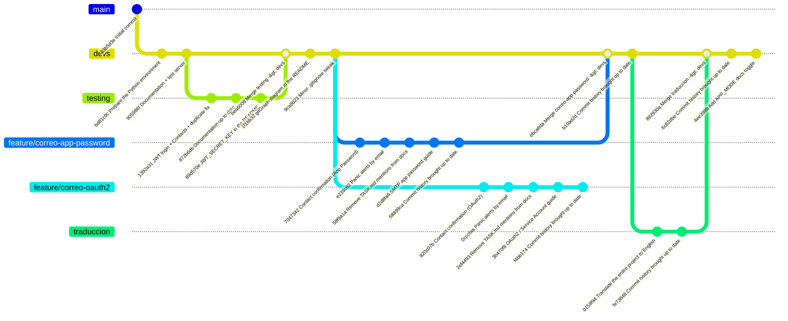

# PanicSwitch

A panic button emergency call


# Backend Installation and Setup

## 1. Configure MariaDB

The MariaDB process must be initialized, and the corresponding user and database must be configured; the user and password will be defined by the server administrator, and those credentials must be written into a `.env` file inside the `backend` directory when it's set up — see `.envexample` to understand the required variables. This must be done as the `root` user, accessing the MariaDB console via `mariadb -u root`.

Also, the `./backend/queries` directory contains the SQL code to run to create the database tables, along with the aforementioned user and database creation, and includes examples of how the INSERTs work.

## 2. Prepare the Environment
- First, install Python (>=3.12) along with its corresponding version of pip
- Then, use the command `pip install uv` to install a more versatile package manager
- Once uv is installed, go to the `./backend` directory and run `uv sync`; the manager will automatically create a virtual environment and install the dependencies (if MariaDB isn't running at this step, a build error will pop up because of the mariadb library)
- Create a `.env` file in the `backend` directory and use `.envexample` as a template to fill in the credentials
- Run `uv run uvicorn main:app --reload`

> For testing, you can simply use `uv run main.py`

> If there's any issue with the server's Python version, uv can resolve it by telling it which version to install. Either way, the libraries/dependencies listed in `pyproject.toml` are compatible with Python 3.12 and up

### Expected `.env` structure

```env
USERNAME=''
PASSWORD=''
HOST=''
PORT=
DATABASE=''
JWT_SECRET_KEY=''
SMTP_USER=''
SMTP_PASSWORD=''
SMTP_HOST='smtp.gmail.com'
SMTP_PORT=587
API_BASE_URL='http://127.0.0.1:8000'
APP_MODE='Debug'
```

`JWT_SECRET_KEY` is the key the backend uses to sign and verify the session tokens (JWT) issued by `POST /auth/login` — see `docs/backend/token.md` for the detail of how it's used. It isn't a MariaDB credential, so it doesn't come out of step 1's database setup: it has to be generated separately.

`SMTP_USER`/`SMTP_PASSWORD` are the Google Workspace account (`soporte@keylogics.com`) emails confirming emergency contacts are sent from, and `SMTP_PASSWORD` is specifically a 16-character **app password** (`myaccount.google.com/apppasswords`), not the account's real password — Google hasn't accepted basic SMTP authentication on Workspace accounts since March 2025. It requires 2-Step Verification active on that account and the Workspace administrator allowing app passwords to be created. See `docs/backend/mail.md` for the complete detail (including the OAuth2 alternative, on the `feature/correo-oauth2` branch, if the client prefers not to rely on app passwords). `API_BASE_URL` is the public URL the API uses to build the confirmation link that travels in those emails — in production, the real domain behind nginx (see `NGINX.md`).

#### `APP_MODE`: toggling FastAPI's automatic docs

`APP_MODE` controls whether the API exposes its automatic documentation — `/docs` (Swagger UI), `/redoc` (ReDoc) and `/openapi.json` (the raw OpenAPI schema). It accepts one of two values:

- **`Debug`** (the default — same behavior as if `APP_MODE` isn't set at all): the docs are enabled at their usual paths. Use this in local development.
- **`Deploy`**: the docs are fully disabled — the routes aren't just hidden, they stop being registered, so hitting them returns `404`. Use this in production, so the API's full surface (every endpoint, every field it expects) isn't handed out to anyone who can reach it without a token.

See `docs/backend/main.md` for the implementation detail.

#### Generate `JWT_SECRET_KEY` for production

It has to be a long, random string, not a hand-picked phrase — anyone who knows it can sign valid tokens for any user of the system. To generate one on the machine where the backend will be deployed, with `uv` already installed and `uv sync` already run (step 2), this is enough:

```bash
uv run python -c "import secrets; print(secrets.token_hex(32))"
```

This prints a 64-character hex string (256 bits of entropy) that gets pasted as-is as the value of `JWT_SECRET_KEY` in that environment's `.env`. Each environment (development, production, etc.) should have its own separately generated secret — don't reuse the same value across them, and never commit it (that's why `.env` is in `.gitignore`).

#### Get `SMTP_PASSWORD` (Google Workspace app password)

This branch (`feature/correo-app-password`) authenticates outgoing email with an **app password** for the Google Workspace account `soporte@keylogics.com`, not the account's real password — Google hasn't accepted basic SMTP authentication (username + normal password) on Workspace accounts since March 2025. Steps to get one:

1. **Enable 2-Step Verification on the account.** Go to [`myaccount.google.com/security`](https://myaccount.google.com/security) with the `soporte@keylogics.com` account and turn on "2-Step Verification" if it isn't already. This is a hard requirement: without 2FA on, Google won't even show the app passwords option.
2. **Confirm the Workspace administrator allows app passwords.** This is controlled at the organization level, not the individual account level, so it can be blocked even if step 1 is done. The Workspace administrator has to go to [Admin Console](https://admin.google.com) → **Security** → **Authentication** → **2-Step Verification**, and enable "Allow users to create app passwords" there. If this policy is disabled, step 3 won't show the option even if the account has 2FA on — in that case, ask the administrator to enable it, or use the OAuth2 alternative (`feature/correo-oauth2` branch, see `docs/backend/mail.md`) if the organization prefers not to enable app passwords.
3. **Generate the password.** With the account already logged in and 2FA on, go to [`myaccount.google.com/apppasswords`](https://myaccount.google.com/apppasswords), give it a recognizable name (for example, "PanicSwitch Backend") and generate it. Google shows a 16-character password grouped into 4 blocks of 4 (for example `abcd efgh ijkl mnop`) — use it **without the spaces**.
4. **Fill in the `.env`.** `SMTP_USER` is the account's full email (`soporte@keylogics.com`) and `SMTP_PASSWORD` is the 16-character password generated in the previous step (no spaces). `SMTP_HOST`/`SMTP_PORT` already come with the correct default value (`smtp.gmail.com`/`587`) and shouldn't need changes.

This password can be revoked at any time from the same `apppasswords` page without affecting the account's real password — it's worth generating a different one per environment (development, production) so one can be revoked without affecting the other, same as with `JWT_SECRET_KEY`.

# Using the API

With the server running, the API exposes registration and login routes (`/auth`), management of the authenticated user (`/users/me`), emergency contacts (`/contacts`), and triggering panic alerts (`/alerts`, which notifies confirmed contacts by email). The complete guide to each endpoint, with usage examples in Python and JavaScript (built with the future Capacitor client in mind), is in [`backend/API.md`](backend/API.md). The design decisions behind each backend module (why JWT, why that route structure, etc.) are documented one by one in [`docs/backend/`](docs/backend/).

# App Preparation and Build

The mobile client lives in [`app/`](app), built with [Capacitor](https://capacitorjs.com/) and plain HTML/CSS/JavaScript (no frontend framework) — Android and iOS from the same codebase. It's a client of the backend above: registration, login, the panic button (captures GPS and hits `POST /alerts`), and managing emergency contacts (including picking them straight from the phone's address book). See [`app/README.md`](app/README.md) for setup instructions and [`docs/app/`](docs/app) for the design decisions behind how it's built.

# Commit History



- **`83b5d3e` — Initial commit** (`main` branch): the repository's first commit, just the initial `README.md`. `main` never advanced past this point; all development happens on `devs` (and, temporarily, on branches like `testing` or `feature/*`).
- **`bd81c9c` — Prepare the Python environment**: the backend's first working skeleton — `pyproject.toml`, the `Cursor` class to talk to MariaDB, `credentials.py`, and the SQL table-creation scripts. Confirmed the database connection worked correctly with a real `.env`.
- **`905986f` — Documentation + test server**: the first business endpoint (`POST /registrar/usuario`), `Guard` for bcrypt password hashing, and the first batch of documentation in `docs/backend/` (`credenciales.md`, `cursor.md`, `guard.md`).
- **`1392a31` — JWT login, Contacts CRUD, editing Users and a duplicate fix** (merged from `testing`): fixes the bug where inserting data that collides with an existing `UNIQUE` constraint used to fail; standardizes routes under `/auth`, `/usuarios` and `/contactos`, adds JWT login, and the full CRUD for emergency contacts and editing users.
- **`872b6db` — Documentation up to date with JWT, routers and Contacts/Users CRUD** (merged from `testing`): updates all of `docs/backend/` to reflect the previous commit's code, and adds `backend/API.md` with usage examples in Python and JavaScript.
- **`89d570e` — Document JWT_SECRET_KEY and API usage in the README** (merged from `testing`): adds the steps for generating the JWT secret in production to the README, and links to the API documentation.
- **`bea6008` — Merge testing → devs**: integrates the three previous commits (developed and reviewed first on the local `testing` branch) into `devs`, bringing all of this stage's work to the main development branch.
- **`1f1bb32` — Add gitGraph diagram and commit history to the README**: visually documents the relationship between `main`, `devs` and `testing` with a Mermaid diagram, along with this same explanation of what each commit contributed.
- **`9ca8023` — Minor `.gitignore` tweak**: small adjustment to the git exclusions file.
- **`7047342` — Add contact confirmation by email (Gmail App Password)**: first real use of the `contacts.confirmed` column — `POST /contacts` fires off a confirmation email in the background with a single-purpose JWT (`Token.CreateContactConfirmation`), and the new `GET /contacts/confirm/{token}` validates it and marks the contact as confirmed. This branch authenticates the send against Gmail with an app password on the Google Workspace account (see `docs/backend/mail.md`); the sibling branch `feature/correo-oauth2` solved the same module with OAuth2/Service Account as an alternative, until the client settled on a method.
- **`e239c62` — Add panic-alert notification system by email**: `POST /alerts` inserts the alert record and notifies by email, in a single batch (`Mail.SendBulk`, one SMTP connection for every recipient), only to the user's **confirmed** contacts — those who never confirmed get nothing.
- **`58f9a1a` — Remove TASK.md mentions from the backend documentation**: `TASK.md` is a personal file (ignored by git) for organizing personal tasks, so the mentions that had been cited from `docs/backend/` and `backend/API.md` were removed.
- **`d2d8fa6` — Document how to get the SMTP app password in the README**: step-by-step guide (enable 2FA, confirm the Workspace administrator's policy, generate the 16-character password) to fill in `SMTP_PASSWORD` without needing context outside this repository.
- **`58899ca` — Bring the README's commit history up to date**: on the `feature/correo-app-password` branch, brings this same diagram and this list up to date with the commits missing since `bea6008`.
- **`820c07b` — Add contact confirmation by email (Gmail OAuth2 / Service Account)**: the same confirmation mechanism as `7047342`, but solved on the sibling branch `feature/correo-oauth2`: the send authenticates against Gmail with a service account and domain-wide delegation (`https://mail.google.com/`) instead of an app password (see `docs/backend/mail.md` on that branch).
- **`0cccfaa` — Add panic-alert notification system by email**: equivalent to `e239c62`, implemented on `feature/correo-oauth2`.
- **`2ef4493` — Remove TASK.md mentions from the backend documentation**: same cleanup as `58f9a1a`, applied in parallel on `feature/correo-oauth2`.
- **`3b470f8` — Document how to configure OAuth2 (Service Account + domain-wide delegation) in the README**: step-by-step guide (Google Cloud project + Gmail API, service account, JSON key, authorizing domain-wide delegation in the Workspace admin console) to get `GOOGLE_SERVICE_ACCOUNT_FILE` working without needing context outside this repository.
- **`f4bb174` — Bring the README's commit history up to date**: on `feature/correo-oauth2`, equivalent to `58899ca` but documenting the history from that branch's point of view.
- **`ebca6da` — Merge feature/correo-app-password (app password) into devs**: the client settled on using a Google Workspace app password as the SMTP authentication method, so `feature/correo-app-password` is merged into `devs` with an explicit merge commit. `feature/correo-oauth2` stays documented in this history as an alternative that was evaluated, but isn't merged in.
- **`b10ad2d` — Bring the README's commit history up to date**: on `devs`, after the merge, extends the diagram and this list with the `ebca6da` merge and with `feature/correo-oauth2`'s full history, so the diagram reflects the repository's complete history.
- **`0159f94` — Translate the entire project to English** (branch `traduccion`, off `devs`): the client requested that the whole project — database schema, API paths, Pydantic models, module and function names, email templates, and every doc — be in English instead of Spanish. Tables/columns (`usuarios`/`contactos`/`alertas` → `users`/`contacts`/`alerts`, `nombre`/`telefono`/`correo`/`contraseña_hash` → `name`/`phone`/`email`/`password_hash`, etc.), API paths (`/auth/registro` → `/auth/register`, `/usuarios` → `/users`, `/contactos` → `/contacts`, `/alertas` → `/alerts`), and every backend module (`correo.py` → `mail.py`, `credenciales.py` → `credentials.py`, `querys/` → `queries/`, and so on) were renamed and translated together in a single commit, verified by importing `main.py` and inspecting the resulting OpenAPI schema.
- **`fe73848` — Bring the README's commit history up to date**: on `traduccion`, documents that same commit in this diagram and list before the branch is reviewed and merged.
- **`892930a` — Merge traduccion → devs**: the translation was reviewed and approved, so `traduccion` is merged into `devs` with an explicit merge commit. The whole project — code, schema, API, docs — is now in English on the main development branch.
- **`6c62dbe` — Bring the README's commit history up to date**: on `devs`, documents the `892930a` merge in this diagram and list.
- **`4ee399b` — Add `APP_MODE` to toggle FastAPI's automatic docs**: `main.py` now reads a new `app_mode` value (see `docs/backend/credentials.md`) to decide whether `/docs`, `/redoc` and `/openapi.json` get registered at all. `APP_MODE=Deploy` disables all three (they return `404`, not just hidden from a menu); `Debug`, or `APP_MODE` not being set, keeps them enabled — the same behavior every environment already had before this change. See `docs/backend/main.md` for the implementation detail.
