# PanicButton

A panic button emergency call


# Backend Installation and Setup

## 1. Configure MariaDB

The MariaDB process must be initialized, and the corresponding user and database must be configured; the user and password will be defined by the server administrator, and those credentials must be written into a `.env` file inside the `backend` directory when it's set up — see `.envexample` to understand the required variables. This must be done as the `root` user, accessing the MariaDB console via `mariadb -u root`.

Also, the `./backend/queries` directory contains the SQL code to run to create the database tables, along with the aforementioned user and database creation, and includes examples of how the INSERTs work.

## 2. Prepare the Environment
- First, install Python (>=3.12) along with its corresponding version of pip
- Then, use the command `pip install uv` to install a more versatile package manager
- Once uv is installed, go to the `./backend` directory and run `uv sync`; the manager will automatically create a virtual environment and install the dependencies (if MariaDB isn't running at this step, a build error will pop up because of the mariadb library)
- Create a `.env` file in the `backend` directory and use `.envexample` as a template to fill in the credentials
- Run `uv run uvicorn main:app --reload`

> For testing, you can simply use `uv run main.py`

> If there's any issue with the server's Python version, uv can resolve it by telling it which version to install. Either way, the libraries/dependencies listed in `pyproject.toml` are compatible with Python 3.12 and up

### Expected `.env` structure

```env
USERNAME=''
PASSWORD=''
HOST=''
PORT=
DATABASE=''
JWT_SECRET_KEY=''
SMTP_USER=''
SMTP_PASSWORD=''
SMTP_HOST='smtp.gmail.com'
SMTP_PORT=587
SMTP_FROM=''
TELEGRAM_BOT_TOKEN=''
TELEGRAM_BOT_USERNAME=''
TELEGRAM_WEBHOOK_SECRET=''
API_BASE_URL='http://127.0.0.1:8000'
APP_MODE='Debug'
LOG_LEVEL='INFO'
```

`JWT_SECRET_KEY` is the key the backend uses to sign and verify the session tokens (JWT) issued by `POST /auth/login` — see `docs/backend/token.md` for the detail of how it's used. It isn't a MariaDB credential, so it doesn't come out of step 1's database setup: it has to be generated separately.

`SMTP_USER`/`SMTP_PASSWORD` are the Google Workspace account (`soporte@keylogics.com`) emails confirming emergency contacts are sent from, and `SMTP_PASSWORD` is specifically a 16-character **app password** (`myaccount.google.com/apppasswords`), not the account's real password — Google hasn't accepted basic SMTP authentication on Workspace accounts since March 2025. It requires 2-Step Verification active on that account and the Workspace administrator allowing app passwords to be created. See `docs/backend/mail.md` for the complete detail (including the OAuth2 alternative, on the `feature/correo-oauth2` branch, if the client prefers not to rely on app passwords). `API_BASE_URL` is the public URL the API uses to build the confirmation link that travels in those emails — in production, the real domain behind nginx (see `NGINX.md`).

`SMTP_FROM` is optional and defaults to `SMTP_USER` — it only needs to be set when the address emails should appear to come **from** isn't the same as the account SMTP authenticates **as**, which happens when that address lives on a domain alias rather than an independently-licensed account (for example, authenticating as `soporte@keycodelogics.com` while sending as `support@panicbutton.me`, if `panicbutton.me` is attached to the Workspace as a domain alias of the primary domain). `SMTP_USER`/`SMTP_PASSWORD` keep authenticating exactly as before either way — this only changes the `From:` header. See `docs/backend/mail.md`'s "`From:` address vs. the authenticating account" section for why the Workspace side (making the desired address an alias *of the authenticating account*, not just of the domain) has to be configured correctly first, or Gmail silently reverts `From:` back to `SMTP_USER`.

`TELEGRAM_BOT_TOKEN`/`TELEGRAM_BOT_USERNAME` come from a bot registered with Telegram's own **@BotFather** (see the step-by-step below); `TELEGRAM_WEBHOOK_SECRET`, like `JWT_SECRET_KEY`, isn't issued by anyone — it's a random string this deployment makes up and registers with Telegram, used to verify that a call to `POST /telegram/webhook` genuinely came from Telegram and not from anyone who found the URL. All three are optional: without a `TELEGRAM_BOT_TOKEN`, the backend boots normally and simply never registers a webhook or sends Telegram messages — see `docs/backend/telegram.md` for the full flow.

#### `APP_MODE`: toggling FastAPI's automatic docs

`APP_MODE` controls whether the API exposes its automatic documentation — `/docs` (Swagger UI), `/redoc` (ReDoc) and `/openapi.json` (the raw OpenAPI schema). It accepts one of two values:

- **`Debug`** (the default — same behavior as if `APP_MODE` isn't set at all): the docs are enabled at their usual paths. Use this in local development.
- **`Deploy`**: the docs are fully disabled — the routes aren't just hidden, they stop being registered, so hitting them returns `404`. Use this in production, so the API's full surface (every endpoint, every field it expects) isn't handed out to anyone who can reach it without a token.

See `docs/backend/main.md` for the implementation detail.

#### `LOG_LEVEL`: how much gets logged

`LOG_LEVEL` sets the minimum severity written to both the console and `backend/logs/panicbutton.log` (a rotating file, gitignored) — one of Python's standard `logging` level names (`DEBUG`, `INFO`, `WARNING`, `ERROR`, `CRITICAL`). Defaults to `INFO` if unset or misspelled. See `docs/backend/logs.md` for what gets logged at each level.

#### Generate `JWT_SECRET_KEY` for production

It has to be a long, random string, not a hand-picked phrase — anyone who knows it can sign valid tokens for any user of the system. To generate one on the machine where the backend will be deployed, with `uv` already installed and `uv sync` already run (step 2), this is enough:

```bash
uv run python -c "import secrets; print(secrets.token_hex(32))"
```

This prints a 64-character hex string (256 bits of entropy) that gets pasted as-is as the value of `JWT_SECRET_KEY` in that environment's `.env`. Each environment (development, production, etc.) should have its own separately generated secret — don't reuse the same value across them, and never commit it (that's why `.env` is in `.gitignore`).

#### Get `SMTP_PASSWORD` (Google Workspace app password)

This branch (`feature/correo-app-password`) authenticates outgoing email with an **app password** for the Google Workspace account `soporte@keylogics.com`, not the account's real password — Google hasn't accepted basic SMTP authentication (username + normal password) on Workspace accounts since March 2025. Steps to get one:

1. **Enable 2-Step Verification on the account.** Go to [`myaccount.google.com/security`](https://myaccount.google.com/security) with the `soporte@keylogics.com` account and turn on "2-Step Verification" if it isn't already. This is a hard requirement: without 2FA on, Google won't even show the app passwords option.
2. **Confirm the Workspace administrator allows app passwords.** This is controlled at the organization level, not the individual account level, so it can be blocked even if step 1 is done. The Workspace administrator has to go to [Admin Console](https://admin.google.com) → **Security** → **Authentication** → **2-Step Verification**, and enable "Allow users to create app passwords" there. If this policy is disabled, step 3 won't show the option even if the account has 2FA on — in that case, ask the administrator to enable it, or use the OAuth2 alternative (`feature/correo-oauth2` branch, see `docs/backend/mail.md`) if the organization prefers not to enable app passwords.
3. **Generate the password.** With the account already logged in and 2FA on, go to [`myaccount.google.com/apppasswords`](https://myaccount.google.com/apppasswords), give it a recognizable name (for example, "PanicButton Backend") and generate it. Google shows a 16-character password grouped into 4 blocks of 4 (for example `abcd efgh ijkl mnop`) — use it **without the spaces**.
4. **Fill in the `.env`.** `SMTP_USER` is the account's full email (`soporte@keylogics.com`) and `SMTP_PASSWORD` is the 16-character password generated in the previous step (no spaces). `SMTP_HOST`/`SMTP_PORT` already come with the correct default value (`smtp.gmail.com`/`587`) and shouldn't need changes.

This password can be revoked at any time from the same `apppasswords` page without affecting the account's real password — it's worth generating a different one per environment (development, production) so one can be revoked without affecting the other, same as with `JWT_SECRET_KEY`.

#### Get the Telegram bot credentials (BotFather)

Panic alerts can also reach a contact over Telegram, in parallel to email (see `docs/backend/telegram.md` for the full flow). This requires a bot, created through Telegram's own **@BotFather** — there's no dashboard or web console for this, it's all done by chatting with BotFather itself:

1. **Open a chat with BotFather.** In Telegram (any device), search for `@BotFather` and start a chat — it's the official bot Telegram itself provides for managing other bots, verified with a blue checkmark.
2. **Create the bot.** Send `/newbot`. BotFather will ask for:
   - A **display name** (e.g. "Panic Button"), shown to contacts in their chat list — can be changed later, doesn't need to be unique.
   - A **username**, which does have to be unique across all of Telegram and must end in `bot` (e.g. `PanicButtonBot` or `panic_button_bot`). This is what goes into `TELEGRAM_BOT_USERNAME` — **without** the leading `@`.
3. **Copy the token.** Once created, BotFather replies with a message containing a line like:
   ```
   Use this token to access the HTTP API:
   123456789:AAHk3jz9X7q_examplecharactersgoeshereXYZ
   ```
   That whole string (digits, colon, and the rest) is `TELEGRAM_BOT_TOKEN`. Treat it exactly like a password — anyone who has it can send messages as the bot and read its incoming updates. If it ever leaks, message BotFather with `/revoke` (or `/token` to reissue) to invalidate it and get a new one.
4. **Generate `TELEGRAM_WEBHOOK_SECRET` yourself.** This one doesn't come from BotFather — it's an arbitrary string this deployment invents and registers with Telegram (`Telegram.SetWebhook`, called automatically at startup, see `docs/backend/telegram.md`), the same idea and the same command as generating `JWT_SECRET_KEY` above:
   ```bash
   uv run python -c "import secrets; print(secrets.token_hex(32))"
   ```
5. **Fill in the `.env`.** `TELEGRAM_BOT_TOKEN` from step 3, `TELEGRAM_BOT_USERNAME` from step 2 (no `@`), `TELEGRAM_WEBHOOK_SECRET` from step 4.

No further configuration is needed on Telegram's side — the backend registers itself as the bot's webhook the moment it starts up (as long as `API_BASE_URL` is a real, publicly reachable HTTPS URL; Telegram can't call back to `http://127.0.0.1:8000`, so this step is effectively a no-op in local development and only takes effect once deployed behind nginx, see `NGINX.md`). Optional but recommended: message BotFather with `/setdescription` and `/setuserpic` to give the bot a recognizable description and avatar, since that's what a contact sees the moment they open the deep-linked chat for the first time.

# Using the API

With the server running, the API exposes registration and login routes (`/auth`), management of the authenticated user (`/users/me`), emergency contacts (`/contacts`, including linking a contact's Telegram account under `/contacts/{id}/telegram`), and triggering panic alerts (`/alerts`, which notifies confirmed contacts by email and/or Telegram — see `docs/backend/telegram.md`). The complete guide to each endpoint, with usage examples in Python and JavaScript (built with the future Capacitor client in mind), is in [`backend/API.md`](backend/API.md). The design decisions behind each backend module (why JWT, why that route structure, etc.) are documented one by one in [`docs/backend/`](docs/backend/).

# App Preparation and Build

The mobile client lives in [`app/`](app), built with [Capacitor](https://capacitorjs.com/) and plain HTML/CSS/JavaScript (no frontend framework) — Android and iOS from the same codebase. It's a client of the backend above: registration, login, the panic button (captures GPS and hits `POST /alerts`), and managing emergency contacts (including picking them straight from the phone's address book). See [`app/README.md`](app/README.md) for setup instructions and [`docs/app/`](docs/app) for the design decisions behind how it's built.

The app's own UI isn't bundled into the native binary anymore — the WebView navigates straight to this backend's `/app` route and loads it live (see `docs/app/architecture.md`'s "Why the app loads its UI from the backend instead of bundling it"), the same idea as Electron pointing a window at a URL. That means **the backend needs `app/www` built before it can serve the app at all**: run `bun run build` inside `app/` (step 3 of `app/README.md`) before starting the backend, or after any change under `app/src/`. The app checks a content-hash manifest at `/app/manifest` on launch and when resuming from the background, and reloads itself automatically when it detects the backend's files changed — no separate "push an update" step needed beyond redeploying the backend with a fresh `app/www`.

# Commit History

```mermaid
gitGraph
   commit id: "e3d641f Initial commit"
   branch devs
   checkout devs
   commit id: "cebdf38 Prepare the Python environment"
   commit id: "f54f05f Documentation + test server"
   branch testing
   checkout testing
   commit id: "5317178 JWT login + Contacts + duplicate fix"
   commit id: "edceeed Documentation up to date"
   commit id: "f22b6ef JWT_SECRET_KEY in the README"
   checkout devs
   merge testing id: "34f4511 Merge testing -> devs"
   commit id: "7972a8d gitGraph diagram in the README"
   commit id: "5f58e4b Minor .gitignore tweak"
   branch feature/correo-app-password
   checkout feature/correo-app-password
   commit id: "7e3d7aa Contact confirmation (App Password)"
   commit id: "694e6a2 Panic alerts by email"
   commit id: "f102c0d Remove TASK.md mentions from docs"
   commit id: "2af5cf7 SMTP app password guide"
   commit id: "0daa055 Commit history brought up to date"
   checkout devs
   branch feature/correo-oauth2
   checkout feature/correo-oauth2
   commit id: "adaec8a Contact confirmation (OAuth2)"
   commit id: "229a3f5 Panic alerts by email"
   commit id: "95f5af3 Remove TASK.md mentions from docs"
   commit id: "dd62949 OAuth2 / Service Account guide"
   commit id: "1294621 Commit history brought up to date"
   checkout devs
   merge feature/correo-app-password id: "d08f56a Merge correo-app-password -> devs"
   commit id: "6d18427 Commit history brought up to date"
   branch traduccion
   checkout traduccion
   commit id: "414908b Translate the entire project to English"
   commit id: "05b187b Commit history brought up to date"
   checkout devs
   merge traduccion id: "32b3d44 Merge traduccion -> devs"
   commit id: "5c0fc66 Commit history brought up to date"
   commit id: "47f9058 Add APP_MODE docs toggle"
   commit id: "8b57e67 Redesign confirmation/alert emails"
   commit id: "4b62949 Extend session token to 30 days"
   branch app
   checkout app
   commit id: "39cadc8 Configure CORS for the mobile app"
   commit id: "1817689 Add the PanicSwitch mobile app"
   checkout main
   merge devs id: "5b3197c Merge devs -> main"
   merge app id: "4e35353 Merge app -> main"
   checkout devs
   commit id: "ac747c8 Reconnect to MariaDB on stale connection errors"
   commit id: "b976000 Add contact deletion and email-based user confirmation"
   commit id: "6f522a4 Purge abandoned unconfirmed accounts, gate login on confirmation"
   commit id: "2169395 Rebrand templates pink, fix a rowcount correctness bug"
   commit id: "22665c5 Document the maintenance scripts"
   commit id: "2ce9b39 Guard against re-vacuuming app/ build artifacts"
   commit id: "f1139f7 Fix the templates' primary color: EA2052"
   checkout app
   commit id: "ccd14a9 Temporarily allow cleartext HTTP for devs.buttonhelpme.com"
   commit id: "d1b0d6f Remove temporary cleartext HTTP allowances"
   commit id: "19f92be Regenerate Capacitor Android/iOS assets"
   commit id: "0571298 Rebrand the app UI, wire up contact deletion"
   checkout devs
   merge app id: "d297d20 Merge app -> devs"
   checkout main
   merge devs id: "f5b780f Merge devs -> main"
   commit id: "61fba5b Finish the rebrand, bring every doc up to date"
   commit id: "58ec03e Redesign with a dark tech aesthetic, add EN/ES i18n"
   commit id: "6bcf28e Add Telegram panic-alert notifications"
   commit id: "8d4de19 Adjust alert message format, document Telegram testing"
```



- **`e3d641f` — Initial commit** (`main` branch): the repository's first commit, just the initial `README.md`. `main` didn't advance past this point until `5b3197c`/`4e35353` below — until then, all development happened on `devs` (and, temporarily, on branches like `testing` or `feature/*`).
- **`cebdf38` — Prepare the Python environment**: the backend's first working skeleton — `pyproject.toml`, the `Cursor` class to talk to MariaDB, `credentials.py`, and the SQL table-creation scripts. Confirmed the database connection worked correctly with a real `.env`.
- **`f54f05f` — Documentation + test server**: the first business endpoint (`POST /registrar/usuario`), `Guard` for bcrypt password hashing, and the first batch of documentation in `docs/backend/` (`credenciales.md`, `cursor.md`, `guard.md`).
- **`5317178` — JWT login, Contacts CRUD, editing Users and a duplicate fix** (merged from `testing`): fixes the bug where inserting data that collides with an existing `UNIQUE` constraint used to fail; standardizes routes under `/auth`, `/usuarios` and `/contactos`, adds JWT login, and the full CRUD for emergency contacts and editing users.
- **`edceeed` — Documentation up to date with JWT, routers and Contacts/Users CRUD** (merged from `testing`): updates all of `docs/backend/` to reflect the previous commit's code, and adds `backend/API.md` with usage examples in Python and JavaScript.
- **`f22b6ef` — Document JWT_SECRET_KEY and API usage in the README** (merged from `testing`): adds the steps for generating the JWT secret in production to the README, and links to the API documentation.
- **`34f4511` — Merge testing → devs**: integrates the three previous commits (developed and reviewed first on the local `testing` branch) into `devs`, bringing all of this stage's work to the main development branch.
- **`7972a8d` — Add gitGraph diagram and commit history to the README**: visually documents the relationship between `main`, `devs` and `testing` with a Mermaid diagram, along with this same explanation of what each commit contributed.
- **`5f58e4b` — Minor `.gitignore` tweak**: small adjustment to the git exclusions file.
- **`7e3d7aa` — Add contact confirmation by email (Gmail App Password)**: first real use of the `contacts.confirmed` column — `POST /contacts` fires off a confirmation email in the background with a single-purpose JWT (`Token.CreateContactConfirmation`), and the new `GET /contacts/confirm/{token}` validates it and marks the contact as confirmed. This branch authenticates the send against Gmail with an app password on the Google Workspace account (see `docs/backend/mail.md`); the sibling branch `feature/correo-oauth2` solved the same module with OAuth2/Service Account as an alternative, until the client settled on a method.
- **`694e6a2` — Add panic-alert notification system by email**: `POST /alerts` inserts the alert record and notifies by email, in a single batch (`Mail.SendBulk`, one SMTP connection for every recipient), only to the user's **confirmed** contacts — those who never confirmed get nothing.
- **`f102c0d` — Remove TASK.md mentions from the backend documentation**: `TASK.md` is a personal file (ignored by git) for organizing personal tasks, so the mentions that had been cited from `docs/backend/` and `backend/API.md` were removed.
- **`2af5cf7` — Document how to get the SMTP app password in the README**: step-by-step guide (enable 2FA, confirm the Workspace administrator's policy, generate the 16-character password) to fill in `SMTP_PASSWORD` without needing context outside this repository.
- **`0daa055` — Bring the README's commit history up to date**: on the `feature/correo-app-password` branch, brings this same diagram and this list up to date with the commits missing since `34f4511`.
- **`adaec8a` — Add contact confirmation by email (Gmail OAuth2 / Service Account)**: the same confirmation mechanism as `7e3d7aa`, but solved on the sibling branch `feature/correo-oauth2`: the send authenticates against Gmail with a service account and domain-wide delegation (`https://mail.google.com/`) instead of an app password (see `docs/backend/mail.md` on that branch).
- **`229a3f5` — Add panic-alert notification system by email**: equivalent to `694e6a2`, implemented on `feature/correo-oauth2`.
- **`95f5af3` — Remove TASK.md mentions from the backend documentation**: same cleanup as `f102c0d`, applied in parallel on `feature/correo-oauth2`.
- **`dd62949` — Document how to configure OAuth2 (Service Account + domain-wide delegation) in the README**: step-by-step guide (Google Cloud project + Gmail API, service account, JSON key, authorizing domain-wide delegation in the Workspace admin console) to get `GOOGLE_SERVICE_ACCOUNT_FILE` working without needing context outside this repository.
- **`1294621` — Bring the README's commit history up to date**: on `feature/correo-oauth2`, equivalent to `0daa055` but documenting the history from that branch's point of view.
- **`d08f56a` — Merge feature/correo-app-password (app password) into devs**: the client settled on using a Google Workspace app password as the SMTP authentication method, so `feature/correo-app-password` is merged into `devs` with an explicit merge commit. `feature/correo-oauth2` stays documented in this history as an alternative that was evaluated, but isn't merged in.
- **`6d18427` — Bring the README's commit history up to date**: on `devs`, after the merge, extends the diagram and this list with the `d08f56a` merge and with `feature/correo-oauth2`'s full history, so the diagram reflects the repository's complete history.
- **`414908b` — Translate the entire project to English** (branch `traduccion`, off `devs`): the client requested that the whole project — database schema, API paths, Pydantic models, module and function names, email templates, and every doc — be in English instead of Spanish. Tables/columns (`usuarios`/`contactos`/`alertas` → `users`/`contacts`/`alerts`, `nombre`/`telefono`/`correo`/`contraseña_hash` → `name`/`phone`/`email`/`password_hash`, etc.), API paths (`/auth/registro` → `/auth/register`, `/usuarios` → `/users`, `/contactos` → `/contacts`, `/alertas` → `/alerts`), and every backend module (`correo.py` → `mail.py`, `credenciales.py` → `credentials.py`, `querys/` → `queries/`, and so on) were renamed and translated together in a single commit, verified by importing `main.py` and inspecting the resulting OpenAPI schema.
- **`05b187b` — Bring the README's commit history up to date**: on `traduccion`, documents that same commit in this diagram and list before the branch is reviewed and merged.
- **`32b3d44` — Merge traduccion → devs**: the translation was reviewed and approved, so `traduccion` is merged into `devs` with an explicit merge commit. The whole project — code, schema, API, docs — is now in English on the main development branch.
- **`5c0fc66` — Bring the README's commit history up to date**: on `devs`, documents the `32b3d44` merge in this diagram and list.
- **`47f9058` — Add `APP_MODE` to toggle FastAPI's automatic docs**: `main.py` now reads a new `app_mode` value (see `docs/backend/credentials.md`) to decide whether `/docs`, `/redoc` and `/openapi.json` get registered at all. `APP_MODE=Deploy` disables all three (they return `404`, not just hidden from a menu); `Debug`, or `APP_MODE` not being set, keeps them enabled — the same behavior every environment already had before this change. See `docs/backend/main.md` for the implementation detail.
- **`8b57e67` — Redesign confirmation/alert emails and serve a real HTML result page**: `contact_confirmation.html.j2`/`panic_alert.html.j2` moved from plain unstyled paragraphs to a table-based layout with the red panic-button palette and a real styled button; `GET /contacts/confirm/{token}` stopped returning raw JSON and now renders a styled success/error page instead (new `modules/pages.py`, `templates/web/`). See `docs/backend/mail.md`, `docs/backend/pages.md`.
- **`4b62949` — Extend the session token's lifetime from 24 hours to 30 days**: `Token.EXPIRATION` (see `docs/backend/token.md`) went from `timedelta(hours=24)` to `timedelta(days=30)`, so the mobile app (below) can keep a user logged in across sessions instead of asking for the password again every day.
- **`39cadc8` — Configure CORS so the mobile app's WebView can call the API** (branch `app`, off `devs`): `main.py` added `CORSMiddleware` allowing the fixed origins Capacitor's WebView presents (`capacitor://localhost`, `https://localhost`, `http://localhost`) — without it, the app's own JavaScript would never see a response, even though every request would still reach the server and succeed. See `docs/backend/main.md`'s CORS section.
- **`1817689` — Add the PanicSwitch mobile app (Capacitor + vanilla JS)**: the `app/` Capacitor project (Android + iOS), built with plain HTML/CSS/JavaScript bundled by Bun — registration, login, the panic button (GPS via `@capacitor/geolocation` and a press-and-hold confirm gesture, `POST /alerts`), and managing emergency contacts manually or by picking them from the device's address book (`@capacitor-community/contacts`). Visually matches the emails' red panic-button palette. See `docs/app/`.
- **`5b3197c` — Merge devs → main**: with the mobile app about to be merged in too, `devs`'s full history (everything above, up through `4b62949`) is brought into `main` for the first time since the initial commit — the start of preparing a test deployment.
- **`4e35353` — Merge app → main**: the `app` branch (`39cadc8`, `1817689`) is merged into `main` right after, so `main` now holds both the backend and the mobile client together, ready to deploy.
- **`ac747c8` — Reconnect to MariaDB on stale connection errors**: `Cursor.execute` now retries once after an `InterfaceError` ("Server has gone away"), since the process held a single connection for its whole lifetime and MariaDB was closing it server-side after `wait_timeout`.
- **`b976000` — Add contact deletion and email-based user confirmation**: `DELETE /contacts/{id}` (scoped to the authenticated user), a new `users.confirmed` column set via a JWT-based link sent on register (mirroring the existing contact-confirmation flow), and `GET /auth/confirm/{token}` now redirects into the app (`panicswitch://`, configurable via `APP_DEEP_LINK`) instead of showing a web page.
- **`6f522a4` — Purge abandoned unconfirmed accounts, gate login on confirmation**: login now requires a confirmed email (`403` otherwise), which makes an unconfirmed account provably harmless — it can never own contacts or alerts — so `scripts/purge_unconfirmed_users.py` can safely delete any account still unconfirmed 24h after signup. Adds an index on `users(confirmed, created_at)` so the sweep stays cheap, and shortens the confirmation token's expiration to match that same 24h window.
- **`2169395` — Rebrand templates to Panic Switch pink and fix a rowcount correctness bug**: every mail/web template moves to a single `#E15671` primary color; more importantly, `cursor.py` starts connecting with `CLIENT.FOUND_ROWS` and `autocommit=True` — without the former, an `UPDATE` that matches a row but doesn't change its value reports `rowcount=0`, which every existence/ownership check in this codebase misreads as "not found" (caught live: an already-confirmed account's link 404'd as "no longer exists"); without the latter, that same no-op `UPDATE` held a row lock nothing ever released.
- **`22665c5` — Document the maintenance scripts, ignore stray local files**: adds `docs/backend/scripts.md` for the purge script, and ignores `NGINX.md`/`.directory`.
- **`2ce9b39` — Guard against re-vacuuming app/ build artifacts into this branch**: `devs` doesn't track `app/`, so its `.gitignore` files don't exist on disk there either — a broad `git add` on this branch has nothing telling it to skip `node_modules` or native build caches. Mirrors the relevant ignore rules here so that can't happen again.
- **`f1139f7` — Fix the templates' primary color: EA2052, not E15671**: the hex from `2169395` turned out to be wrong; the app's real 1024px icon is `#EA2052` exactly — every derived shade gets recomputed from the corrected anchor.
- **`ccd14a9` — Temporarily allow cleartext HTTP for devs.buttonhelpme.com** (branch `app`): the test-deployment domain didn't have an HTTPS certificate yet, and both Android and iOS block cleartext traffic by default — scoped narrowly to that one domain, not a general allow-all.
- **`d1b0d6f` — Remove temporary cleartext HTTP allowances now that HTTPS is live**: the client finished the certificate, so `ccd14a9`'s exceptions (Android's `networkSecurityConfig`, iOS's `NSAppTransportSecurity` domain) come back out, and the app rebuilds against the real `https://` URL.
- **`19f92be` — Regenerate Capacitor Android/iOS assets and sync platform config**: new app icon/splash source assets and regenerated night-mode/ldpi variants, native project files re-synced (Gradle, `AndroidManifest`, Xcode project, `Package.swift`).
- **`0571298` — Rebrand the app UI and wire up contact deletion + email confirmation**: `#EA2052` as the single brand color across CSS and the native Android theme (which didn't have one before, using Capacitor's stock indigo/pink), emoji icons replaced with inline Material-style SVGs, the real app icon as favicon/brand mark, `DELETE /contacts/{id}` reachable from the edit sheet, and `register()` no longer auto-logs in (the API blocks login pre-confirmation anyway) — it shows a "check your email" screen instead.
- **`d297d20` — Merge branch 'app' into devs**: brings the mobile app's rebrand and contact-deletion/confirmation UI together with `devs`'s own parallel backend work into one branch.
- **`f5b780f` — Merge branch 'devs' into main**: everything above — both `devs`'s and `app`'s independent work — reaches `main` together.
- **`61fba5b` — Finish the Panic Switch rebrand and bring every doc up to date**: the plain-text mail templates and one in-app error message still had the old branding; every doc under `docs/backend/` and `docs/app/` gets rewritten to describe the backend and app as they exist today instead of the pre-redesign state they still described.
- **`58ec03e` — Redesign the app with a dark tech aesthetic and add EN/ES i18n**: a dark/light theme following the system preference, a full Spanish/English translation layer with a switcher in Profile, expanded Material icon usage, and a live confirmed-contacts status chip on Home.
- **`6bcf28e` — Add Telegram panic-alert notifications and app-side follow-up fixes**: contacts can now link Telegram (a single-use, DB-backed token deep-linked via `t.me`, redeemed through a webhook rather than polling) and receive panic alerts over Telegram in parallel to email — new `telegram_chat_id`/`telegram_link_token`/`telegram_link_expires_at` columns, a `Telegram` static class mirroring `Mail`, and full docs in `docs/backend/telegram.md`. On the app side: Telegram connect/disconnect UI on contacts, a phone country-code selector, email domain quick-picks, accent color customization, and a round of navbar/panic-button polish.
- **`8d4de19` — Adjust panic alert message format and document Telegram testing/deploy steps**: panic alert messages (Telegram and email) now name the alerting user without the phone number crammed into the same sentence — phone and email get their own lines instead — per client feedback after reviewing a real test alert sent while validating the Telegram flow end-to-end against a real bot and a local database. `docs/backend/telegram.md` gained a section on testing that flow without a public webhook, plus a production checklist.
