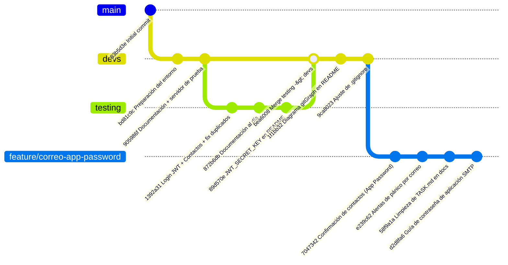

# PanicSwitch

A panic buttom emergency call


# Instalación y Ejecución del Backend

## 1. Configurar MariaDB

El proceso de MariaDB debe inicializarse y debe configurarse el usuario y base de datos correspondiente, el usuario y la contraseña serán definidos por el administrador del servidor y dichas credenciales deben ser escritas en un .env dentro del directorio backend al momento de montarlo, vease .envexample para comprender las variables requeridas. Este proceso debe realizarse como usuario root al acceder a la consola de MariaDB mediante `mariadb -u root`

A su vez, en el directorio ./backend/querys está presente el código SQL a ejecutar para crear las tablas de la base de datos, junto con la antes mencionada creación del usuario y base, también cuenta con ejemplos de cómo funcionarán los INSERT.

## 2. Preparar el Entorno
- Primero hay que instalar Python (>=3.12) junto con su versión correspondiente de pip
- Luego mediante el comando `pip install uv` para poder instalar un gestor más versatil
- Al momento de haberse instalado uv, dirigirse al directorio ./backend y ejecutar `uv sync`, el gestor automáticamente creará un entorno virtual y instalará las dependencias (Si MariaDB no está funcionando al momento de este paso, saltará un error de building por la librería de mariadb)
- Crear un archivo .env en el directorio backend y utilizar .envexample como plantilla para llenar las credenciales
- Ejecutar `uv run uvicorn main:app --reload`
  
> Para pruebas puede usar simplemente `uv run main.py`

> En caso de haber algún problema con la versión de Python del servidor, uv puede solucionarlo indicandole qué versión instalar. Igualmente las librerías/dependencias listadas en pyproject.toml son compatibles con Python 3.12 en adelante

### Estructura de .env esperada

```env
USERNAME=''
PASSWORD=''
HOST=''
PORT=
DATABASE=''
JWT_SECRET_KEY=''
SMTP_USER=''
SMTP_PASSWORD=''
SMTP_HOST='smtp.gmail.com'
SMTP_PORT=587
API_BASE_URL='http://127.0.0.1:8000'
```

`JWT_SECRET_KEY` es la clave con la que el backend firma y verifica los tokens de sesión (JWT) que emite `POST /auth/login` — ver `docs/backend/token.md` para el detalle de cómo se usa. No es una credencial de MariaDB, así que no sale de la configuración de la base de datos del paso 1: hay que generarla aparte.

`SMTP_USER`/`SMTP_PASSWORD` son la cuenta de Google Workspace (`soporte@keylogics.com`) desde la que se mandan los correos de confirmación de contactos de emergencia, y `SMTP_PASSWORD` es específicamente una **contraseña de aplicación** de 16 caracteres (`myaccount.google.com/apppasswords`), no la contraseña real de la cuenta — Google no acepta autenticación SMTP básica en cuentas de Workspace desde marzo de 2025. Requiere verificación en 2 pasos activa en esa cuenta y que el administrador de Workspace permita crear contraseñas de aplicación. Ver `docs/backend/correo.md` para el detalle completo (incluyendo la alternativa con OAuth2, en la rama `feature/correo-oauth2`, si el cliente prefiere no depender de contraseñas de aplicación). `API_BASE_URL` es la URL pública con la que la API arma el link de confirmación que viaja en esos correos — en producción, el dominio real detrás de nginx (ver `NGINX.md`).

#### Generar `JWT_SECRET_KEY` para producción

Tiene que ser una cadena larga y aleatoria, no una frase elegida a mano — cualquiera que la conozca puede firmar tokens válidos para cualquier usuario del sistema. Para generar una en la máquina donde se vaya a desplegar el backend, con `uv` ya instalado y `uv sync` ya ejecutado (paso 2), alcanza con:

```bash
uv run python -c "import secrets; print(secrets.token_hex(32))"
```

Esto imprime una cadena hexadecimal de 64 caracteres (256 bits de entropía) que se pega tal cual como valor de `JWT_SECRET_KEY` en el `.env` de ese entorno. Cada entorno (desarrollo, producción, etc.) debería tener su propio secreto generado por separado — no reutilizar el mismo valor entre ellos, y nunca versionarlo (por eso `.env` está en `.gitignore`).

#### Obtener `SMTP_PASSWORD` (contraseña de aplicación de Google Workspace)

Esta rama (`feature/correo-app-password`) autentica el envío de correos con una **contraseña de aplicación** de la cuenta de Google Workspace `soporte@keylogics.com`, no con la contraseña real de la cuenta — Google no acepta autenticación SMTP básica (usuario + contraseña normal) en cuentas de Workspace desde marzo de 2025. Pasos para conseguirla:

1. **Activar la verificación en 2 pasos en la cuenta.** Entrar a [`myaccount.google.com/security`](https://myaccount.google.com/security) con la cuenta `soporte@keylogics.com` y activar "Verificación en 2 pasos" si todavía no está activa. Es un requisito obligatorio: sin 2FA activo, Google ni siquiera muestra la opción de contraseñas de aplicación.
2. **Confirmar que el administrador de Workspace permite contraseñas de aplicación.** Esto se controla a nivel organización, no a nivel de la cuenta individual, así que puede estar bloqueado aunque el paso 1 esté hecho. El administrador de Workspace debe entrar a [Admin Console](https://admin.google.com) → **Seguridad** → **Autenticación** → **Verificación en 2 pasos**, y ahí habilitar "Permitir que los usuarios generen contraseñas de aplicación". Si esta política está deshabilitada, el paso 3 no va a mostrar la opción aunque la cuenta tenga 2FA activo — en ese caso hay que pedirle al administrador que la habilite, o usar la alternativa con OAuth2 (rama `feature/correo-oauth2`, ver `docs/backend/correo.md`) si la organización prefiere no habilitar contraseñas de aplicación.
3. **Generar la contraseña.** Con la cuenta ya logueada y 2FA activo, ir a [`myaccount.google.com/apppasswords`](https://myaccount.google.com/apppasswords), ponerle un nombre identificable (por ejemplo, "PanicSwitch Backend") y generar. Google muestra una contraseña de 16 caracteres agrupados en 4 bloques de 4 (por ejemplo `abcd efgh ijkl mnop`) — se usa **sin los espacios**.
4. **Completar el `.env`.** `SMTP_USER` es el correo completo de la cuenta (`soporte@keylogics.com`) y `SMTP_PASSWORD` es la contraseña de 16 caracteres generada en el paso anterior (sin espacios). `SMTP_HOST`/`SMTP_PORT` ya vienen con el valor correcto por defecto (`smtp.gmail.com`/`587`) y no deberían necesitar cambios.

Esta contraseña se puede revocar en cualquier momento desde la misma página de `apppasswords` sin afectar la contraseña real de la cuenta — conviene generar una distinta por entorno (desarrollo, producción) para poder revocar una sin afectar la otra, igual que con `JWT_SECRET_KEY`.

# Uso de la API

Con el servidor corriendo, la API expone rutas de registro y login (`/auth`), gestión del usuario autenticado (`/usuarios/me`), contactos de emergencia (`/contactos`) y activación de alertas de pánico (`/alertas`, que notifica por correo a los contactos confirmados). La guía completa de cada endpoint, con ejemplos de consumo en Python y JavaScript (pensados para el futuro cliente Capacitor), está en [`backend/API.md`](backend/API.md). Las decisiones de diseño detrás de cada módulo del backend (por qué JWT, por qué esa estructura de rutas, etc.) están documentadas una por una en [`docs/backend/`](docs/backend/).

# Preparación y Compilación de Aplicaciones

> Pendiente por comenzar el desarrollo de la aplicación y detalles técnicos
> Será desarrollada con capacitor.js y estará disponible para Android y iOS

# Historial de Commits



- **`83b5d3e` — Initial commit** (rama `main`): primer commit del repositorio, solo el `README.md` inicial. `main` no volvió a avanzar desde acá; todo el desarrollo ocurre en `devs` (y, temporalmente, en ramas como `testing` o `feature/*`).
- **`bd81c9c` — Preparación del entorno de Python**: primer esqueleto funcional del backend — `pyproject.toml`, la clase `Cursor` para hablar con MariaDB, `credenciales.py`, y los scripts SQL de creación de tablas. Se corroboró que la conexión a la base de datos funcionaba correctamente con un `.env` real.
- **`905986f` — Redacción de documentación + Servidor de prueba**: primer endpoint de negocio (`POST /registrar/usuario`), `Guard` para el hash de contraseñas con bcrypt, y el primer lote de documentación en `docs/backend/` (`credenciales.md`, `cursor.md`, `guard.md`).
- **`1392a31` — Login con JWT, CRUD de Contactos, edición de Usuarios y fix de duplicados** (mergeado desde `testing`): corrige el bug de insertar datos que chocan con un `UNIQUE` existente (ahora responde `409` en vez de un `500` sin manejar), estandariza las rutas bajo `/auth`, `/usuarios` y `/contactos`, agrega login con JWT, y el CRUD completo de contactos de emergencia y edición de usuarios.
- **`872b6db` — Documentación al día con JWT, routers y CRUD de Contactos/Usuarios** (mergeado desde `testing`): actualiza toda la documentación de `docs/backend/` para que refleje el código del commit anterior, y agrega `backend/API.md` con ejemplos de uso en Python y JavaScript.
- **`89d570e` — Documentar JWT_SECRET_KEY y uso de la API en el README** (mergeado desde `testing`): agrega al README los pasos para generar el secreto de JWT en producción y enlaza la documentación de la API.
- **`bea6008` — Merge testing → devs**: integra los tres commits anteriores (desarrollados y revisados primero en la rama local `testing`) a `devs`, trayendo todo el trabajo de esta etapa a la rama principal de desarrollo.
- **`1f1bb32` — Agregar diagrama gitGraph e historial de commits al README**: documenta visualmente la relación entre `main`, `devs` y `testing` con un diagrama Mermaid, junto con esta misma explicación de qué aportó cada commit.
- **`9ca8023` — Ligera modificación a `.gitignore`**: ajuste menor al archivo de exclusiones de git.
- **`7047342` — Agregar confirmación de contactos por correo (Gmail App Password)**: primer uso real de la columna `contactos.confirmado` — `POST /contactos` dispara un correo de confirmación en segundo plano con un JWT de un solo propósito (`Token.CrearConfirmacionContacto`), y el nuevo `GET /contactos/confirmar/{token}` lo valida y marca el contacto como confirmado. Esta rama autentica el envío contra Gmail con una contraseña de aplicación de la cuenta de Google Workspace (ver `docs/backend/correo.md`); la rama hermana `feature/correo-oauth2` resuelve el mismo módulo con OAuth2/Service Account, a la espera de que el cliente elija un método.
- **`e239c62` — Agregar sistema de alertas de pánico con notificación por correo**: `POST /alertas` inserta el registro de la alerta y notifica por correo, en un único lote (`Correo.EnviarMasivo`, una sola conexión SMTP para todos los destinatarios), solo a los contactos **confirmados** del usuario — los que nunca confirmaron no reciben nada.
- **`58f9a1a` — Eliminar referencias a TASK.md de la documentación del backend**: `TASK.md` es un archivo de uso personal (ignorado por git) para organizar tareas propias, así que se quitaron las menciones que habían quedado citadas desde `docs/backend/` y `backend/API.md`.
- **`d2d8fa6` — Documentar cómo obtener la contraseña de aplicación SMTP en el README**: guía paso a paso (activar 2FA, confirmar la política del administrador de Workspace, generar la contraseña de 16 caracteres) para completar `SMTP_PASSWORD` sin depender de contexto externo a este repositorio.
