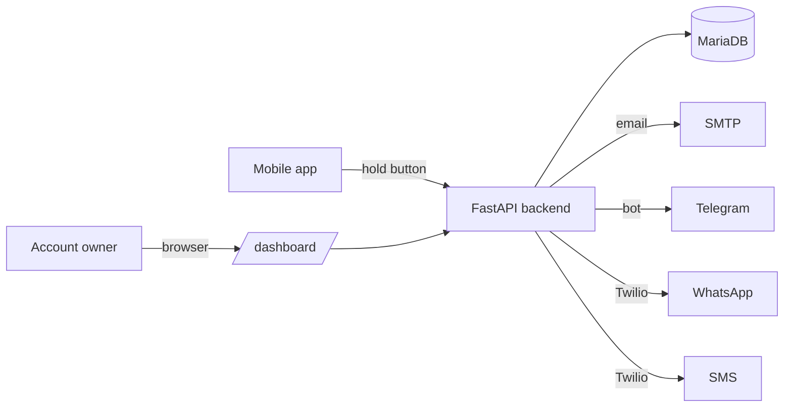

# Panic Button — Documentation

Panic Button is a personal-safety system: a mobile app with a single hold-to-alert button that shares the user's live location with their trusted emergency contacts over **four independent channels — email, Telegram, WhatsApp and SMS**. A web dashboard lets the account owner review every alert and see who was reached on which channel.

The project has two deployable parts:

- **`backend/`** — a FastAPI service (Python) backed by MariaDB. It owns accounts, contacts, alerts, all notification channels, the public landing page and the alert dashboard.
- **`app/`** — a Capacitor (Android) app. It is an *online* app: the native shell loads its UI live from the backend's `/app` mount, so most UI changes ship without rebuilding the APK.

## Documentation map

### Getting started
- [Setup & first run](backend/setup.md) — install the backend, provision the database, fill in `.env`, run it.
- [Twilio setup](backend/twilio.md) — enable WhatsApp (sender + template) and SMS.
- [Changing the domain](backend/domain-change.md) — everything to update when the public URL changes.
- [Docker deployment](backend/docker.md) — run the backend (and a bundled MariaDB) in containers.

### Backend reference
- [Architecture](backend/architecture.md) — modules, request flow, middleware, startup.
- [Real-time geolocation](backend/realtime-geolocation.md) — implementation protocol, lifecycle, deployment, and verification checklist.
- [Short alert URLs](backend/short-alert-urls.md) — compact contact links, security model, migration, and before/after comparison.
- [Authentication](backend/auth.md) — password hashing and the JWT token types.
- [Database](backend/database.md) — schema, the thread-confined cursor, migrations.
- [API reference](backend/api.md) — every route.
- [Notifications](backend/notifications.md) — the four channels and how they are chosen.
- [Operations](backend/operations.md) — environment variables, logging, rate limits, health, maintenance.
- [Web pages](backend/web-pages.md) — landing page and dashboard.

### App reference
- [Architecture](app/architecture.md) — the online-app model and project layout.
- [Real-time tracking compatibility](app/realtime-tracking.md) — current plugin support, background limitations, and the native implementation path.
- [Screens](app/screens.md) — what each screen does.

## The five-minute picture

A contact is reachable on a channel once it is **confirmed** for that channel (email confirmation link, Telegram/WhatsApp opt-in, or simply enabling SMS). When the user triggers an alert, the backend records it and fans it out, in parallel, to every confirmed channel of every contact.

## Conventions

- Docs are bilingual: this is the English set; the Spanish mirror lives under [`docs/es/`](../es/README.md).
- Code and configuration keys are in English. UI copy is translated in the app.
- These docs describe the code on the `main` branch.
