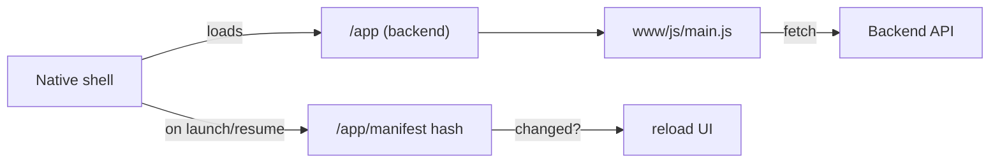

# App architecture

The mobile app is a **Capacitor** (Android) app that runs *online*: the native shell is a thin container whose WebView loads the UI live from the backend's `/app` mount. Most changes ship by rebuilding the web bundle and redeploying the backend — no new APK.

## Layout

```
app/
├── src/
│   ├── main.js            # entry: router, view mounting
│   ├── views/             # home, contacts, profile, login, register
│   ├── lib/               # api.js, session.js, features.js, i18n.js, icons.js, …
│   └── ...
├── www/                   # served by the backend at /app
│   ├── js/main.js         # the built bundle (Bun output)
│   └── css/styles.css     # served directly (not bundled)
├── assets/icon.png        # source launcher icon (SOS)
├── build.js               # Bun build script (also generates www/offline.html)
└── android/, ios/         # native shells (Capacitor)
```

## The online model



- **JS** is bundled from `src/main.js` into `www/js/main.js` by Bun (`build.js`). `API_BASE_URL` is injected at build time.
- **CSS** (`www/css/styles.css`) is served directly — CSS-only changes need no rebuild.
- On launch/resume the shell checks `/app/manifest` (a content hash) and reloads the WebView when it changed, so a redeployed bundle reaches installed apps without a store update.

## Offline fallback

Because the UI loads from the backend, a device that can't reach `API_BASE_URL` would otherwise see a blank WebView. Capacitor's `server.errorPath` points at a local `www/offline.html` (generated by `build.js`, with the backend URL baked in) shown instead — a branded "you're offline" screen whose **Retry** button returns to `${API_BASE_URL}/app/`.

## Building

```bash
cd app
bun install
API_BASE_URL='https://your-domain' bun run build   # → www/js/main.js
```

Deploy by shipping `app/www` with the backend (it serves `/app`).

## When an APK rebuild *is* required

Only for changes the native shell bakes in: native plugins/permissions, the launcher icon or app name, the Capacitor config, or the shell's start URL. A pure UI change (views, styles, i18n, channel toggles) does not. See [domain-change.md](../backend/domain-change.md) for the domain case.

## Configuration from the backend

The app asks `GET /features` once per session and adapts: it hides a channel's UI (Telegram / WhatsApp / SMS) when that channel isn't configured, and reads `max_contacts` so its "add contact" limit matches the backend. Auth token is kept with `@capacitor/preferences` and sent as `Authorization: Bearer` on every call.

## Sharing links

When a contact has no email, enabling Telegram/WhatsApp returns a link to share. `lib/share.js` opens the device's **native share sheet** (`@capacitor/share`), first checking `Capacitor.isPluginAvailable("Share")` so an older installed binary — which loads this newer JS live but lacks the native plugin — falls back to copying the link to the clipboard.
