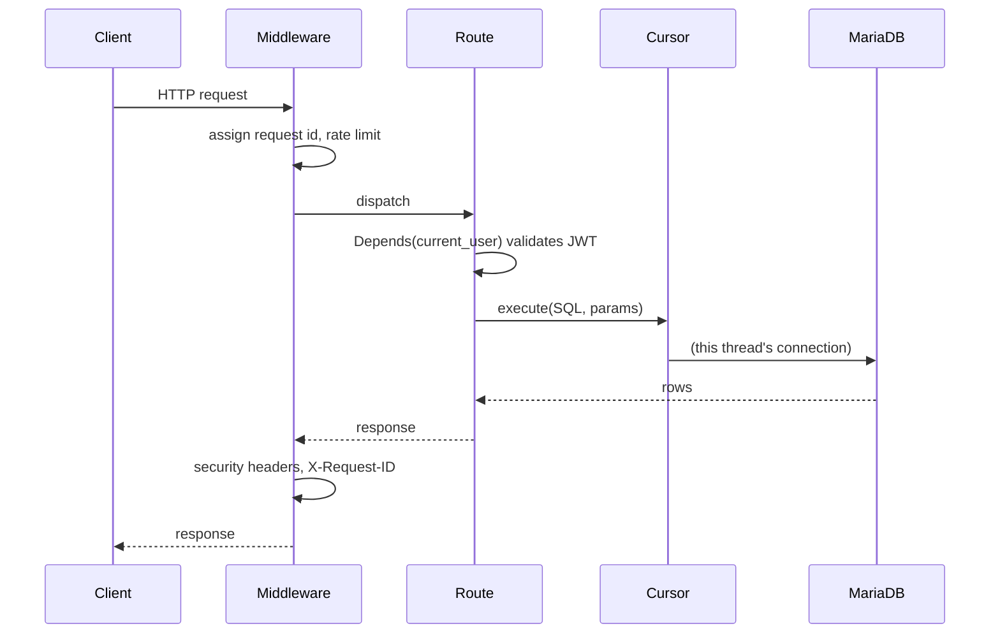

# Backend architecture

A FastAPI service over MariaDB, no ORM. Routes are plain functions; SQL lives as parameterised strings in one place.

## Layout

```
backend/
├── main.py                 # app assembly: lifespan, middleware, routes, static mounts
├── modules/
│   ├── credentials.py      # .env → one grouped config dict
│   ├── db.py, cursor.py    # thread-confined MariaDB access + all SQL (Queries)
│   ├── guard.py, token.py  # password hashing, JWT
│   ├── dependencies.py     # current_user auth dependency
│   ├── types.py            # Pydantic request/response models
│   ├── limiter.py          # slowapi rate limiter
│   ├── email_check.py      # recipient-domain deliverability check
│   ├── mail.py             # SMTP channel
│   ├── telegram.py         # Telegram channel + webhook (self-healing)
│   ├── whatsapp.py         # WhatsApp channel (Twilio) + signature check
│   ├── sms.py              # SMS channel (Twilio)
│   ├── logs.py, pages.py, app_assets.py
│   └── routers/            # auth, users, contacts, alerts, features,
│                           #   telegram, whatsapp, dashboard
├── templates/              # Jinja: mail/, telegram/, whatsapp/, sms/, web/
├── static/                 # css, js, img (favicon), downloads (apk)
└── queries/                # creation.sql, tables.sql, migrations/
```

## Request flow



FastAPI runs `def` routes in a threadpool, so several requests can be in flight at once. Each thread gets its **own** MariaDB connection (see [database.md](database.md)), so `execute` / `rowcount` / `lastrowid` always describe the statement *this* request just ran.

## Middleware

Registered in `main.py`:

- **SlowAPI** — rate limits `register`, `login`, `alerts` (see [operations.md](operations.md)).
- **CORS** — allows the app origins (`capacitor://localhost`, `http://localhost`, `https://localhost`).
- **Request context** — assigns a per-request id (inherited by background tasks so an alert's fan-out is traceable), catches unhandled errors into a clean `500`, and sets security headers (`X-Content-Type-Options`, `X-Frame-Options`, `Referrer-Policy`, `Permissions-Policy`).

## Startup / shutdown (`lifespan`)

1. **Verify the database** — open a connection immediately; refuse to boot if it fails.
2. **Register the Telegram webhook** — if a bot token is set, `EnsureWebhook` sets it and verifies via `getWebhookInfo`, retrying on transient failures; the status is logged. A background **keeper** then re-checks periodically and re-registers if the webhook drifts. Cancelled cleanly on shutdown.

## Routers

| Router | Prefix | Purpose |
|---|---|---|
| `auth` | `/auth` | register, login, account confirmation |
| `users` | `/users` | profile, sensitive-change re-auth |
| `contacts` | `/contacts` | CRUD + per-channel enable/disable |
| `alerts` | `/alerts` | trigger/list alerts, live-location WebSockets, token-protected contact map |
| `features` | `/features` | which channels are configured + `max_contacts` |
| `telegram` | `/telegram` | inbound bot webhook |
| `whatsapp` | `/whatsapp` | inbound Twilio webhook (opt-in) |
| `dashboard` | `/dashboard` | the web alert dashboard |

Plus top-level routes in `main.py`: `/` (landing), `/health`, `/favicon.ico`, `/app` (the mobile UI mount) and `/static`.

## Notification channels

Four independent channels — `mail.py`, `telegram.py`, `whatsapp.py`, `sms.py` — with the same `Send`/`SendBulk` shape. None knows about the others; `alerts.py` decides who gets notified on which channel(s) and calls each. Every channel has a dry-run switch so it can run against real credentials without sending. See [notifications.md](notifications.md).
