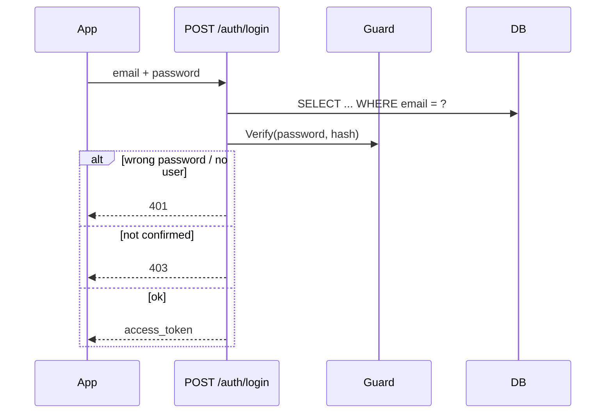
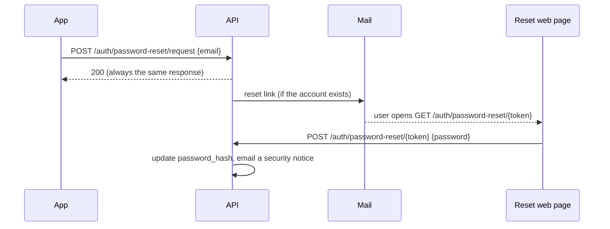

# Authentication

Two independent pieces: `Guard` (password hashing) and `Token` (JWT). Neither touches the database — routers combine them with `Cursor` calls.

## Password hashing — `guard.py`

```python
class Guard:
    Hash(password) -> str      # store this, never the plaintext
    Verify(password, stored_hash) -> bool
```

`passlib`'s `CryptContext` with **bcrypt** handles salting. `deprecated="auto"` means that if the scheme list ever grows, old hashes keep verifying while new ones use the newest scheme.

## JWT — `token.py`

One secret (`JWT_SECRET_KEY`), algorithm `HS256`, and separate token *purposes* distinguished by a `type` claim — so a confirmation link can never be replayed as a login session, even though both are "just a valid JWT":

| Purpose | Created by | Payload | Expires |
|---|---|---|---|
| Login session | `Token.Create` | `sub` (user id), `type=session` | 30 days |
| Account confirmation | `Token.CreateUserConfirmation` | `user_id`, `type=user_confirmation` | 24 h |
| Contact confirmation | `Token.CreateContactConfirmation` | `contact_id`, `type=contact_confirmation` | 7 days |
| Alert-view link | `Token.CreateAlertNotificationView` | `notification_id`, `type=alert_notification_view` | 30 days |
| Dashboard alert-view link | `Token.CreateAlertOwnerView` | `alert_id`, `user_id`, `type=alert_owner_view` | 30 days |

`Token.Validate` only checks signature/expiry and returns the raw payload or `None`. Each `Validate<Purpose>` wrapper then also checks that `payload["type"]` matches before trusting the id inside — "any valid signature" is not enough.

Alert-view links outlive the confirmation links (30 days) so a contact or account owner
may reopen the map well after an alert. The owner-scoped form is generated only while
loading an authenticated user's own alert list and does not mark a contact notification
as viewed.

## `current_user`

```python
def current_user(credentials = Depends(_security)) -> int:
    user_id = Token.ValidateSession(credentials.credentials)
    if user_id is None:
        raise HTTPException(401, "Invalid or expired token")
    return user_id
```

FastAPI's `HTTPBearer` extracts `Authorization: Bearer <token>`; every protected route declares `user_id: int = Depends(current_user)`. `ValidateSession` requires the `type=session` claim, so only a real login token opens a protected route — any other valid JWT is rejected with `401`.

## Login



The app stores `access_token` (`@capacitor/preferences`) and sends it as `Authorization: Bearer <token>` on every authenticated call.

## Re-authentication for sensitive changes

Changing the account email or password (`PUT /users/me`) requires the **current password** in the body (`current_password`), even with a valid session token. A 30-day token is convenient but long-lived; re-asking for the password means a stolen token alone can't take over an account. The check verifies `current_password` against the stored hash (missing → `400`, wrong → `403`); editing only name or phone doesn't require it. When a sensitive field changes, a security notice is emailed to the address on file **before** the change, so the legitimate owner hears about it even if the email itself was changed (see [notifications.md](notifications.md)).

## Password reset (forgot password)

For a user who can't log in, a fifth token purpose drives an emailed reset link:

| Purpose | Created by | Payload | Expires |
|---|---|---|---|
| Password reset | `Token.CreatePasswordReset` | `user_id`, `type=password_reset` | 1 hour |



- **Request** (`POST /auth/password-reset/request`) is rate-limited and **always returns the same response** whether or not the email exists — no account enumeration. If it exists, a 1-hour reset link is emailed.
- **The link** (`GET /auth/password-reset/{token}`) serves a small web page with a new-password form; an invalid/expired token shows the standard error page.
- **The form** posts the new password to `POST /auth/password-reset/{token}`, which validates the token (**type-checked**, so a session or confirmation token can't be used here), updates the hash, and emails a security notice.
- In the app, a **"Forgot your password?"** link on the login screen triggers the request.
