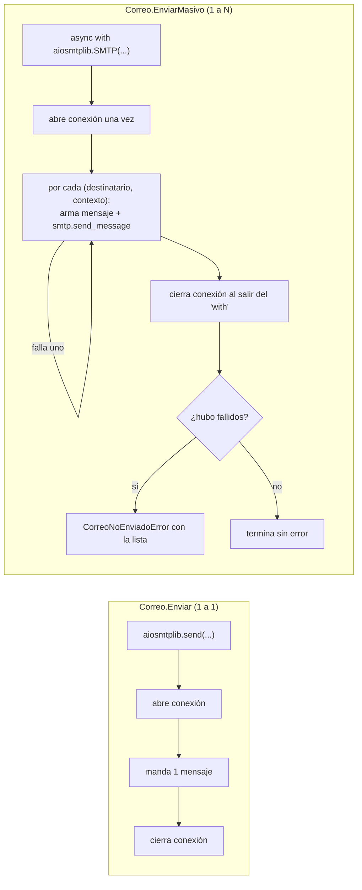
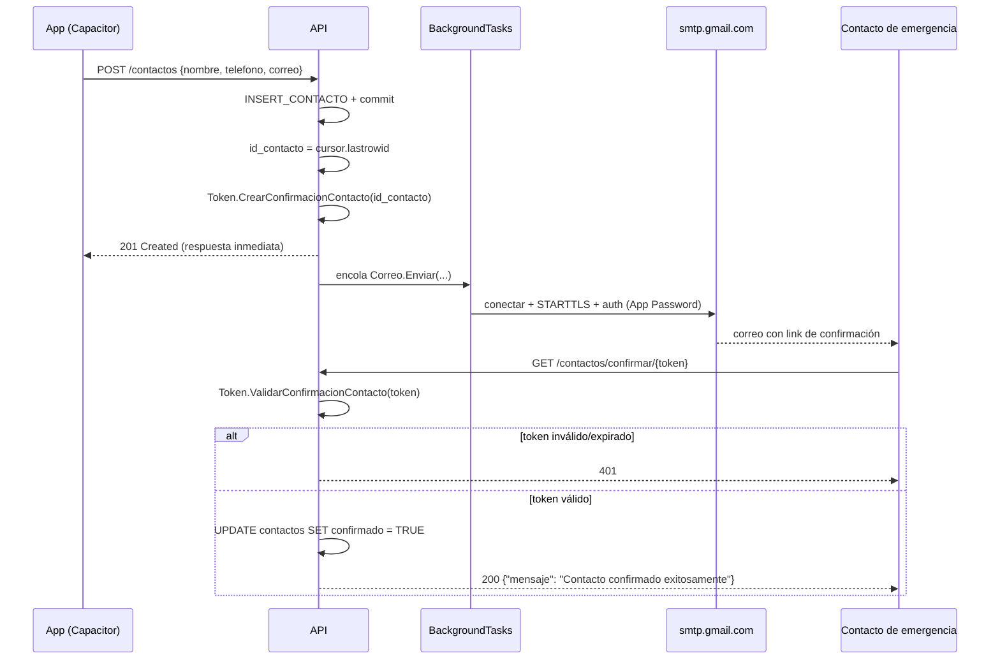
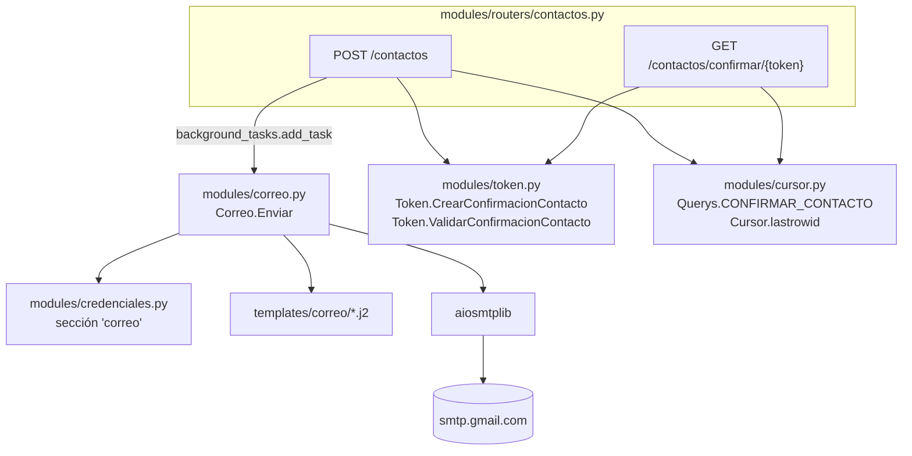

# `modules/correo.py`

## Propósito

Este módulo aísla todo lo relacionado con el envío de correos detrás de una clase `Correo`, siguiendo el mismo patrón "verb class" estático que `Guard` (`guard.md`) y `Token` (`token.md`):

```python
class Correo:
    @staticmethod
    async def Enviar(destinatario: str, asunto: str, plantilla: str, contexto: dict) -> None:
        ...
```

`Correo.Enviar` recibe el destinatario, el asunto, el **nombre** de una plantilla (sin extensión) y un diccionario de contexto, y se encarga de tres cosas: renderizar la plantilla en HTML y en texto plano con Jinja2, armar el mensaje MIME con ambas versiones, y mandarlo por SMTP con `aiosmtplib`. `Correo.EnviarMasivo` (ver más abajo) resuelve el mismo problema para cuando hay que mandarle el mismo tipo de correo a varios destinatarios a la vez, como ocurre al disparar una alerta de pánico.

## Por qué es la única pieza `async` del backend

Todo el resto del proyecto (`cursor.py`, los routers) es código síncrono — `mariadb` no tiene driver async y no valía la pena introducir uno solo para eso. `aiosmtplib`, en cambio, sí es una librería asíncrona (es su razón de ser: no bloquear el event loop de `uvicorn` mientras se espera la respuesta de un servidor SMTP, que puede tardar más que una consulta a la base de datos local). Por eso `Correo.Enviar` es la única función `async` del código de negocio.

Esto no obliga a que los endpoints que la usan sean `async def`: FastAPI permite pasar tanto funciones síncronas como corutinas a `BackgroundTasks.add_task`, y las ejecuta correctamente en cualquiera de los dos casos. `POST /contactos` (ver `routers.md`) sigue siendo `def`, no `async def`, y aun así puede encolar `Correo.Enviar` como tarea de fondo.

## Por qué `BackgroundTasks` y no `await` directo en el endpoint

```python
background_tasks.add_task(Correo.Enviar, data.correo, asunto, "confirmacion_contacto", contexto)
return {"Skellent": "Success!"}
```

Si el endpoint hiciera `await Correo.Enviar(...)` antes de responder, el cliente que crea un contacto tendría que esperar a que el correo termine de mandarse (conexión SMTP, TLS, autenticación, respuesta del servidor) antes de recibir su `201`. Eso puede tardar perceptiblemente más que la operación que realmente le importa a quien llama (guardar el contacto), y además significa que un problema transitorio de Gmail (lento, caído, rate-limited) degradaría directamente la experiencia de crear un contacto. `BackgroundTasks` hace que Starlette ejecute `Correo.Enviar` **después** de haber enviado la respuesta al cliente: el `201` llega tan rápido como siempre, y el correo se manda en paralelo.

La contrapartida, y es importante tenerla presente: si el envío falla, el cliente nunca se entera (ya recibió su `201` antes de que el intento de envío siquiera empezara). Hoy esa falla queda solo en el log del proceso — no hay reintento automático ni una tabla de auditoría de "correos pendientes/fallidos". Es una limitación conocida y aceptable para el volumen actual del proyecto (confirmaciones 1 a 1, no envíos masivos), pero si el proyecto creciera a necesitar garantías de entrega, el paso siguiente sería una cola de tareas real (Celery, RQ) en vez de `BackgroundTasks`, que es deliberadamente la opción más simple que ofrece FastAPI.

## Por qué Jinja2 en vez de f-strings para el cuerpo del correo

```python
_entorno_jinja: Environment = Environment(
    loader=FileSystemLoader(Path(__file__).resolve().parent.parent / "templates" / "correo"),
    autoescape=select_autoescape(["html", "xml"]),
)
```

Las plantillas viven como archivos separados en `backend/templates/correo/` (`confirmacion_contacto.html.j2`, `confirmacion_contacto.txt.j2`), no como strings armados a mano dentro de `correo.py` — mismo criterio que separar el SQL en `Querys` (ver `cursor.md`): el contenido que se le muestra a una persona no debería estar mezclado con la lógica que lo envía.

`autoescape=select_autoescape(["html", "xml"])` **no es opcional**: los valores que se interpolan en la plantilla (`nombre_contacto`, `nombre_usuario`) vienen, en última instancia, de campos que un usuario escribió al registrarse o al cargar un contacto (ver `types.py`). Sin autoescape, alguien podría poner como `nombre` algo como `<script>...</script>` y ese HTML terminaría ejecutándose en el cliente de correo de quien lo reciba. Con autoescape activado, Jinja2 escapa automáticamente cualquier carácter especial de HTML antes de insertarlo en la plantilla `.html.j2` — la misma clase de defensa que ya usa el proyecto en el otro extremo (parámetros `%s` en SQL, ver `cursor.md`), aplicada acá a HTML en vez de a SQL.

## Por qué texto plano *y* HTML, no solo HTML

```python
mensaje.set_content(cuerpo_texto)
mensaje.add_alternative(cuerpo_html, subtype="html")
```

Esto arma un mensaje `multipart/alternative`: el cliente de correo de quien lo recibe elige cuál de las dos versiones mostrar (la mayoría muestra el HTML si puede renderizarlo, y cae al texto plano si no). Mandar ambas versiones mejora la entregabilidad (algunos filtros anti-spam penalizan los correos que son *solo* HTML, por parecerse más a spam/marketing) y garantiza que el mensaje se pueda leer igual en un cliente que no renderiza HTML.

## Por qué `CorreoNoEnviadoError` en vez de dejar propagar las excepciones de `aiosmtplib`

```python
class CorreoNoEnviadoError(Exception):
    pass

class Correo:
    @staticmethod
    async def Enviar(...) -> None:
        ...
        try:
            await aiosmtplib.send(...)
        except aiosmtplib.SMTPException as e:
            raise CorreoNoEnviadoError(str(e)) from e
```

Mismo criterio que `RegistroDuplicadoError` en `cursor.py`: `correo.py` es, a propósito, el único archivo del backend que importa `aiosmtplib` directamente. Cualquier código que en el futuro quiera reaccionar a un fallo de envío (por ejemplo, reintentar, o registrar el fallo en una tabla) puede capturar `CorreoNoEnviadoError` sin necesitar saber que el transporte es SMTP ni que la librería usada es `aiosmtplib` — si el día de mañana el proyecto migrara a otro proveedor o protocolo (una API HTTP de envío de correos, por ejemplo), solo este archivo cambiaría.

## `Correo.EnviarMasivo`: cuando un correo tiene que llegarle a varios contactos a la vez

```python
@staticmethod
async def EnviarMasivo(asunto: str, plantilla: str, destinatarios: list[tuple[str, dict]]) -> None:
    fallidos: list[str] = []

    async with aiosmtplib.SMTP(
        hostname=_credenciales['host'],
        port=_credenciales['port'],
        start_tls=True,
        username=_credenciales['usuario'],
        password=_credenciales['password'],
    ) as smtp:
        for destinatario, contexto in destinatarios:
            try:
                mensaje: EmailMessage = _armar_mensaje(destinatario, asunto, plantilla, contexto)
                await smtp.send_message(mensaje)
            except Exception:
                fallidos.append(destinatario)

    if fallidos:
        raise CorreoNoEnviadoError(f"No se pudo notificar a: {', '.join(fallidos)}")
```

Hasta la llegada de `POST /alertas` (ver `routers.md`), todo envío de este proyecto era 1 a 1: `Correo.Enviar` abre una conexión, manda un correo a un único destinatario, y la cierra. Una alerta de pánico rompe ese supuesto — puede necesitar notificar a varios contactos confirmados a la vez, y llamar a `Correo.Enviar` en un loop hubiera abierto y cerrado una conexión SMTP por cada uno de ellos, exactamente el patrón que ya habíamos identificado como innecesario para el volumen actual del proyecto (ver la sección de límites de Gmail, más abajo).

### Por qué recibe `list[tuple[str, dict]]` y no `list[str]` + un único `dict`

Cada destinatario de una alerta necesita su propio contexto de plantilla (`nombre_contacto` cambia según a quién se le escribe, aunque `nombre_usuario`/`latitud`/`longitud` sean los mismos para todos). Por eso `EnviarMasivo` recibe una lista de pares `(destinatario, contexto)` en vez de separar destinatarios de un contexto compartido — cada mensaje se renderiza con los datos que le corresponden a esa persona específica.

### Por qué reutiliza una única conexión (`async with aiosmtplib.SMTP(...)`)

`Correo.Enviar` usa `aiosmtplib.send(...)`, que internamente abre una conexión, manda un mensaje y la cierra — perfecto para un envío aislado, pero desperdicia trabajo (handshake TCP, STARTTLS, autenticación) si hay que repetirlo varias veces seguidas para el mismo lote. `EnviarMasivo` en cambio abre la conexión una sola vez (`async with aiosmtplib.SMTP(...) as smtp`) y la reutiliza para todos los mensajes del lote con `smtp.send_message(...)`, cerrándola automáticamente al salir del bloque `async with`. Es exactamente la optimización que ya habíamos anotado como pendiente para el día en que el proyecto necesitara notificar a varios contactos a la vez — ese día es este.

### Por qué el `except` es `Exception` genérico, no `aiosmtplib.SMTPException`

A diferencia de `Correo.Enviar` (donde un único destinatario que falla es, por definición, el 100% del envío), acá el objetivo es que un problema con **un** contacto no le impida recibir la alerta al resto. Capturar solo `aiosmtplib.SMTPException` no alcanza para esa garantía: cualquier excepción inesperada al armar o mandar un mensaje puntual (no necesariamente una excepción de SMTP) podría cortar el `for` a mitad de camino y dejar sin notificar a los contactos que todavía no le tocaba su turno. Por eso el `try`/`except` envuelve tanto `_armar_mensaje` como `smtp.send_message`, y captura `Exception` en general — la prioridad, en un sistema de alertas de pánico, es que un fallo aislado nunca se lleve puesto al resto del lote.

### Por qué junta los fallos y levanta un único error al final, en vez de uno por destinatario

`fallidos` acumula qué direcciones no pudieron recibir el mensaje, y recién al final —si la lista no quedó vacía— se levanta un solo `CorreoNoEnviadoError` que las lista a todas. Esto preserva la misma visibilidad que tiene cualquier otro fallo de `Correo` (el proyecto no tiene un logger dedicado; confía en que las excepciones no capturadas terminen en el log de `uvicorn`, ver más abajo en la sección de `BackgroundTasks`), sin necesitar levantar y silenciar una excepción por cada contacto que falle en el medio del loop.

### Diagrama: la diferencia con `Correo.Enviar`



## Autenticación con Gmail/Google Workspace: App Password

Para `soporte@keylogics.com` (una cuenta de Google Workspace con dominio propio), `Correo.Enviar` se autentica contra `smtp.gmail.com` con usuario y contraseña de aplicación:

```python
await aiosmtplib.send(
    mensaje,
    hostname=_credenciales['host'],   # smtp.gmail.com
    port=_credenciales['port'],       # 587
    start_tls=True,
    username=_credenciales['usuario'],
    password=_credenciales['password'],
)
```

- **`start_tls=True`**: el mensaje se manda siempre cifrado. Puerto `587` es el estándar para STARTTLS (conexión en plano que se actualiza a TLS), a diferencia del `465` que sería TLS implícito desde el inicio de la conexión.
- **Contraseña de aplicación, no la contraseña real de la cuenta**: desde marzo de 2025, Google ya no acepta autenticación SMTP con usuario+contraseña "normal" (básica) en cuentas de Workspace — hay que generar una *App Password* específica (una cadena de 16 caracteres, en `myaccount.google.com/apppasswords`) y usarla como `SMTP_PASSWORD`. Esto **requiere dos precondiciones del lado del cliente, fuera del control de este código**:
  1. Verificación en 2 pasos activa en `soporte@keylogics.com`.
  2. Que el administrador de Workspace tenga habilitada la opción "permitir a los usuarios crear contraseñas de aplicación" — algunas organizaciones la desactivan por política de seguridad, en cuyo caso esta rama no funcionaría y habría que migrar a la variante con OAuth2 (ver la rama `feature/correo-oauth2` de este mismo repositorio, que resuelve exactamente este mismo módulo pero con Service Account + delegación de dominio en vez de App Password).
- **Límites de envío de Google Workspace**: una cuenta puede mandar hasta 10.000 destinatarios únicos y 10.000 mensajes en 24 horas usando `smtp.gmail.com` directamente. El volumen actual del proyecto (una confirmación por contacto creado, y una notificación por contacto confirmado cuando se dispara una alerta, ver más abajo) está muy por debajo de eso. `Correo.EnviarMasivo` ya reutiliza una única conexión por lote de destinatarios (en vez de abrir una por contacto), que es la optimización relevante para el volumen actual — un límite de conexiones **concurrentes** entre alertas de *distintos* usuarios disparadas al mismo tiempo (`asyncio.Semaphore`) seguiría siendo un paso posterior, solo necesario si el proyecto llegara a un volumen de alertas simultáneas mucho mayor al actual.

## Variables de entorno que introduce este módulo

```env
SMTP_USER=soporte@keylogics.com
SMTP_PASSWORD='contraseña de aplicación de 16 caracteres'
SMTP_HOST=smtp.gmail.com   # valor por defecto si no se define
SMTP_PORT=587              # valor por defecto si no se define
API_BASE_URL=http://127.0.0.1:8000   # o el dominio real en producción, ver NGINX.md
```

`API_BASE_URL` no es una credencial de correo, pero se agregó junto a esta funcionalidad porque el correo de confirmación necesita construir un enlace absoluto (`{API_BASE_URL}/contactos/confirmar/{token}`) y la API, corriendo detrás de nginx (ver `NGINX.md`), no tiene forma de conocer su propio dominio público desde adentro.

## El flujo completo: de crear un contacto a confirmarlo



Puntos a notar de este flujo:

- El `201` de `POST /contactos` no espera al correo — llega apenas se confirma el `INSERT` (ver la sección de `BackgroundTasks` más arriba).
- `GET /contactos/confirmar/{token}` es, junto con las dos rutas de `auth.py`, de los pocos endpoints del backend que **no** exige `Depends(usuario_actual)` (ver `dependencies.md`) — y por la misma razón que ellas: quien hace clic en el link viene de un correo, no de una sesión iniciada en la app, así que no puede tener un JWT de login.
- Justamente porque es un endpoint público, el token que viaja en la URL no es el JWT de sesión (`Token.Crear`/`Token.Validar`) sino uno distinto, con su propio claim `"tipo": "confirmacion_contacto"` — ver la sección siguiente.

## Por qué el token de confirmación no reutiliza `Token.Crear`/`Token.Validar` tal cual

`modules/token.py` (ver `token.md`) agrega dos métodos nuevos en vez de reutilizar los existentes sin cambios:

```python
Token.CrearConfirmacionContacto(id_contacto) -> str
Token.ValidarConfirmacionContacto(token) -> int | None
```

El payload de un token de confirmación incluye `"tipo": "confirmacion_contacto"` junto a `"contacto_id"`. Esto no es decorativo: si un token de confirmación tuviera la misma forma que un JWT de login (`{"sub": ..., "exp": ...}`), y un `id_contacto` coincidiera numéricamente con el `id` de un usuario válido, un JWT de sesión robado o filtrado podría, en teoría, colarse por el endpoint de confirmación (o viceversa) porque ambos estarían firmados con el mismo secreto y tendrían una forma indistinguible. El claim `"tipo"` hace que `ValidarConfirmacionContacto` rechace cualquier token que no haya sido creado específicamente para este propósito, aunque esté firmado correctamente y no haya expirado.

La expiración también es distinta y deliberadamente más larga: `EXPIRACION_CONFIRMACION_CONTACTO = timedelta(days=7)`, contra las 24 horas de un token de sesión. Un contacto de emergencia puede tardar días en revisar su correo; no tendría sentido que el link caducara con la misma urgencia que una sesión de la app.

## Diagrama de módulos



## Relación con el resto del backend

Dos routers importan `Correo` hoy (ver `routers.md`): `contactos.py` usa `Correo.Enviar` (1 a 1) para el correo de confirmación cuando se crea un contacto, y `alertas.py` usa `Correo.EnviarMasivo` (1 a N) para notificar a todos los contactos confirmados de un usuario cuando se dispara una alerta. `correo.py` depende de `modules/credenciales.py` para las credenciales SMTP, y de `modules/cursor.py` solo indirectamente, a través de los routers que lo llaman (no directamente: `correo.py` no toca la base de datos). `modules/token.py`, en cambio, solo lo necesita `contactos.py` para el token de confirmación — `alertas.py` no emite ni valida ningún token propio.
