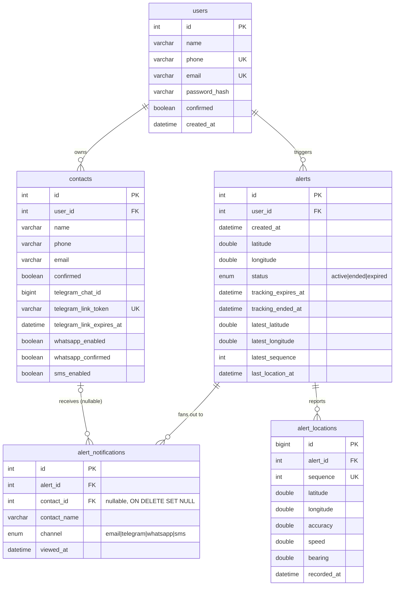

# Database

MariaDB, no ORM, no migration framework. `queries/` holds the SQL an operator runs by hand; `modules/cursor.py` holds every query the app runs, as plain parameterised strings.

## Schema



`queries/tables.sql` is the source of truth for a fresh install.

- **`users.confirmed`** gates login (`403` until true) — set by clicking the registration email link. An unconfirmed account can own nothing, so `scripts/purge_unconfirmed_users.py` can safely delete stale ones.
- **`contacts`** carries one set of state per channel: `confirmed` (email), `telegram_chat_id` (+ single-use link token/expiry), `whatsapp_enabled`/`whatsapp_confirmed`, and `sms_enabled`. A contact is notified on a channel only when that channel's condition holds (see [notifications.md](notifications.md)).
- **`alert_notifications`** is one row per `(alert, contact, channel)`. It stores the **`contact_name`** at send time and its `contact_id` FK is **`ON DELETE SET NULL`** — so deleting a contact keeps the alert's history intact (the row survives with the name; only the link to the live contact is cleared). `viewed_at` marks the first time that specific view link was opened.
- **`alert_locations`** stores ordered GPS points for one live session. `alerts` also keeps the latest point and lifecycle state so reconnecting viewers get an immediate snapshot without scanning the full trail.

## `Cursor`: one connection per thread

FastAPI runs `def` routes in a threadpool. A single shared connection would let requests interleave `execute` / `rowcount` / `lastrowid` on the same cursor — one request reading another's insert id. Each thread instead gets its own connection and cursor, created on first use and kept for that thread (via `threading.local()`); the shared `cursor` object each module imports is just the dispatcher in front of them.

```python
conn = mariadb.connect(..., client_flag=CLIENT.FOUND_ROWS, autocommit=True)
```

Two non-default flags, each fixing a real bug:

- **`CLIENT.FOUND_ROWS`** — without it, an `UPDATE` that matches a row but changes nothing reports `rowcount = 0`, indistinguishable from "no match". Every existence/ownership check here relies on `rowcount` meaning "rows found".
- **`autocommit = True`** — a backstop so a stray write (or a bare `SELECT`, which still opens a transaction) never leaves a row locked. The few read-then-write paths that must be atomic use `cursor.transaction()`, an explicit transaction on the calling thread's connection.

`execute()` retries once on `mariadb.InterfaceError` (the "server has gone away" after `wait_timeout`) by reconnecting — so an idle backend recovers on the next request instead of needing a restart. A `mariadb.IntegrityError` (UNIQUE violation) is translated to `DuplicateRecordError`, which routers turn into a `409`. At startup `cursor.verify()` opens a connection eagerly so a misconfigured database fails loudly.

## `Queries`

The `Queries` class in `modules/cursor.py` is a namespace of `str` constants — `SELECT_USER_BY_EMAIL`, `INSERT_CONTACT`, `SELECT_CONFIRMED_CONTACTS_BY_USER`, etc. Routes that need a one-off `UPDATE … SET <dynamic columns>` (partial updates in `PUT /users/me`, `PUT /contacts/{id}`) build that inline; everything reused lives here.

## Provisioning & migrations

See [setup.md](setup.md) to create a database from `creation.sql` + `tables.sql`, and [operations.md](operations.md) for applying the `migrations/` files to an existing database.
