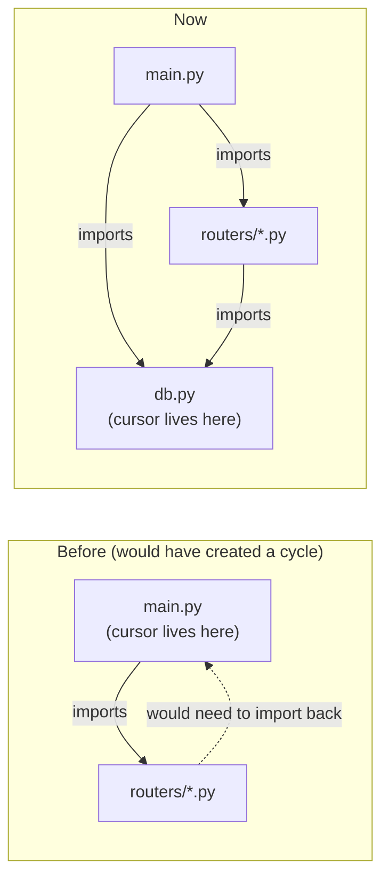

# `modules/db.py`

## Purpose

```python
from modules.cursor      import Cursor
from modules.credentials import get_credentials


credentials: dict = get_credentials()

cursor: Cursor = Cursor(
    credentials['database']['user'],
    credentials['database']['password'],
    credentials['database']['host'],
    credentials['database']['port'],
    credentials['database']['database'],
)
```

This module is, on purpose, almost entirely a repeat of something that already existed: it's exactly the same code that used to live at module level in `main.py` (reads the credentials with `get_credentials()`, see `credentials.md`, and opens the single MariaDB connection wrapped in `Cursor`, see `cursor.md`). The only thing that changed is which file it lives in.

## Why it was extracted from `main.py`

While the only business logic was `registrar_usuario` (now `register`), it made sense for it to live alongside the connection, in `main.py`. But as soon as the endpoints needed to be split across several routers (`modules/routers/auth.py`, `users.py`, `contacts.py`, see `routers.md`), a problem showed up: **all of those routers also need to use the same `cursor`**, and it's `main.py` that imports them (`from modules.routers import auth, users, contacts`), not the other way around. If `cursor` had stayed defined in `main.py`, each router would have had to write `from main import cursor` — and that creates a **circular import**: Python starts loading `main.py`, which on its first line tries to import `auth.py`, which in turn tries to import back from `main.py`, which hasn't finished defining `cursor` yet because it's stuck partway through its first line. The result is an `ImportError` at startup.

The standard solution to this problem is to pull the shared resource (`cursor`) out into a third module that neither side depends on: neither `main.py` nor the routers. That's why `modules/db.py` exists — a "leaf" module in the import tree (it imports nothing from `modules/routers/` or from `main.py`), from which both `main.py` and any router can import `cursor` without creating a cycle:



## Why it isn't a class or a function

`db.py` doesn't wrap anything in a function like `get_cursor()`: it simply runs the code at module level and exposes `cursor` as a module variable. This is intentional and takes advantage of how Python's import system works: a module only runs the **first** time it's imported anywhere in the process; any later import (from `main.py`, from `auth.py`, from `users.py`, etc.) reuses the same already-created object, instead of opening a new connection again. In practice, it's a singleton pattern implemented with the language's native tools, without needing a dedicated class for it.

## Relationship with the rest of the backend

`main.py` no longer imports this module directly (it doesn't need the cursor, it only mounts routers, see `main.md`). The ones that do import `cursor` from here are the routers in `modules/routers/` (see `routers.md`), whenever they need to read or write to the database.
