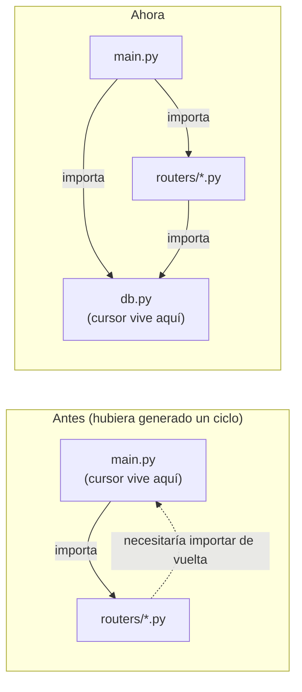

# `modules/db.py`

## Propósito

```python
from modules.cursor       import Cursor
from modules.credenciales import obtener_credenciales


credenciales: dict = obtener_credenciales()

cursor: Cursor = Cursor(
    credenciales['database']['user'],
    credenciales['database']['password'],
    credenciales['database']['host'],
    credenciales['database']['port'],
    credenciales['database']['database'],
)
```

Este módulo es, a propósito, casi todo repetición de algo que ya existía: es exactamente el mismo código que antes vivía a nivel de módulo en `main.py` (lee las credenciales con `obtener_credenciales()`, ver `credenciales.md`, y abre la única conexión a MariaDB envuelta en `Cursor`, ver `cursor.md`). Lo único que cambió es el archivo donde vive.

## Por qué se extrajo de `main.py`

Mientras la única lógica de negocio era `registrar_usuario`, tenía sentido que viviera junto a la conexión, en `main.py`. Pero apenas se necesitó repartir los endpoints en varios routers (`modules/routers/auth.py`, `usuarios.py`, `contactos.py`, ver `routers.md`), surgió un problema: **todos esos routers también necesitan usar el mismo `cursor`**, y `main.py` es quien los importa a ellos (`from modules.routers import auth, usuarios, contactos`), no al revés. Si `cursor` se hubiera quedado definido en `main.py`, cada router hubiera tenido que escribir `from main import cursor` — y eso crea un **import circular**: Python empieza a cargar `main.py`, que en la primera línea intenta importar `auth.py`, que a su vez intenta importar de vuelta a `main.py`, que todavía no terminó de definir `cursor` porque se quedó a mitad de la primera línea. El resultado es un `ImportError` al arrancar.

La solución estándar a este problema es sacar el recurso compartido (`cursor`) a un tercer módulo que no dependa de ninguno de los dos lados: ni de `main.py` ni de los routers. Por eso existe `modules/db.py` — un módulo "hoja" en el árbol de imports (no importa nada de `modules/routers/` ni de `main.py`), del que tanto `main.py` como cualquier router pueden importar `cursor` sin generar un ciclo:



## Por qué no es una clase ni una función

`db.py` no encapsula nada en una función tipo `obtener_cursor()`: simplemente ejecuta el código a nivel de módulo y expone `cursor` como una variable del módulo. Esto es intencional y aprovecha cómo funciona el sistema de imports de Python: un módulo solo se ejecuta la **primera** vez que se importa en todo el proceso; cualquier import posterior (desde `main.py`, desde `auth.py`, desde `usuarios.py`, etc.) reutiliza el mismo objeto ya creado, en vez de volver a abrir una conexión nueva. Es, en la práctica, un patrón singleton implementado con las herramientas nativas del lenguaje, sin necesitar una clase dedicada a eso.

## Relación con el resto del backend

`main.py` ya no importa este módulo directamente (no necesita el cursor, solo monta routers, ver `main.md`). Quienes sí importan `cursor` desde acá son los tres routers de `modules/routers/` (ver `routers.md`), cada vez que necesitan leer o escribir en la base de datos.
