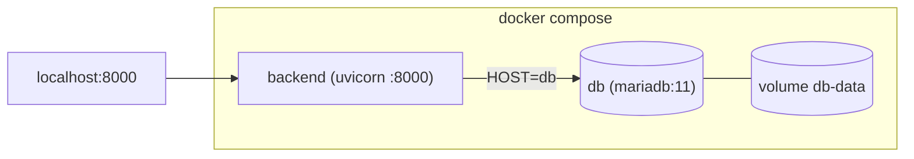

# Running the backend with Docker

The repository ships a container setup for the backend:

- **`backend/Dockerfile`** — builds a single image that runs the FastAPI backend.
- **`backend/docker-compose.yml`** — runs that image together with a MariaDB service as one stack.
- **`.dockerignore`** (repo root) — keeps the build context small.

## Prerequisites

- **Docker Desktop** (Windows/macOS) or Docker Engine + the Compose plugin (Linux). Confirm it's running:
  ```bash
  docker --version
  docker compose version
  docker info          # must reach the daemon
  ```

## Quick start

From the `backend/` directory:

```bash
docker compose up -d --build
```

This builds the backend image, starts MariaDB, waits until the database is healthy, then starts the backend. Check it:

```bash
curl http://127.0.0.1:8000/health      # {"status":"ok","database":true}
```

- Landing page: `http://127.0.0.1:8000/`
- Dashboard: `http://127.0.0.1:8000/dashboard`
- Stop everything: `docker compose down` (add `-v` to also delete the database volume).

## How the image is built

The Dockerfile is **multi-stage** and its **build context is the repository root** (not `backend/`), because the backend serves the mobile app's built UI from `../app/www` and that directory must be inside the image.

- **builder stage** — installs Python dependencies with `uv` into `/opt/venv`. It needs `build-essential` + `libmariadb-dev` because the `mariadb` connector is compiled against the MariaDB Connector/C headers.
- **runtime stage** — a slim image carrying only `libmariadb3`, the virtualenv, and the app. It mirrors the repo layout so paths resolve:
  - `/srv/backend` — the backend code (working directory)
  - `/srv/app/www` — the mobile UI served at `/app`
  It runs as a non-root user, exposes `8000`, has a `/health` HEALTHCHECK, and starts `uvicorn … --proxy-headers`.

Compose sets the build context for you:

```yaml
build:
  context: ..
  dockerfile: backend/Dockerfile
```

To build the image without Compose, run from the **repo root**:

```bash
docker build -f backend/Dockerfile -t panicbutton-backend .
```

## The compose stack



- Two containers on a private network; the backend reaches the database as host **`db`**.
- The database persists in the named volume **`db-data`** (survives `down`; removed by `down -v`).
- On the database's **first** start, `queries/tables.sql` is auto-loaded (mounted into `/docker-entrypoint-initdb.d/`), so the schema is created for you. If you later change `tables.sql`, recreate the volume (`down -v` then `up`) for it to re-run.

## Configuration

The backend reads `backend/.env` (via `env_file`) for its secrets and channels — JWT, SMTP, Telegram, Twilio, `API_BASE_URL`, `APP_MODE` (see [operations.md](operations.md)). The **database credentials for the bundled db** are set separately, through Compose variables:

| Compose variable | Default | Used for |
|---|---|---|
| `DB_USERNAME` | `panic` | MariaDB app user (and the backend's `USERNAME`) |
| `DB_PASSWORD` | `panic` | its password |
| `DB_NAME` | `panicbutton` | the database |
| `DB_ROOT_PASSWORD` | `change-me-root` | MariaDB root password |

Set them in `backend/.env` (or the shell) to override the defaults; both the `db` and `backend` services read the same values, so they can't drift.

> **Why `DB_USERNAME` and not `USERNAME`?** On Windows the shell already defines `USERNAME` (the logged-in account), and Docker Compose interpolation prefers the shell over `.env` — so `${USERNAME}` would create the database user with your Windows account name instead of the one you intended. The dedicated `DB_*` names don't collide. (The backend still reads `USERNAME` *inside* the container, where there is no such collision; Compose sets it from `DB_USERNAME`.)

## Using an external database instead

If you already run MariaDB elsewhere, skip the `db` service and point the backend at it: set `HOST`, `PORT`, `USERNAME`, `PASSWORD`, `DATABASE` in `.env`, apply the schema/migrations yourself (see [operations.md](operations.md)), and run just the backend:

```bash
docker build -f backend/Dockerfile -t panicbutton-backend .
docker run --rm -p 8000:8000 --env-file backend/.env panicbutton-backend
```

If that MariaDB runs on the Docker host, set `HOST=host.docker.internal` (not `127.0.0.1`, which inside the container is the container itself).

## Production notes

- Set `API_BASE_URL` to the public **HTTPS** URL and `APP_MODE=Deploy` (hides `/docs`).
- Terminate TLS at a reverse proxy in front of the container; the image already runs uvicorn with `--proxy-headers`.
- Set real `DB_PASSWORD` / `DB_ROOT_PASSWORD` and a strong `JWT_SECRET_KEY`; never commit `.env`.
- Common commands: `docker compose logs -f backend`, `docker compose ps`, `docker compose down`.
