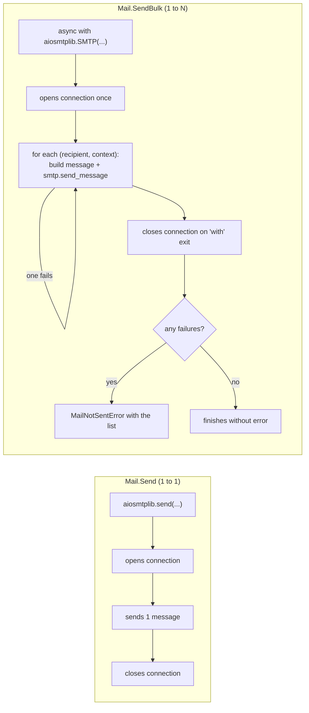
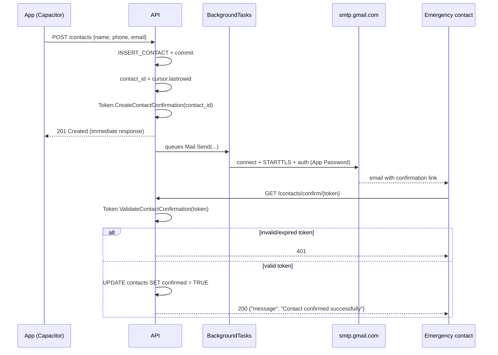
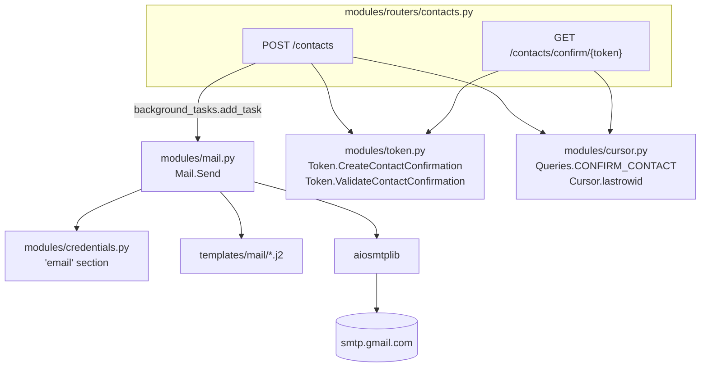

# `modules/mail.py`

## Purpose

This module isolates everything related to sending emails behind a `Mail` class, following the same static "verb class" pattern as `Guard` (`guard.md`) and `Token` (`token.md`):

```python
class Mail:
    @staticmethod
    async def Send(recipient: str, subject: str, template: str, context: dict) -> None:
        ...
```

`Mail.Send` receives the recipient, the subject, the **name** of a template (without extension) and a context dictionary, and takes care of three things: rendering the template in HTML and plain text with Jinja2, assembling the MIME message with both versions, and sending it over SMTP with `aiosmtplib`. `Mail.SendBulk` (see below) solves the same problem for when the same type of email needs to go out to several recipients at once, as happens when a panic alert is triggered.

## Why it's the backend's only `async` piece

Everything else in the project (`cursor.py`, the routers) is synchronous code — `mariadb` has no async driver and it wasn't worth introducing one just for that. `aiosmtplib`, on the other hand, *is* an asynchronous library (that's its whole point: not blocking `uvicorn`'s event loop while waiting for an SMTP server's response, which can take longer than a query against the local database). That's why `Mail.Send` is the only `async` function in the business logic.

This doesn't force the endpoints that use it to be `async def`: FastAPI can accept both synchronous functions and coroutines in `BackgroundTasks.add_task`, and runs them correctly either way. `POST /contacts` (see `routers.md`) stays a `def`, not `async def`, and can still queue `Mail.Send` as a background task.

## Why `BackgroundTasks` instead of a direct `await` in the endpoint

```python
background_tasks.add_task(Mail.Send, data.email, subject, "contact_confirmation", context)
return {"Skellent": "Success!"}
```

If the endpoint did `await Mail.Send(...)` before responding, the client creating a contact would have to wait for the email to finish sending (SMTP connection, TLS, authentication, server response) before getting its `201`. That could take noticeably longer than the operation the caller actually cares about (saving the contact), and it would also mean a transient Gmail problem (slow, down, rate-limited) would directly degrade the experience of creating a contact. `BackgroundTasks` makes Starlette run `Mail.Send` **after** the response has already been sent to the client: the `201` arrives as fast as ever, and the email is sent in parallel.

The tradeoff, and it's important to keep in mind: if the send fails, the client never finds out (it already got its `201` before the send attempt even started). Today that failure only shows up in the process log — there's no automatic retry or a "pending/failed emails" audit table. It's a known and acceptable limitation for the project's current volume (one-to-one confirmations, not bulk sends), but if the project grew to need delivery guarantees, the next step would be a real task queue (Celery, RQ) instead of `BackgroundTasks`, which is deliberately the simplest option FastAPI offers.

## Why Jinja2 instead of f-strings for the email body

```python
_jinja_env: Environment = Environment(
    loader=FileSystemLoader(Path(__file__).resolve().parent.parent / "templates" / "mail"),
    autoescape=select_autoescape(["html", "xml"]),
)
```

Templates live as separate files in `backend/templates/mail/` (`contact_confirmation.html.j2`, `contact_confirmation.txt.j2`), not as strings assembled by hand inside `mail.py` — the same rationale as keeping SQL separate in `Queries` (see `cursor.md`): content shown to a person shouldn't be mixed in with the logic that sends it.

`autoescape=select_autoescape(["html", "xml"])` **is not optional**: the values interpolated into the template (`contact_name`, `user_name`) ultimately come from fields a user typed in while registering or adding a contact (see `types.py`). Without autoescape, someone could set their `name` to something like `<script>...</script>`, and that HTML would end up executing in the recipient's mail client. With autoescape on, Jinja2 automatically escapes any special HTML character before inserting it into the `.html.j2` template — the same class of defense the project already uses at the other end (`%s` parameters in SQL, see `cursor.md`), applied here to HTML instead of SQL.

## Why plain text *and* HTML, not just HTML

```python
message.set_content(text_body)
message.add_alternative(html_body, subtype="html")
```

This builds a `multipart/alternative` message: the recipient's mail client picks which of the two versions to show (most render the HTML if they can, and fall back to plain text if not). Sending both versions improves deliverability (some spam filters penalize HTML-only emails for looking more like spam/marketing) and guarantees the message is still readable on a client that doesn't render HTML.

## Why `MailNotSentError` instead of letting `aiosmtplib`'s exceptions propagate

```python
class MailNotSentError(Exception):
    pass

class Mail:
    @staticmethod
    async def Send(...) -> None:
        ...
        try:
            await aiosmtplib.send(...)
        except aiosmtplib.SMTPException as e:
            raise MailNotSentError(str(e)) from e
```

Same rationale as `DuplicateRecordError` in `cursor.py`: `mail.py` is, on purpose, the only backend file that imports `aiosmtplib` directly. Any code that in the future wants to react to a send failure (for example, retrying, or logging the failure in a table) can catch `MailNotSentError` without needing to know the transport is SMTP or that the library used is `aiosmtplib` — if the project ever migrated to a different provider or protocol (an HTTP email-sending API, for example), only this file would change.

## `Mail.SendBulk`: when an email has to reach several contacts at once

```python
@staticmethod
async def SendBulk(subject: str, template: str, recipients: list[tuple[str, dict]]) -> None:
    failed: list[str] = []

    async with aiosmtplib.SMTP(
        hostname=_credentials['host'],
        port=_credentials['port'],
        start_tls=True,
        username=_credentials['user'],
        password=_credentials['password'],
    ) as smtp:
        for recipient, context in recipients:
            try:
                message: EmailMessage = _build_message(recipient, subject, template, context)
                await smtp.send_message(message)
            except Exception:
                failed.append(recipient)

    if failed:
        raise MailNotSentError(f"Could not notify: {', '.join(failed)}")
```

Until `POST /alerts` (see `routers.md`) arrived, every send in this project was one-to-one: `Mail.Send` opens a connection, sends one email to a single recipient, and closes it. A panic alert breaks that assumption — it may need to notify several confirmed contacts at once, and calling `Mail.Send` in a loop would have opened and closed an SMTP connection for each one of them, exactly the pattern we'd already flagged as unnecessary overhead for the project's current volume (see the Gmail limits section below).

### Why it takes `list[tuple[str, dict]]` and not `list[str]` plus a single `dict`

Each recipient of an alert needs their own template context (`contact_name` changes depending on who's being written to, even though `user_name`/`latitude`/`longitude` are the same for everyone). That's why `SendBulk` takes a list of `(recipient, context)` pairs instead of separating recipients from a shared context — each message renders with the data that belongs to that specific person.

### Why it reuses a single connection (`async with aiosmtplib.SMTP(...)`)

`Mail.Send` uses `aiosmtplib.send(...)`, which internally opens a connection, sends one message and closes it — perfect for an isolated send, but wasteful (TCP handshake, STARTTLS, authentication) if it has to be repeated several times in a row for the same batch. `SendBulk`, instead, opens the connection once (`async with aiosmtplib.SMTP(...) as smtp`) and reuses it for every message in the batch with `smtp.send_message(...)`, closing it automatically when the `async with` block exits. It's exactly the optimization we'd already noted as pending for the day the project needed to notify several contacts at once — that day is this one.

### Why the `except` catches generic `Exception`, not `aiosmtplib.SMTPException`

Unlike `Mail.Send` (where a single failing recipient is, by definition, 100% of the send), here the goal is that a problem with **one** contact doesn't stop the rest from receiving the alert. Catching only `aiosmtplib.SMTPException` isn't enough for that guarantee: any unexpected exception while building or sending a specific message (not necessarily an SMTP exception) could cut the `for` loop short and leave contacts whose turn hadn't come up yet without a notification. That's why the `try`/`except` wraps both `_build_message` and `smtp.send_message`, and catches `Exception` broadly — in a panic-alert system, the priority is that one isolated failure never takes down the rest of the batch.

### Why it collects failures and raises a single error at the end, instead of one per recipient

`failed` accumulates which addresses couldn't receive the message, and only at the end — if the list isn't empty — does it raise a single `MailNotSentError` listing all of them. This preserves the same visibility as any other `Mail` failure (the project doesn't have a dedicated logger; it relies on uncaught exceptions ending up in `uvicorn`'s log, see the `BackgroundTasks` section above), without needing to raise and swallow one exception per failing contact in the middle of the loop.

### Diagram: the difference with `Mail.Send`



## Authentication with Gmail/Google Workspace: App Password

For `soporte@keylogics.com` (a Google Workspace account with its own domain), `Mail.Send` authenticates against `smtp.gmail.com` with a username and app password:

```python
await aiosmtplib.send(
    message,
    hostname=_credentials['host'],   # smtp.gmail.com
    port=_credentials['port'],       # 587
    start_tls=True,
    username=_credentials['user'],
    password=_credentials['password'],
)
```

- **`start_tls=True`**: the message always sends encrypted. Port `587` is the standard for STARTTLS (plaintext connection that upgrades to TLS), as opposed to `465`, which would be implicit TLS from the start of the connection.
- **App password, not the account's real password**: since March 2025, Google no longer accepts SMTP authentication with a "normal" (basic) username+password on Workspace accounts — you have to generate a specific *App Password* (a 16-character string, at `myaccount.google.com/apppasswords`) and use it as `SMTP_PASSWORD`. This **requires two client-side preconditions, outside this code's control**:
  1. 2-Step Verification enabled on `soporte@keylogics.com`.
  2. The Workspace administrator having enabled the option "allow users to create app passwords" — some organizations disable it by security policy, in which case this branch wouldn't work and it would be necessary to migrate to the OAuth2 variant (see the `feature/correo-oauth2` branch of this same repository, which solves this exact same module but with a Service Account + domain-wide delegation instead of an App Password).
- **Google Workspace sending limits**: an account can send up to 10,000 unique recipients and 10,000 messages within 24 hours using `smtp.gmail.com` directly. The project's current volume (one confirmation per contact created, and one notification per confirmed contact when an alert fires, see below) is well under that. `Mail.SendBulk` already reuses a single connection per batch of recipients (instead of opening one per contact), which is the relevant optimization for the current volume — a limit on **concurrent** connections between alerts from *different* users fired at the same time (`asyncio.Semaphore`) would still be a later step, only needed if the project reached a volume of simultaneous alerts much higher than today's.

## Environment variables introduced by this module

```env
SMTP_USER=soporte@keylogics.com
SMTP_PASSWORD='16-character app password'
SMTP_HOST=smtp.gmail.com   # default value if not defined
SMTP_PORT=587              # default value if not defined
API_BASE_URL=http://127.0.0.1:8000   # or the real domain in production, see NGINX.md
```

`API_BASE_URL` isn't an email credential, but was added alongside this feature because the confirmation email needs to build an absolute link (`{API_BASE_URL}/contacts/confirm/{token}`) and the API, running behind nginx (see `NGINX.md`), has no way of knowing its own public domain from the inside.

## The full flow: from creating a contact to confirming it



Points worth noting about this flow:

- The `201` from `POST /contacts` doesn't wait on the email — it arrives as soon as the `INSERT` is confirmed (see the `BackgroundTasks` section above).
- `GET /contacts/confirm/{token}` is, along with `auth.py`'s two routes, one of the few backend endpoints that does **not** require `Depends(current_user)` (see `dependencies.md`) — and for the same reason as those: whoever clicks the link comes from an email, not from a session logged into the app, so they can't possibly have a login JWT.
- Precisely because it's a public endpoint, the token traveling in the URL isn't the session JWT (`Token.Create`/`Token.Validate`) but a different one, with its own `"type": "contact_confirmation"` claim — see the next section.

## Why the confirmation token doesn't reuse `Token.Create`/`Token.Validate` unchanged

`modules/token.py` (see `token.md`) adds two new methods instead of reusing the existing ones as-is:

```python
Token.CreateContactConfirmation(contact_id) -> str
Token.ValidateContactConfirmation(token) -> int | None
```

A confirmation token's payload includes `"type": "contact_confirmation"` alongside `"contact_id"`. This isn't decorative: if a confirmation token had the same shape as a login JWT (`{"sub": ..., "exp": ...}`), and a `contact_id` numerically matched a valid user's `id`, a stolen or leaked session JWT could, in theory, slip through the confirmation endpoint (or vice versa) because both would be signed with the same secret and have an indistinguishable shape. The `"type"` claim makes `ValidateContactConfirmation` reject any token that wasn't created specifically for this purpose, even if it's correctly signed and hasn't expired.

Expiration is also different, and deliberately longer: `CONTACT_CONFIRMATION_EXPIRATION = timedelta(days=7)`, versus a session token's 24 hours. An emergency contact might take days to check their email; it wouldn't make sense for the link to expire with the same urgency as an active app session.

## Module diagram



## Relationship with the rest of the backend

Two routers import `Mail` today (see `routers.md`): `contacts.py` uses `Mail.Send` (1 to 1) for the confirmation email when a contact is created, and `alerts.py` uses `Mail.SendBulk` (1 to N) to notify all of a user's confirmed contacts when an alert fires. `mail.py` depends on `modules/credentials.py` for the SMTP credentials, and on `modules/cursor.py` only indirectly, through the routers that call it (not directly: `mail.py` never touches the database). `modules/token.py`, on the other hand, is only needed by `contacts.py` for the confirmation token — `alerts.py` neither issues nor validates any token of its own.
