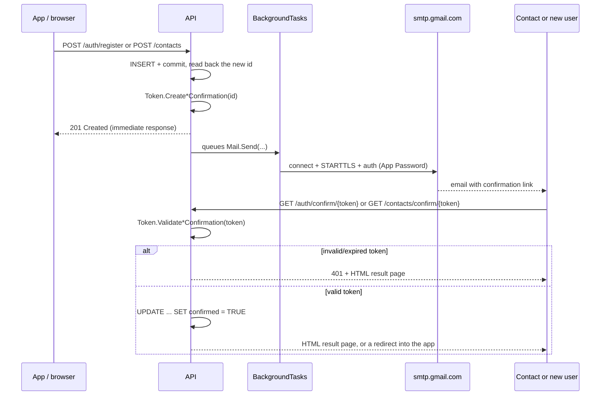
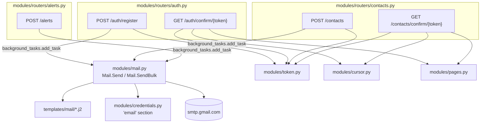

# `modules/mail.py`

## Purpose

This module isolates everything related to sending emails behind a `Mail` class, following the same static "verb class" pattern as `Guard` (`guard.md`) and `Token` (`token.md`):

```python
class Mail:
    @staticmethod
    async def Send(recipient: str, subject: str, template: str, context: dict) -> None:
        ...
```

`Mail.Send` receives the recipient, the subject, the **name** of a template (without extension) and a context dictionary, and takes care of three things: rendering the template in HTML and plain text with Jinja2, assembling the MIME message with both versions, and sending it over SMTP with `aiosmtplib`. `Mail.SendBulk` solves the same problem for when the same type of email needs to go out to several recipients at once, as happens when a panic alert is triggered.

## Why it's the backend's only `async` piece

Everything else in the project (`cursor.py`, the routers) is synchronous code — `mariadb` has no async driver and it wasn't worth introducing one just for that. `aiosmtplib`, on the other hand, *is* an asynchronous library (that's its whole point: not blocking `uvicorn`'s event loop while waiting for an SMTP server's response, which can take longer than a query against the local database). That's why `Mail.Send` is the only `async` function in the business logic.

This doesn't force the endpoints that use it to be `async def`: FastAPI can accept both synchronous functions and coroutines in `BackgroundTasks.add_task`, and runs them correctly either way. Every router that queues an email stays a plain `def`.

## Why `BackgroundTasks` instead of a direct `await` in the endpoint

```python
background_tasks.add_task(Mail.Send, data.email, subject, "contact_confirmation", context)
return {"Skellent": "Success!"}
```

If an endpoint did `await Mail.Send(...)` before responding, the client would have to wait for the email to finish sending (SMTP connection, TLS, authentication, server response) before getting its `201`. That could take noticeably longer than the operation the caller actually cares about (saving a contact, registering an account), and it would mean a transient Gmail problem directly degrades an unrelated action. `BackgroundTasks` makes Starlette run `Mail.Send` **after** the response has already been sent: the `201` arrives as fast as ever, and the email is sent in parallel.

The tradeoff, and it's important to keep in mind: if the send fails, the client never finds out (it already got its success response before the send attempt even started). Today that failure only shows up in the process log — there's no automatic retry or a "pending/failed emails" audit table. It's a known and acceptable limitation for the project's current volume, but if it grew to need delivery guarantees, the next step would be a real task queue (Celery, RQ) instead of `BackgroundTasks`, which is deliberately the simplest option FastAPI offers.

## Why Jinja2 instead of f-strings for the email body

```python
_jinja_env: Environment = Environment(
    loader=FileSystemLoader(Path(__file__).resolve().parent.parent / "templates" / "mail"),
    autoescape=select_autoescape(["html", "xml"]),
)
```

Templates live as separate files in `backend/templates/mail/`, not as strings assembled by hand inside `mail.py` — the same rationale as keeping SQL separate in `Queries` (see `cursor.md`): content shown to a person shouldn't be mixed in with the logic that sends it.

`autoescape=select_autoescape(["html", "xml"])` **is not optional**: values interpolated into a template (a contact's or user's name) ultimately come from fields someone typed in while registering or adding a contact (see `types.py`). Without autoescape, someone could set their `name` to something like `<script>...</script>`, and that HTML would end up executing in the recipient's mail client. With autoescape on, Jinja2 automatically escapes any special HTML character before inserting it — the same class of defense the project uses at the other end (`%s` parameters in SQL, see `cursor.md`), applied here to HTML instead of SQL.

## Why plain text *and* HTML, not just HTML

```python
message.set_content(text_body)
message.add_alternative(html_body, subtype="html")
```

This builds a `multipart/alternative` message: the recipient's mail client picks which of the two versions to show (most render the HTML if they can, and fall back to plain text if not). Sending both versions improves deliverability (some spam filters penalize HTML-only emails for looking more like marketing) and guarantees the message is still readable on a client that doesn't render HTML.

## Why `MailNotSentError` instead of letting `aiosmtplib`'s exceptions propagate

```python
class MailNotSentError(Exception):
    pass
```

Same rationale as `DuplicateRecordError` in `cursor.py`: `mail.py` is, on purpose, the only backend file that imports `aiosmtplib` directly. Any code that in the future wants to react to a send failure can catch `MailNotSentError` without needing to know the transport is SMTP or that the library used is `aiosmtplib` — if the project ever migrated to a different provider or protocol, only this file would change.

## `Mail.SendBulk`: when an email has to reach several contacts at once

```python
@staticmethod
async def SendBulk(subject: str, template: str, recipients: list[tuple[str, dict]]) -> None:
    failed: list[str] = []
    async with aiosmtplib.SMTP(
        hostname=_credentials['host'], port=_credentials['port'], start_tls=True,
        username=_credentials['user'], password=_credentials['password'],
    ) as smtp:
        for recipient, context in recipients:
            try:
                message: EmailMessage = _build_message(recipient, subject, template, context)
                await smtp.send_message(message)
            except Exception as e:
                _logger.error(f"Could not send '{template}' email to {recipient}: {e}")
                failed.append(recipient)

    _logger.info(f"Sent '{template}' bulk email to {len(recipients) - len(failed)}/{len(recipients)} recipients")
    if failed:
        raise MailNotSentError(f"Could not notify: {', '.join(failed)}")
```

`Mail.Send` opens a connection, sends one message and closes it — fine for an isolated send, but wasteful (TCP handshake, STARTTLS, authentication) when repeated several times in a row for the same batch, as `POST /alerts` needs when a user has more than one confirmed contact. `SendBulk` opens the connection once and reuses it for every message in the batch, closing it automatically when the `async with` block exits.

- **Why it takes `list[tuple[str, dict]]`, not `list[str]` plus a single `dict`**: each recipient of an alert needs their own template context (`contact_name` changes depending on who's being written to, even though `user_name`/`latitude`/`longitude` are the same for everyone). A list of `(recipient, context)` pairs lets each message render with the data that belongs to that specific person.
- **Why the `except` catches generic `Exception`, not `aiosmtplib.SMTPException`**: the goal is that a problem with **one** contact doesn't stop the rest from receiving the alert. Catching only `SMTPException` isn't enough for that guarantee — any unexpected exception while building or sending a specific message could cut the loop short and leave contacts whose turn hadn't come up yet without a notification. The `try`/`except` wraps both `_build_message` and `smtp.send_message` and catches broadly, because in a panic-alert system the priority is that one isolated failure never takes down the rest of the batch.
- **Why it collects failures and raises a single error at the end**: `failed` accumulates which addresses couldn't receive the message, and only at the end — if the list isn't empty — does it raise one `MailNotSentError` listing all of them, preserving the same visibility as any other `Mail` failure without raising and swallowing one exception per recipient mid-loop.

Both `Mail.Send` and `Mail.SendBulk` log an `ERROR` (see `logs.md`) *before* raising `MailNotSentError`, and `Mail.Send` logs an `INFO` on success — `SendBulk` logs a single summary line instead (`Sent 'panic_alert' bulk email to 2/3 recipients`), since one line per successful recipient in a batch would be noise the failure count above it already conveys. This closes a gap the project used to have: since `Mail.Send`/`SendBulk` are always invoked through `BackgroundTasks` (above), the `201` response has already gone out by the time a send fails — the exception has no one left to propagate to, and used to simply vanish. For most endpoints that's an acceptable tradeoff (a confirmation email can be re-triggered); for `POST /alerts` specifically, a contact silently not being notified during an actual emergency is a failure worth having a permanent record of, which is exactly what this log line now is (searchable in `backend/logs/panicswitch.log`, see `logs.md`) — still not a retry or an alert to a human, but no longer invisible either.

## Authentication with Gmail/Google Workspace: App Password

```python
await aiosmtplib.send(
    message,
    hostname=_credentials['host'],   # smtp.gmail.com
    port=_credentials['port'],       # 587
    start_tls=True,
    username=_credentials['user'],
    password=_credentials['password'],
)
```

- **`start_tls=True`**: the message always sends encrypted. Port `587` is the standard for STARTTLS, as opposed to `465`, which would be implicit TLS from the start of the connection.
- **App password, not the account's real password**: Google no longer accepts SMTP authentication with a "normal" username+password on Workspace accounts — a specific *App Password* (a 16-character string, generated at `myaccount.google.com/apppasswords`) has to be used as `SMTP_PASSWORD`. This requires two client-side preconditions outside this code's control: 2-Step Verification enabled on the sending account, and the Workspace administrator having allowed app passwords to be created (some organizations disable this by policy, in which case the alternative is the OAuth2 variant on the `feature/correo-oauth2` branch, which solves this same module with a Service Account + domain-wide delegation instead).
- **Google Workspace sending limits**: an account can send up to 10,000 unique recipients and 10,000 messages within 24 hours using `smtp.gmail.com` directly — well above this project's current volume.

## Environment variables introduced by this module

```env
SMTP_USER=soporte@keylogics.com
SMTP_PASSWORD='16-character app password'
SMTP_HOST=smtp.gmail.com   # default value if not defined
SMTP_PORT=587              # default value if not defined
API_BASE_URL=http://127.0.0.1:8000   # or the real domain in production, see NGINX.md
```

`API_BASE_URL` isn't an email credential (see `credentials.md`), but it's needed here because every confirmation email builds an absolute link the recipient can click, and the API — running behind nginx (see root `NGINX.md`) — has no way of knowing its own public domain from the inside.

## The two confirmation flows this module powers

Two different things get confirmed by email, and both follow the same shape: create something in an unconfirmed state, email a link, flip a flag when the link is clicked.



- The success response from `POST /auth/register`/`POST /contacts` never waits on the email — it arrives as soon as the row is committed (see the `BackgroundTasks` section above).
- Both `GET .../confirm/{token}` endpoints are public — see `routers.md` for why neither requires `Depends(current_user)`. The token traveling in the URL is never the session JWT; it's a purpose-built one with its own `"type"` claim (`token.md`), so a leaked session token and a leaked confirmation link can't be swapped for each other.
- Whoever clicks the link is a person looking at a browser tab, not an API client parsing JSON, so both endpoints respond with rendered HTML (`modules/pages.py`, see `pages.md`) instead of the `{"message": ...}` shape the rest of the API returns.
- The two flows diverge after the flag flips: confirming a contact renders a result page and stops there (see `pages.md`); confirming a user redirects straight into the app instead (see `routers.md`, `GET /auth/confirm/{token}`) — a contact has nothing further to do, but a newly confirmed user still needs to go log in.

## Module diagram



## Visual identity of the HTML templates

`contact_confirmation.html.j2`, `user_confirmation.html.j2` and `panic_alert.html.j2` are built as table-based layouts (a single-column `<table>` wrapping the whole card, buttons built with a one-cell `<table>` around the `<a>`) instead of `<div>`/flexbox, because that's still the layout method the widest range of email clients (Outlook desktop in particular) renders consistently — CSS Grid/Flexbox support in email clients is inconsistent enough that it isn't worth the risk. All three, plus the web pages in `templates/web/` (see `pages.md`), share one palette derived from the app's real icon color:

| Color | Hex | Used for |
|---|---|---|
| Primary | `#EA2052` | Header band, call-to-action buttons, links |
| Dark text-on-tint | `#690E25` | Small readable text inside the light-tint callout box |
| Light tint | `#FCE4EA` | The details callout box background in `panic_alert.html.j2` |
| Light-medium tint | `#F7A6BA` | The callout box border in `panic_alert.html.j2` |
| Near-white / gray | `#f4f4f5`, `#fafafa`, `#3f3f46`, `#a1a1aa` | Page background, footer, body text |

The brand mark is the words "PANIC SWITCH," set in bold uppercase in the header band — there's no image logo embedded in the mail templates (email clients frequently block remote images by default, so text is the more reliable mark here); the app itself uses the real icon image where an embedded image is reliable (see `docs/app/architecture.md`).

Every HTML template includes a hidden preheader (`display:none` div with a one-line summary) so the snippet shown in an inbox list (Gmail, Outlook) is meaningful instead of showing the first stray words of the HTML. Confirmation buttons are real markup (a table-wrapped `<a>`), not just a plain link, but the raw URL is still printed below in small gray text — some email clients strip inline styles or block images, so a link that still works even if the button doesn't render is kept as a fallback, not a decorative afterthought.

## Relationship with the rest of the backend

`auth.py` and `contacts.py` both use `Mail.Send` (one recipient at a time) for their respective confirmation emails; `alerts.py` uses `Mail.SendBulk` (one to many) to notify a user's confirmed contacts. `mail.py` depends on `modules/credentials.py` for the SMTP credentials, and on `modules/cursor.py` only indirectly, through the routers that call it — `mail.py` never touches the database directly. `modules/token.py` is used by `auth.py` and `contacts.py` for their respective confirmation tokens — `alerts.py` neither issues nor validates any token of its own.
