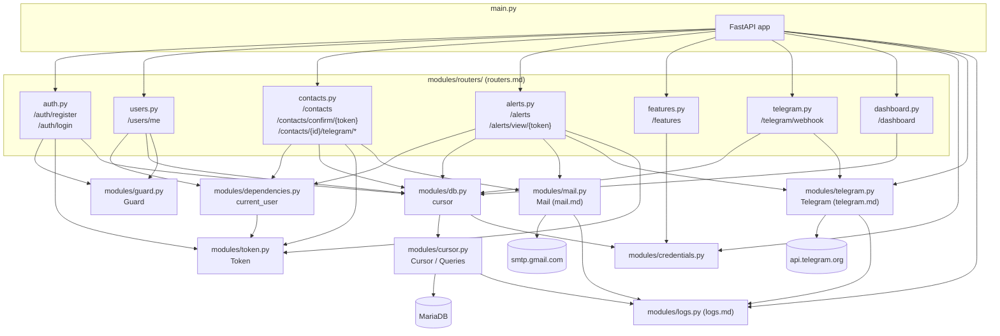

# `main.py`

## Purpose

It's the API's entry point: this is where the FastAPI application is instantiated and the rest of the functionality gets mounted. It's the module `uvicorn` loads when running `uvicorn main:app` (see README, "Prepare the Environment" section).

```python
from contextlib import asynccontextmanager

from modules.credentials import get_credentials
from modules.logs        import get_logger
from modules.routers     import auth, users, contacts, alerts, features, telegram as telegram_router, dashboard
from modules.telegram    import Telegram

from fastapi                  import FastAPI
from fastapi.middleware.cors  import CORSMiddleware
from fastapi.responses        import RedirectResponse


_docs_enabled: bool = get_credentials()['app_mode'] != "Deploy"
_credentials: dict = get_credentials()
_logger = get_logger(__name__)


@asynccontextmanager
async def _lifespan(app: FastAPI):
    _logger.info(f"Starting Panic Switch API (app_mode={_credentials['app_mode']})")
    if _credentials['telegram']['bot_token']:
        try:
            webhook_url: str = f"{_credentials['api_base_url']}/telegram/webhook"
            await Telegram.SetWebhook(webhook_url)
            _logger.info(f"Telegram webhook registered at {webhook_url}")
        except Exception as e:
            _logger.error(f"Could not register Telegram webhook: {e}")
    yield


app = FastAPI(
    docs_url=("/docs" if _docs_enabled else None),
    redoc_url=("/redoc" if _docs_enabled else None),
    openapi_url=("/openapi.json" if _docs_enabled else None),
    lifespan=_lifespan,
)

app.add_middleware(
    CORSMiddleware,
    allow_origins=["capacitor://localhost", "http://localhost", "https://localhost"],
    allow_methods=["*"],
    allow_headers=["*"],
)

@app.get("/")
def root():
    return RedirectResponse(url="/dashboard", status_code=302)


app.include_router(auth.router)
app.include_router(users.router)
app.include_router(contacts.router)
app.include_router(alerts.router)
app.include_router(features.router)
app.include_router(telegram_router.router)
app.include_router(dashboard.router)
```

There used to be a single business endpoint (`registrar_usuario`) written directly here, and `main.py` also used to be responsible for reading credentials and opening the MariaDB connection. With login, editing users, and the contacts CRUD arriving, that file would have grown without limit and mixed together things that have nothing to do with each other (registration, authentication, contacts) in one place. That's why this file was deliberately emptied out: `main.py` creates the app (deciding whether its automatic docs are exposed, and registering the Telegram webhook on startup — see below), configures CORS, tells it which routers exist, and mounts them — all the business logic lives in `modules/routers/` (see `routers.md`).

## Startup: logging, then registering the Telegram webhook

```python
@asynccontextmanager
async def _lifespan(app: FastAPI):
    _logger.info(f"Starting Panic Switch API (app_mode={_credentials['app_mode']})")
    if _credentials['telegram']['bot_token']:
        try:
            webhook_url: str = f"{_credentials['api_base_url']}/telegram/webhook"
            await Telegram.SetWebhook(webhook_url)
            _logger.info(f"Telegram webhook registered at {webhook_url}")
        except Exception as e:
            _logger.error(f"Could not register Telegram webhook: {e}")
    yield
```

FastAPI's `lifespan` parameter replaces the older `@app.on_event("startup")` decorator with an async context manager: code before `yield` runs once when the process starts, code after `yield` (there is none here) would run on shutdown. Beyond the one-line "the process is up" log, the only thing `main.py` does here is tell Telegram where to deliver updates by calling `Telegram.SetWebhook` (see `telegram.md`) once, at boot, instead of requiring a manual step after every deploy. It's guarded on `bot_token` being set at all (a `Debug` environment with no bot configured just skips this silently) and wrapped in `try`/`except` (a Telegram API hiccup at boot shouldn't crash the entire backend over one optional integration) — the same fail-soft posture the rest of this feature takes, in contrast to the fail-fast `sys.exit(1)` `modules/cursor.py` uses when the database itself is unreachable (see `cursor.md`): losing the database means nothing works, losing Telegram at boot means one notification channel is temporarily unregistered. `SetWebhook` itself now raises on a Telegram-side rejection rather than returning a `bool` no one checked — see `telegram.md` for that fix, which is what makes the `except` branch here actually fire when registration fails instead of only on a network-level error.

## `modules/logs.py`: imported before everything else

`from modules.logs import get_logger` is the second import in this file, right after `modules.credentials` and before any router. This isn't incidental ordering: `modules/logs.py` calls `logging.basicConfig(...)` at module level, and that call only takes effect the *first* time it runs in the process — see `logs.md` for why. Every router, `modules/cursor.py` and `modules/mail.py` all log something of their own, so `main.py` has to be the one to settle the console/file handler configuration before importing any of them, otherwise whichever module happened to touch `logging` first (however indirectly) would decide it instead.

## `APP_MODE` and FastAPI's automatic docs

```python
_docs_enabled: bool = get_credentials()['app_mode'] != "Deploy"

app = FastAPI(
    docs_url=("/docs" if _docs_enabled else None),
    redoc_url=("/redoc" if _docs_enabled else None),
    openapi_url=("/openapi.json" if _docs_enabled else None),
)
```

By default, FastAPI exposes three routes that describe the API itself: `/docs` (Swagger UI), `/redoc` (ReDoc) and `/openapi.json` (the raw OpenAPI schema the other two are built from). That's convenient in development — it's how `/docs` has been used throughout this documentation to describe request/response shapes — but it also means anyone who can reach the API can enumerate every endpoint, every field each one expects, and every response shape, without needing a token. That's more surface than a production deployment should hand out for free.

`FastAPI(...)` accepts `docs_url`, `redoc_url` and `openapi_url` as constructor arguments; passing `None` to any of them disables that specific route entirely (not just hides it from a menu — it stops being registered, so hitting it returns `404`). `_docs_enabled` reads `app_mode` (see `credentials.md`) once, at module level, and the three arguments are computed off of it: when `app_mode` is `"Deploy"`, all three become `None` and the docs disappear; for `"Debug"` (or any other value, including `APP_MODE` not being set at all) they keep their usual paths. Defaulting to enabled means a `.env` that doesn't mention `APP_MODE` — like any existing development setup from before this feature — keeps behaving exactly as it did before; a deployment has to opt in to hiding the docs by setting `APP_MODE=Deploy` explicitly, rather than accidentally shipping them hidden (or accidentally shipping them exposed) by omission.

This check happens once, when the module loads and `app` is constructed — not on every request — since FastAPI needs to know at construction time whether to register those routes at all.

## CORS: why the API needs to know about origins at all

```python
app.add_middleware(
    CORSMiddleware,
    allow_origins=["capacitor://localhost", "http://localhost", "https://localhost"],
    allow_methods=["*"],
    allow_headers=["*"],
)
```

Every client that existed before the `app/` Capacitor app (`curl`, `requests`, the automatic docs) talks to this API from *outside* any browser engine, so none of them were ever subject to CORS — that's a restriction browsers (and browser-based WebViews) enforce, not something servers hit on their own. The mobile app changes that: it's a web page (`app/www/`, see the app's own docs) running inside Capacitor's WebView, and `fetch()` calls from that page to this API are cross-origin as far as the WebView's engine is concerned, even though both "sides" are pieces of the same project. Without `CORSMiddleware`, the WebView's engine would block every response from reaching the app's JavaScript, regardless of whether the request itself reached the server and succeeded.

`allow_origins` lists Capacitor's own fixed WebView origins instead of `["*"]`: `capacitor://localhost` for iOS, `https://localhost` for Android's default `androidScheme`, and `http://localhost` as a fallback for testing the same `www/` folder in a desktop browser during development. These don't change per install or per device — every copy of the app, on every phone, presents one of these same three origins — so there's no reason to open this up to arbitrary origins just to cover a set that's actually fixed and known in advance.

## Module diagram



This diagram is, at bottom, the module dependency map the backend currently has. It's useful to keep in mind because it shows at a glance why `main.py` imports what it imports and nothing more: it doesn't need to know anything about `mariadb`, JWT, bcrypt, SMTP, or the Telegram Bot API directly — it only needs to know about the seven routers, mount them, read `app_mode` from `modules/credentials.py` to decide whether to expose its own docs, configure logging once via `modules/logs.py`, and call `Telegram.SetWebhook` once at startup.

## Module-level initialization

```python
_docs_enabled: bool = get_credentials()['app_mode'] != "Deploy"

app = FastAPI(
    docs_url=("/docs" if _docs_enabled else None),
    redoc_url=("/redoc" if _docs_enabled else None),
    openapi_url=("/openapi.json" if _docs_enabled else None),
)
```

This is all `main.py` initializes on its own: the `app_mode`-driven docs toggle described above, and the `FastAPI` instance itself. The MariaDB connection (previously created here, see this document's git history if you need to compare) now opens in `modules/db.py` (see `db.md`) the first time some router imports it. The underlying behavior is identical to before — it's still **a single connection**, shared, opened when the process starts, not one per request — only the file it lives in changed, so routers can import it without depending on `main.py` (which would have created a circular import: `main` imports the routers, and the routers would need to import back from `main` to get the cursor).

## `GET /`

```python
@app.get("/")
def root():
    return RedirectResponse(url="/dashboard", status_code=302)
```

It's the API's root route. It used to return a plain `{"Skellent": "You shouldn't be here, boy!"}` — an informal health-check string that also made casual exploration a bit harder for someone landing on the root without knowing what they were looking at. Now that `GET /dashboard` (see `routers.md`) exists and is itself a reasonable thing for a person to land on, the root simply redirects there instead: visiting the API's base URL in a browser now shows something useful (a login form) rather than a bare JSON string. It's still the only route that stays living directly in `main.py`, for the same reason as before: it doesn't belong to any business resource (it's not "users," it's not "contacts," and it isn't really "dashboard" either — it's a redirect *to* it), so there's no reason to move it into a router.

## `app.include_router(...)`

```python
app.include_router(auth.router)
app.include_router(users.router)
app.include_router(contacts.router)
app.include_router(alerts.router)
app.include_router(features.router)
app.include_router(telegram_router.router)
app.include_router(dashboard.router)
```

Each module inside `modules/routers/` defines its own `APIRouter` with a prefix (`/auth`, `/users`, `/contacts`, `/alerts`, `/features`, `/telegram`, `/dashboard`) and its own endpoints (see `routers.md` for the detail of each one). `include_router` is the mechanism FastAPI offers to "attach" those routes, already defined in another file, to the main application, as if they had been declared directly on `app`. `routers/telegram.py`, `routers/features.py` and `routers/dashboard.py` are the most recent examples of why this matters: an entire new resource gets added by adding a file and a single line here, without touching anything that already existed.

## What's still missing (for now)

Logging alerts (`POST /alerts`, see `routers.md`) already exists and already notifies a user's confirmed emergency contacts by email **and now Telegram** (see `mail.md`, `telegram.md`, `sql.md`). What's still pending is a third channel — SMS via Twilio's API or an equivalent — for contacts who don't have an `email` on file and haven't linked Telegram either (see `types.md`).
