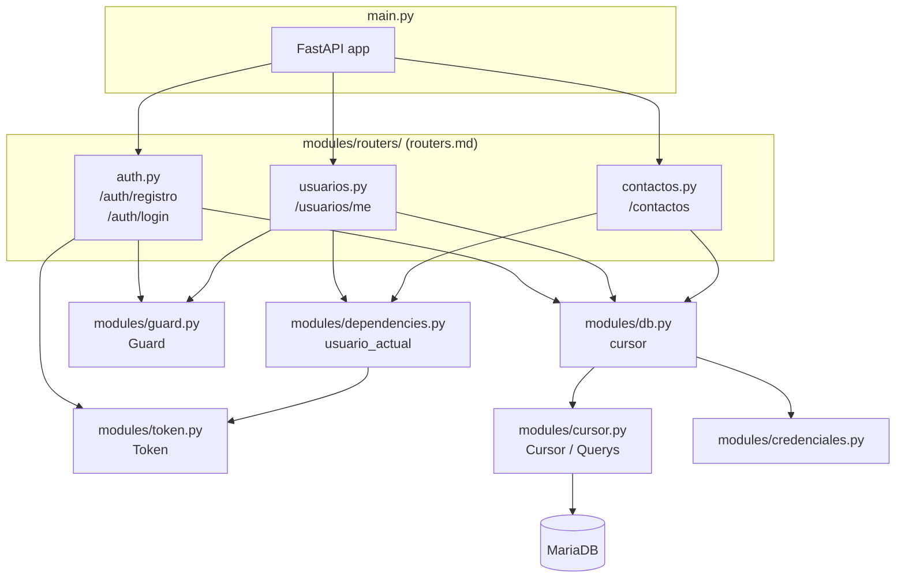

# `main.py`

## Propósito

Es el punto de entrada de la API: aquí se instancia la aplicación FastAPI y se monta el resto de la funcionalidad. Es el módulo que `uvicorn` carga al ejecutar `uvicorn main:app` (ver README, sección "Preparar el Entorno").

```python
from modules.routers import auth, usuarios, contactos

from fastapi          import FastAPI


app = FastAPI()

@app.get("/")
def root():
    return {"Skellent": "You shouldn't be here, boy!" }


app.include_router(auth.router)
app.include_router(usuarios.router)
app.include_router(contactos.router)
```

Antes había un solo endpoint de negocio (`registrar_usuario`) escrito directamente aquí, y `main.py` también era responsable de leer las credenciales y abrir la conexión a MariaDB. Con la llegada del login, la edición de usuarios y el CRUD de contactos, ese archivo hubiera crecido sin límite y hubiera mezclado en un mismo lugar cosas que no tienen que ver entre sí (registro, autenticación, contactos). Por eso este archivo se vació a propósito: ahora `main.py` solo hace dos cosas — crear la app y decirle qué routers existen — y toda la lógica de negocio vive en `modules/routers/` (ver `routers.md`).

## Diagrama de módulos



Este diagrama es, en el fondo, el mapa de dependencias entre módulos que hoy tiene el backend. Es útil tenerlo en la cabeza porque explica de un vistazo por qué `main.py` importa lo que importa y nada más: no necesita saber nada de `mariadb`, de JWT ni de bcrypt, solo necesita conocer los tres routers y montarlos.

## Inicialización a nivel de módulo

```python
app = FastAPI()
```

Esto es todo lo que `main.py` inicializa por sí mismo. La conexión a MariaDB (antes creada aquí, ver el historial de este documento en git si hace falta comparar) ahora se abre en `modules/db.py` (ver `db.md`) la primera vez que algún router lo importa. El comportamiento de fondo es idéntico al de antes — sigue siendo **una única conexión** compartida, abierta al arrancar el proceso, no una por request — solo cambió el archivo donde vive ese código, para que los routers puedan importarla sin depender de `main.py` (lo que hubiera generado un import circular: `main` importa a los routers, y los routers necesitarían importar de vuelta a `main` para obtener el cursor).

## `GET /`

```python
@app.get("/")
def root():
    return {"Skellent": "You shouldn't be here, boy!" }
```

Es la ruta raíz de la API. No cumple una función de negocio: sirve como comprobación rápida de que el servidor está arriba y respondiendo (un endpoint de vida/"health check" informal), y de paso dificulta un poco la exploración casual de la API por parte de alguien que llegue a la raíz sin saber qué está mirando. Es la única ruta que se queda a vivir directamente en `main.py`: no pertenece a ningún recurso de negocio (no es "usuarios", no es "contactos"), así que no tiene sentido moverla a un router.

## `app.include_router(...)`

```python
app.include_router(auth.router)
app.include_router(usuarios.router)
app.include_router(contactos.router)
```

Cada módulo dentro de `modules/routers/` define su propio `APIRouter` con un prefijo (`/auth`, `/usuarios`, `/contactos`) y sus propios endpoints (ver `routers.md` para el detalle de cada uno). `include_router` es el mecanismo que ofrece FastAPI para "pegar" esas rutas, ya definidas en otro archivo, a la aplicación principal, como si hubieran sido declaradas directamente sobre `app`. Esto es lo que permite que el proyecto escale a más funcionalidad (alertas, en el futuro) sin que `main.py` vuelva a crecer: solo haría falta un archivo `routers/alertas.py` nuevo y una línea más aquí.

## Qué falta (por ahora)

El registro de alertas (activar el botón de pánico en sí) todavía no tiene endpoint ni router propio, aunque la tabla `alertas` ya existe en el esquema (ver `sql.md`). Tampoco hay todavía integración con ninguna API de terceros (Twilio u otra) para notificar a los contactos de emergencia cuando eso ocurra — ese es, en el fondo, el propósito final de la aplicación, y las piezas construidas hasta ahora (usuarios, login, contactos) son la base sobre la que ese flujo se va a apoyar.
