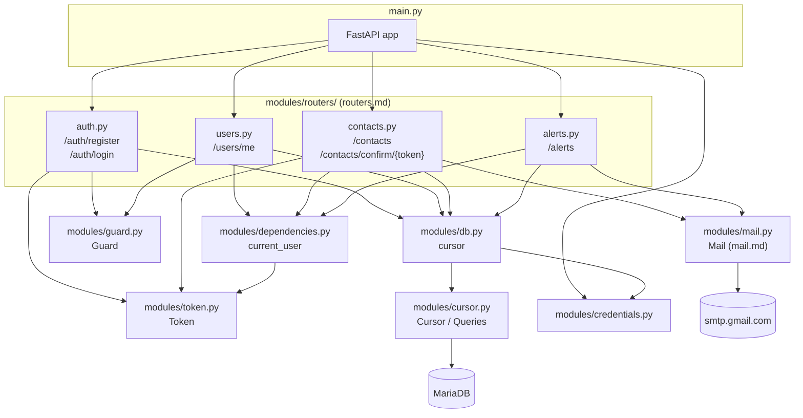

# `main.py`

## Purpose

It's the API's entry point: this is where the FastAPI application is instantiated and the rest of the functionality gets mounted. It's the module `uvicorn` loads when running `uvicorn main:app` (see README, "Prepare the Environment" section).

```python
from modules.credentials import get_credentials
from modules.routers     import auth, users, contacts, alerts

from fastapi              import FastAPI


_docs_enabled: bool = get_credentials()['app_mode'] != "Deploy"

app = FastAPI(
    docs_url=("/docs" if _docs_enabled else None),
    redoc_url=("/redoc" if _docs_enabled else None),
    openapi_url=("/openapi.json" if _docs_enabled else None),
)

@app.get("/")
def root():
    return {"Skellent": "You shouldn't be here, boy!" }


app.include_router(auth.router)
app.include_router(users.router)
app.include_router(contacts.router)
app.include_router(alerts.router)
```

There used to be a single business endpoint (`registrar_usuario`) written directly here, and `main.py` also used to be responsible for reading credentials and opening the MariaDB connection. With login, editing users, and the contacts CRUD arriving, that file would have grown without limit and mixed together things that have nothing to do with each other (registration, authentication, contacts) in one place. That's why this file was deliberately emptied out: now `main.py` only does three things — create the app (deciding whether its automatic docs are exposed), tell it which routers exist, and mount them — and all the business logic lives in `modules/routers/` (see `routers.md`).

## `APP_MODE` and FastAPI's automatic docs

```python
_docs_enabled: bool = get_credentials()['app_mode'] != "Deploy"

app = FastAPI(
    docs_url=("/docs" if _docs_enabled else None),
    redoc_url=("/redoc" if _docs_enabled else None),
    openapi_url=("/openapi.json" if _docs_enabled else None),
)
```

By default, FastAPI exposes three routes that describe the API itself: `/docs` (Swagger UI), `/redoc` (ReDoc) and `/openapi.json` (the raw OpenAPI schema the other two are built from). That's convenient in development — it's how `/docs` has been used throughout this documentation to describe request/response shapes — but it also means anyone who can reach the API can enumerate every endpoint, every field each one expects, and every response shape, without needing a token. That's more surface than a production deployment should hand out for free.

`FastAPI(...)` accepts `docs_url`, `redoc_url` and `openapi_url` as constructor arguments; passing `None` to any of them disables that specific route entirely (not just hides it from a menu — it stops being registered, so hitting it returns `404`). `_docs_enabled` reads `app_mode` (see `credentials.md`) once, at module level, and the three arguments are computed off of it: when `app_mode` is `"Deploy"`, all three become `None` and the docs disappear; for `"Debug"` (or any other value, including `APP_MODE` not being set at all) they keep their usual paths. Defaulting to enabled means a `.env` that doesn't mention `APP_MODE` — like any existing development setup from before this feature — keeps behaving exactly as it did before; a deployment has to opt in to hiding the docs by setting `APP_MODE=Deploy` explicitly, rather than accidentally shipping them hidden (or accidentally shipping them exposed) by omission.

This check happens once, when the module loads and `app` is constructed — not on every request — since FastAPI needs to know at construction time whether to register those routes at all.

## Module diagram



This diagram is, at bottom, the module dependency map the backend currently has. It's useful to keep in mind because it shows at a glance why `main.py` imports what it imports and nothing more: it doesn't need to know anything about `mariadb`, JWT, bcrypt, or SMTP — it only needs to know about the four routers, mount them, and read `app_mode` from `modules/credentials.py` to decide whether to expose its own docs.

## Module-level initialization

```python
_docs_enabled: bool = get_credentials()['app_mode'] != "Deploy"

app = FastAPI(
    docs_url=("/docs" if _docs_enabled else None),
    redoc_url=("/redoc" if _docs_enabled else None),
    openapi_url=("/openapi.json" if _docs_enabled else None),
)
```

This is all `main.py` initializes on its own: the `app_mode`-driven docs toggle described above, and the `FastAPI` instance itself. The MariaDB connection (previously created here, see this document's git history if you need to compare) now opens in `modules/db.py` (see `db.md`) the first time some router imports it. The underlying behavior is identical to before — it's still **a single connection**, shared, opened when the process starts, not one per request — only the file it lives in changed, so routers can import it without depending on `main.py` (which would have created a circular import: `main` imports the routers, and the routers would need to import back from `main` to get the cursor).

## `GET /`

```python
@app.get("/")
def root():
    return {"Skellent": "You shouldn't be here, boy!" }
```

It's the API's root route. It serves no business purpose: it acts as a quick check that the server is up and responding (an informal health-check endpoint), and incidentally makes casual exploration of the API a bit harder for someone who lands on the root without knowing what they're looking at. It's the only route that stays living directly in `main.py`: it doesn't belong to any business resource (it's not "users," it's not "contacts"), so there's no reason to move it into a router.

## `app.include_router(...)`

```python
app.include_router(auth.router)
app.include_router(users.router)
app.include_router(contacts.router)
app.include_router(alerts.router)
```

Each module inside `modules/routers/` defines its own `APIRouter` with a prefix (`/auth`, `/users`, `/contacts`, `/alerts`) and its own endpoints (see `routers.md` for the detail of each one). `include_router` is the mechanism FastAPI offers to "attach" those routes, already defined in another file, to the main application, as if they had been declared directly on `app`. `routers/alerts.py` is the most recent example of why this matters: an entire new resource was added (triggering the panic button) by adding a file and a single line here, without touching anything that already existed.

## What's still missing (for now)

Logging alerts (`POST /alerts`, see `routers.md`) already exists and already notifies a user's **confirmed** emergency contacts by email (see `mail.md`, `sql.md`). What's still pending is notifying by SMS or another channel in addition to email — the integration with Twilio's API (or an equivalent) hasn't started yet, and it particularly matters for contacts who don't have an `email` on file (see `types.md`) and today have no way to confirm or be notified.
