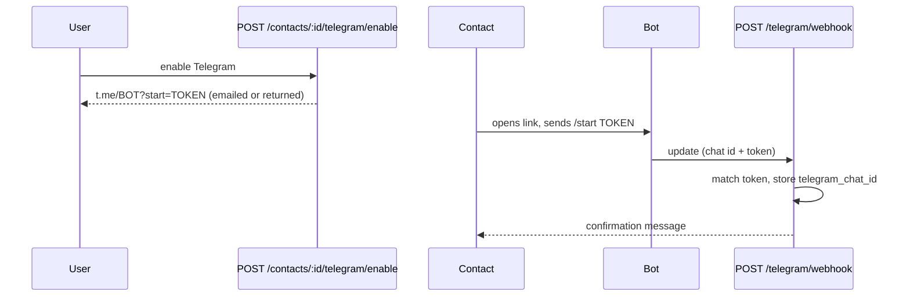

# Notifications — four channels

Four independent delivery channels for the same events (contact confirmation, panic alerts): **email** (`mail.py`), **Telegram** (`telegram.py`), **WhatsApp** (`whatsapp.py`) and **SMS** (`sms.py`). Each has the same `Send`/`SendBulk` shape and a dry-run switch; none knows about the others. `alerts.py` decides who is reached on which channel and calls each.

## Who gets notified

`SELECT_CONFIRMED_CONTACTS_BY_USER` returns a contact if **any** channel is active, then `alerts.py` re-checks each channel independently:

| Channel | Sent when | Address |
|---|---|---|
| Email | `email` set **and** `confirmed = TRUE` | contact email |
| Telegram | `telegram_chat_id` set | that chat |
| WhatsApp | `whatsapp_enabled` **and** `whatsapp_confirmed` | contact phone |
| SMS | `sms_enabled` | contact phone |

Each `(alert, contact, channel)` gets its own `alert_notifications` row with the contact's name and a no-expiry view-link token, so "did this contact, on this channel, open the map" is tracked per channel and shown on the dashboard.

## Fan-out

```mermaid
sequenceDiagram
    participant App
    participant Alerts as POST /alerts
    participant DB
    App->>Alerts: latitude, longitude + JWT
    Alerts->>DB: INSERT alert; SELECT confirmed contacts
    loop each contact × active channel
        Alerts->>DB: INSERT alert_notifications
    end
    Alerts-->>App: 201 with per-channel counts
    par background
        Alerts->>Alerts: email batch
    and
        Alerts->>Alerts: Telegram batch
    and
        Alerts->>Alerts: WhatsApp batch
    and
        Alerts->>Alerts: SMS batch
    end
```

The four batches are queued as separate background tasks and each channel's failure is caught, not raised — `BackgroundTasks` stops at the first exception, so a broken mailbox must never stop the Telegram/WhatsApp/SMS batches queued after it. During a real alert, one dead channel can't silence the others.

## Email

SMTP over `aiosmtplib`, Jinja templates under `templates/mail/*.{html,txt}.j2` (both rendered). `Send` opens one connection per email; `SendBulk` reuses a single connection for the whole batch. When `SMTP_ENABLED=false`, both log what they *would* send and return without connecting (dry-run for local dev).

**Deliverability check.** Before any address is accepted — register, a contact's email, an email change — its domain is checked for a mail server (MX/A). A typo like `gmial.com` is rejected with `422`, so no record is created whose confirmation could only ever bounce. Toggle with `SMTP_VERIFY_DELIVERABILITY`.

**Contact confirmation (email).** Adding a contact with an email queues a confirmation link; clicking it sets `confirmed`. Editing the email starts the flow over (unconfirmed again, fresh link). `POST /contacts/{id}/confirm/resend` re-sends without an edit.

**Account-change notice.** Changing the account email or password emails the `security_alert` template to the address on file *before* the change, so a takeover can't happen silently.

## Telegram

HTTP to the Bot API (`httpx`), plain-text templates under `templates/telegram/`. Telegram's deep-link `start` parameter only allows `[A-Za-z0-9_-]`, so contact linking uses an opaque, database-backed token instead of a JWT.



**Webhook security & self-healing.** `POST /telegram/webhook` checks `X-Telegram-Bot-Api-Secret-Token` against `TELEGRAM_WEBHOOK_SECRET`. The webhook URL is **registered by the backend** at startup (`EnsureWebhook`: set + verify via `getWebhookInfo`, with retries) and re-asserted by a background keeper if it drifts. Every hit and every ignore/failure reason is logged, so a mis-registered webhook is visible rather than silent (see [operations.md](operations.md)).

## WhatsApp

Twilio Messages API (`httpx`). Because a panic alert is business-initiated and usually outside WhatsApp's 24 h free-form window, alerts are sent through an **approved template** when `TWILIO_WHATSAPP_TEMPLATE_SID` is set (free-form body otherwise, for sandbox). Full setup in [twilio.md](twilio.md).

**Opt-in.** Enabling WhatsApp on a contact sets `whatsapp_enabled` and returns a `wa.me` link. When the contact messages the number, Twilio calls `POST /whatsapp/webhook` (verified by Twilio signature), which matches them by phone and sets `whatsapp_confirmed`. Both flags must be true to be notified. Unlike Telegram, this webhook is **configured manually** in Twilio — it is not auto-registered.

## SMS

Twilio Messages API, one short text template (`templates/sms/panic_alert.txt.j2`). No opt-in, no template, no 24 h window — SMS is a per-contact toggle (`sms_enabled`): enable it, and confirmed contacts get a text on the next alert. Caveats (A2P 10DLC, geo-permissions) are in [twilio.md](twilio.md).
