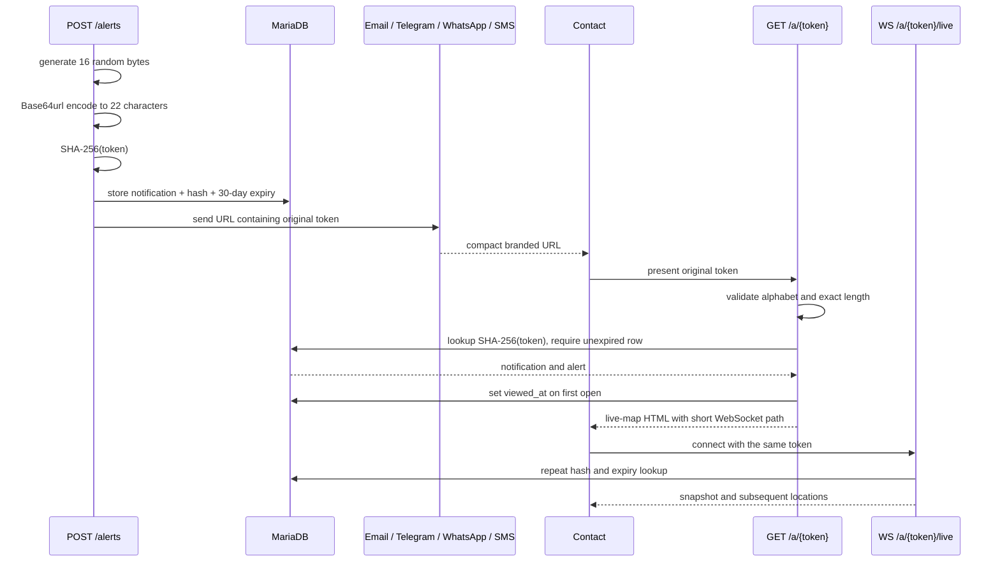

# Short alert URLs

Panic Button sends a private live-location link once per alert, contact, and delivery
channel. New notifications use a compact, database-backed capability URL:

```text
https://panicbutton.me/a/<22-character-token>
```

This is an application endpoint, not a third-party URL-shortening service and not a
redirect. It renders the existing live map directly and opens its same-origin WebSocket
at `/a/{token}/live`.

## Status

- [x] Fresh-install schema and upgrade migration
- [x] Short-token generation, hash lookup, expiry, HTTP route, and WebSocket route
- [x] Email, Telegram, WhatsApp, and SMS notification URLs
- [x] Backward compatibility for existing JWT view links
- [x] Focused Python tests, Python compilation, JavaScript syntax check, and app build
- [ ] Apply the migration to the authorized development database
- [ ] Run a real alert, browser, WebSocket, and notification-delivery test

Documentation describes the implemented branch. The unchecked live checks must be
completed before production deployment.

## Before and after

| Property | Before | After |
|---|---|---|
| Contact URL | `/alerts/view/{JWT}` | `/a/{opaque-token}` |
| Credential size | About 179 characters | 22 characters |
| Example full URL | About 219 characters | About 52 characters on `devs.panicbutton.me` |
| Credential contents | Notification id, type, expiry, signature | No embedded data; random bytes only |
| Validation | Verify JWT signature and claims | SHA-256 the supplied token and query MariaDB |
| Server-side storage | None | Hash and expiry on `alert_notifications` |
| Individual revocation | Not directly available | Delete/expire the notification token |
| Map request | Render live map | Render the same live map; no redirect hop |
| Existing links | JWT route | JWT route remains valid until its own expiry |

The owner link returned by `GET /alerts` remains a JWT. It is shown in the authenticated
dashboard, does not travel in SMS, and contains both alert and owner identity. Only the
per-channel contact URLs were changed.

## Lifecycle



## Token size

The implementation calls `secrets.token_urlsafe(16)`. The argument is **bytes**, so the
token has **128 bits** of randomness and encodes to 22 URL-safe characters without
padding.

| Random input | Entropy | URL-safe length | Assessment |
|---|---:|---:|---|
| 16 bytes | 128 bits | 22 characters | Current choice; impractical to guess |
| 24 bytes | 192 bits | 32 characters | More margin, but adds 10 URL characters |

The change was initially implemented with 24 bytes as a conservative choice matching
the existing Telegram-link token. Sixteen **bytes** are preferable for alert URLs:

- 128-bit brute-force resistance is already far beyond what an online attacker can
  search during the 30-day validity period.
- With one billion generated URLs, the birthday-bound collision probability is about
  `1.5 × 10^-21`.
- The database has a unique index as a final collision guard.
- Removing ten characters gives SMS more room for the user's name while remaining in
  one GSM-7 segment.

User count is therefore not the main security limit. Token entropy, validity time,
online request capacity, and accidental disclosure matter more.

## Data model and privacy

`alert_notifications` adds:

```sql
view_token_hash       BINARY(32)
view_token_expires_at DATETIME
```

SHA-256 always produces 32 bytes; this column size is independent of whether the input
token contains 16 or 24 random bytes. The raw token is never stored or logged. A database
copy by itself therefore does not immediately reveal working location URLs.

The lookup requires `view_token_expires_at > UTC_TIMESTAMP()`. Malformed tokens are
rejected before querying MariaDB. The page keeps `Cache-Control: no-store`, and its
referrer policy prevents the private path from being sent to the external map-tile host.

Do not replace the random token with an encoded notification id such as `/a/123`: ids
are enumerable and would expose other alerts. Do not use public shared shorteners such
as TinyURL or Bitly: they introduce another availability dependency and obscure the
Panic Button domain in an emergency message.

## SMS effect

The SMS template was shortened and its Unicode em dash was replaced with ASCII. The em
dash forced Twilio to encode every message as UCS-2, whose multipart segments carry far
fewer characters than GSM-7. With a representative user, timestamp, phone, and the new
URL, the template is about 141 ASCII characters and fits in one GSM-7 segment.

A user's name can still contain characters outside GSM-7, so production delivery logs
should be monitored for messages that legitimately require UCS-2.

## Deployment and rollback

Apply the migration before deploying the new backend:

```bash
mariadb -u <user> -p <database> \
  < backend/queries/migrations/2026-09-short-alert-urls.sql
```

The migration leaves the new columns nullable because historical notification rows do
not have short tokens. Fresh installations require both fields for all newly created
rows. The application continues validating historical `/alerts/view/{JWT}` URLs.

Rolling the application back after applying the additive migration is safe: the older
code ignores the two extra nullable columns. URLs created by the new version require the
new `/a/{token}` route, so do not roll back while newly sent alerts still need to open.

## Verification

Local checks:

```bash
cd backend
./.venv/bin/python -m unittest discover -s tests -v
./.venv/bin/python -m py_compile main.py modules/cursor.py modules/routers/alerts.py
node --check static/js/live_alert.js
```

Authorized integration checks:

1. Apply the migration to the development database and restart the backend.
2. Trigger one alert with dry-run channels first and confirm every rendered `map_url`
   uses `/a/` and has a 22-character token.
3. Confirm MariaDB stores a 32-byte hash, never the original token, plus a UTC expiry.
4. Open the URL and verify the map snapshot, `viewed_at`, and `no-store` response.
5. Publish another GPS point and verify it arrives through `/a/{token}/live`.
6. Try malformed, unknown, and manually expired tokens; expect rejection.
7. Send authorized real notifications through each configured channel and open them.
8. Recheck one historical JWT contact link and one owner dashboard link.
