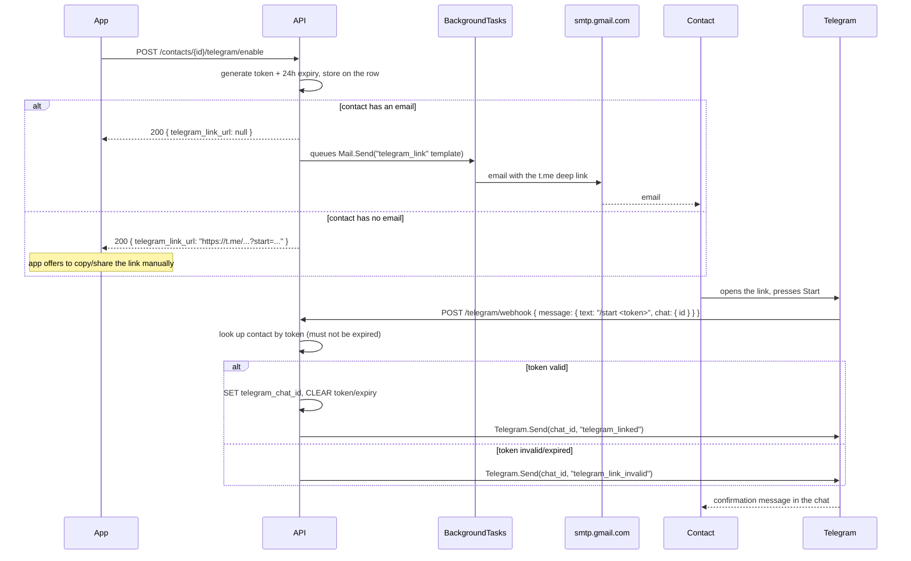

# `modules/telegram.py` and `modules/routers/telegram.py`

## Purpose

Lets a user's emergency contacts be notified over Telegram, in parallel to email, when a panic alert fires. Two files split the work:

- **`modules/telegram.py`**: the `Telegram` static class, following the same "verb class" pattern as `Mail` (`mail.md`) — `Telegram.Send`/`Telegram.SendBulk` render a Jinja2 template from `templates/telegram/` and call the Bot API over `httpx`. Also `Telegram.SetWebhook`, used once at startup.
- **`modules/routers/telegram.py`**: a single endpoint, `POST /telegram/webhook`, that receives updates pushed by Telegram itself (not by the app) whenever someone messages the bot.

## Why a contact links Telegram at all, instead of the app just asking for a `chat_id`

There's no way for the app (or the user adding the contact) to know a `chat_id` up front — it only exists once the contact themselves has started a conversation with the bot. Telegram's own mechanism for this is a **deep link**: a URL of the form `https://t.me/{bot_username}?start={payload}` that, when opened, launches Telegram, opens a chat with the bot, and — if the person presses **Start** — sends the bot an update containing `message.text = "/start {payload}"` and `message.chat.id` (the very `chat_id` this feature needs). The `payload` is how the bot tells *which* pending link just got redeemed.

## Why the link token is an opaque, DB-stored string, not a JWT

Every other confirmation flow in this project (`Token.CreateContactConfirmation`, `Token.CreateUserConfirmation`, see `token.md`) is a stateless JWT — no database row, just a signed, self-describing token with an expiry. That doesn't work here: Telegram restricts a deep link's `start` parameter to `^[A-Za-z0-9_-]{1,64}$`, and a JWT is `header.payload.signature` — the two `.` separators alone make it an invalid deep-link payload.

So `POST /contacts/{id}/telegram/enable` (see `routers.md`) generates `secrets.token_urlsafe(24)` instead — a random, URL-safe string with no dots — and stores it on the contact row itself (`telegram_link_token`, `telegram_link_expires_at`; see `sql.md`), rather than encoding it statelessly. This turns out to be an improvement over the JWT approach, not just a workaround: because the token is a real row, `POST /telegram/webhook` can (and does) clear it the moment it's redeemed, so it genuinely can't be reused — unlike the contact-confirmation JWT, which is stateless by design and, per `TASK.md`, has no "already used" record at all.

## Sequence



Later, `POST /alerts` (see `routers.md`) queues `Telegram.SendBulk` for every confirmed contact whose `telegram_chat_id` is set — independently of whether that same contact is also `confirmed` by email.

## The webhook: `POST /telegram/webhook`

```python
@router.post("/webhook")
async def telegram_webhook(request: Request, x_telegram_bot_api_secret_token: str | None = Header(default=None)):
    if _WEBHOOK_SECRET and x_telegram_bot_api_secret_token != _WEBHOOK_SECRET:
        raise HTTPException(status_code=401, detail="Invalid webhook secret")
    try:
        await _handle_update(await request.json())
    except Exception as e:
        _logger.exception(f"Error handling Telegram webhook: {e}")
    return {"ok": True}
```

Two things make this endpoint different from everything else in `modules/routers/`:

- **No `Depends(current_user)`, but not unauthenticated either.** The caller is Telegram's servers, not an app user — there's no session JWT to check. Instead, `Telegram.SetWebhook` (called once at startup, see below) registers a `secret_token` with Telegram, which echoes it back on the `X-Telegram-Bot-Api-Secret-Token` header of every subsequent call. Anyone who discovers this URL and posts to it without knowing that secret gets `401`ed before their payload is even parsed. If `TELEGRAM_WEBHOOK_SECRET` isn't set at all (no Telegram bot configured), the check is skipped rather than locking the endpoint open with a `None != None` comparison — acceptable since without a registered webhook, Telegram never calls this URL in the first place.
- **It always returns `200`**, even when `_handle_update` raises. Telegram retries a webhook call aggressively on anything but a 2xx response; since almost any failure here (a malformed update, a transient Telegram API error while replying) is either not the caller's fault or won't succeed on a bare retry, catching the exception and logging it (`_logger.exception`, which — unlike `_logger.error` — also records the full traceback, see `logs.md`) avoids a retry storm without hiding the failure completely.

`_handle_update` itself only cares about one shape: a `message` whose `text` starts with `"/start "`. Anything else (the bot being added to a group, a `/start` with no payload, an unrelated message) is a silent no-op — this webhook doesn't implement a general-purpose bot, only the one interaction this feature needs.

## Registering the webhook: `Telegram.SetWebhook` and `main.py`'s lifespan

```python
@asynccontextmanager
async def _lifespan(app: FastAPI):
    _logger.info(f"Starting Panic Button API (app_mode={_credentials['app_mode']})")
    if _credentials['telegram']['bot_token']:
        try:
            webhook_url: str = f"{_credentials['api_base_url']}/telegram/webhook"
            await Telegram.SetWebhook(webhook_url)
            _logger.info(f"Telegram webhook registered at {webhook_url}")
        except Exception as e:
            _logger.error(f"Could not register Telegram webhook: {e}")
    yield
```

Telegram has to be told, once, where to send updates — that's what `setWebhook` (the Bot API method `Telegram.SetWebhook` wraps) does. Rather than requiring a manual `curl` step after every deploy, `main.py`'s lifespan calls it every time the process starts, using `api_base_url` (the same setting that builds every other absolute link this backend emails out, see `credentials.md`) to build the callback URL. Calling it repeatedly is harmless — Telegram's `setWebhook` is idempotent, it just re-registers the same URL/secret. If `TELEGRAM_BOT_TOKEN` isn't set (no bot configured yet, e.g. a fresh `Debug` environment), this is skipped entirely rather than failing startup; if the call itself fails (network issue, Telegram API down), the exception is caught and logged at `ERROR`, not allowed to crash the whole application over one optional integration.

```python
@staticmethod
async def SetWebhook(url: str) -> None:
    async with httpx.AsyncClient(timeout=10) as client:
        response = await client.post(
            _url("setWebhook"),
            json={"url": url, "secret_token": _credentials['webhook_secret']},
        )
    if response.status_code != 200 or not response.json().get("ok", False):
        _logger.error(f"Telegram rejected setWebhook for {url}: {response.text}")
        raise TelegramNotSentError(f"Telegram rejected setWebhook: {response.text}")
```

`SetWebhook` used to `return response.status_code == 200 and response.json().get("ok", False)` — a `bool` the lifespan's `await Telegram.SetWebhook(...)` never inspected. In practice that meant a Telegram-side rejection (an `http://` `api_base_url` in local dev, since Telegram requires HTTPS for webhooks; a malformed secret; any `4xx` from the Bot API) still fell through to the success log line right after it, misreporting a registration that hadn't actually happened — the `try`/`except` below it only ever caught network-level failures (`httpx` raising), not Telegram *answering* with a rejection. `SetWebhook` now raises `TelegramNotSentError` on exactly the same conditions `Telegram.Send` already does (see below), so the existing `except Exception as e: _logger.error(...)` in the lifespan actually fires when registration fails, instead of only when the HTTP call itself couldn't be made.

## Why `Telegram.Send`/`SendBulk` mirror `Mail.Send`/`SendBulk` so closely

```python
class Telegram:
    @staticmethod
    async def Send(chat_id: int, template: str, context: dict) -> None: ...
    @staticmethod
    async def SendBulk(template: str, recipients: list[tuple[int, dict]]) -> None: ...
```

Same rationale as `Mail` (see `mail.md`): templates live as separate files (`templates/telegram/*.txt.j2`), rendered with the project's existing Jinja2 pattern, and `SendBulk` reuses a single `httpx.AsyncClient` across every recipient in a batch instead of opening a new connection per message. There's no HTML/plain-text pair here (unlike `Mail`) — Telegram messages are plain text, there's no separate "does the client render this" concern the way there is with an email client. `TelegramNotSentError` plays the same role as `MailNotSentError`: `modules/telegram.py` is, on purpose, the only file that imports `httpx` for talking to Telegram, so nothing else in the backend needs to know the transport is HTTP against `api.telegram.org`.

Both methods also log the same way `Mail.Send`/`SendBulk` do (see `mail.md`, `logs.md`): an `ERROR` naming the chat id before raising, an `INFO` on success — one line per message for `Send`, a single `Sent 'panic_alert' bulk Telegram message to N/M chats` summary for `SendBulk`.

## Environment variables introduced by this module

```env
TELEGRAM_BOT_TOKEN=123456:ABC-...        # from @BotFather, secret
TELEGRAM_BOT_USERNAME=PanicButtonBot     # no leading @, used to build t.me links
TELEGRAM_WEBHOOK_SECRET=some-random-string  # made up by whoever deploys this, not issued by Telegram
```

See `credentials.md` for how these are read, and the root `README.md` ("Get the Telegram bot credentials (BotFather)") for the step-by-step on obtaining `TELEGRAM_BOT_TOKEN`/`TELEGRAM_BOT_USERNAME` and generating `TELEGRAM_WEBHOOK_SECRET`. None of the three have a default — a deployment without a `TELEGRAM_BOT_TOKEN` simply never registers a webhook and never sends Telegram messages; the rest of the API works exactly as before.

## Relationship with the rest of the backend

`modules/routers/contacts.py` calls `Queries.SET_CONTACT_TELEGRAM_LINK_TOKEN` directly and uses `Mail.Send` (not `Telegram`) to deliver the link — the *invitation* still travels by email. `modules/routers/telegram.py` (the webhook) and `modules/routers/alerts.py` are what actually call into `Telegram.Send`/`SendBulk`. `modules/cursor.py` owns every SQL string this feature needs (see `cursor.md`); `modules/telegram.py` never touches `mariadb` directly, same separation of concerns as `modules/mail.py` never touching it either.

## What a contact actually sees (`templates/telegram/panic_alert.txt.j2`)

```
PANIC ALERT

{{ user_name }} triggered a panic alert on
Panic Button at {{ timestamp }}. You are one of their emergency contacts.

Phone: {{ user_phone }}
Email: {{ user_email }}

Last reported location:
{{ map_url }}
(latitude {{ latitude }}, longitude {{ longitude }})

Please try to contact {{ user_name }} as soon as possible.
```

The alerting user's name identifies them in the main sentence; phone and email sit on their own lines below instead of being crammed as `{{ user_name }} ({{ user_phone }})` — a change made after the client reviewed a real test alert and asked for the name-first layout. `modules/routers/alerts.py`'s `context` dict (shared between the `Mail` and `Telegram` recipient lists) carries `user_email` alongside `user_name`/`user_phone` for this reason; the equivalent `templates/mail/panic_alert.txt.j2` and `panic_alert.html.j2` got the same treatment, so the two channels stay consistent with each other (see `mail.md`).

`{{ map_url }}` isn't a plain, static `https://www.google.com/maps?q=...` link — it's a per-recipient, per-channel redirect through `GET /alerts/view/{token}` (`Token.CreateAlertNotificationView`, see `token.md`) that marks that specific `alert_notifications` row as `viewed_at` before sending the contact on to the real map (see `routers.md`, `sql.md`). This means a contact tapping the link inside Telegram gets tracked exactly the same way a contact clicking the equivalent link in the email does — `alerts.py` builds one `_view_url(notification_id)` per contact per channel, so the two links (email and Telegram, for the same contact and the same alert) point at two different notification rows, and either one being opened is independently recorded. The dashboard (`GET /dashboard`) currently shows this per row — a contact confirmed on both channels appears twice for the same alert, each with its own "Seen"/"Not seen yet" status — rather than collapsing the two into a single per-contact indicator; nothing about the tracking mechanism itself needs to change to do that later, it's purely how `GET /alerts` groups the rows it already has (see `routers.md`).

## Testing this end-to-end without a public webhook (local dev)

`Telegram.SetWebhook` (see above) is a no-op the moment `API_BASE_URL` isn't a real, publicly reachable HTTPS URL — which is always true on a laptop. That means the ordinary path (Telegram pushes an `Update` to `POST /telegram/webhook` on its own) simply never fires locally, and the webhook route has to be exercised by hand instead of by waiting for real traffic. This was done against the client's own test bot (`panic_switch_alert_bot`) and a local MariaDB:

1. **Fill in `TELEGRAM_BOT_TOKEN`/`TELEGRAM_BOT_USERNAME`/`TELEGRAM_WEBHOOK_SECRET`** in `backend/.env` (see the root `README.md` for getting these from BotFather — a throwaway/dev bot works fine, it doesn't have to be the production one).
2. **If the database predates this feature** (true of any dev database created before this branch), run the `ALTER TABLE` from `sql.md` by hand first — without it, every query in `cursor.py` that touches `telegram_chat_id`/`telegram_link_token`/`telegram_link_expires_at` fails with `Unknown column`.
3. **Start the backend** and confirm the webhook registration attempt is indeed a silent no-op: `GET https://api.telegram.org/bot<token>/getWebhookInfo` should show `"url": ""`. This also means `getUpdates` (long polling, step 5) is free to use — Telegram refuses `getUpdates` while a webhook URL is registered, but an empty one doesn't count.
4. **Drive the normal flow through the API**: create a contact (one with no `email` is easiest — `POST /contacts/{id}/telegram/enable` then hands the `t.me` link straight back in the response instead of mailing it), open that link on a phone, press **Start**.
5. **Fetch the update Telegram generated**: `GET https://api.telegram.org/bot<token>/getUpdates` returns the `/start <token>` message, including the real `chat.id`, exactly as it would have been POSTed to the webhook.
6. **Replay it against the local webhook by hand**: `POST http://127.0.0.1:8000/telegram/webhook` with that same JSON body and an `X-Telegram-Bot-Api-Secret-Token` header matching `TELEGRAM_WEBHOOK_SECRET`. This runs the exact same `_handle_update` code a production webhook call would — it isn't a shortcut around the logic being tested, only around Telegram's inability to reach `127.0.0.1`.
7. **Verify**: the contact's row now has `telegram_chat_id` set and both token columns cleared, and the "You're linked to Panic Button" message (`telegram_linked.txt.j2`) arrives in the chat. From there, `POST /alerts` can be triggered normally to confirm `panic_alert.txt.j2` reaches the same chat.

The same `getUpdates`-and-replay trick covers the edge cases worth checking before a deploy: sending `/start` with an already-consumed or expired token (expect `telegram_link_invalid.txt.j2`), `POST /telegram/webhook` with a missing/wrong secret header (expect `401`), and `DELETE /contacts/{id}/telegram` followed by a new alert (expect no Telegram message, `telegram_chat_id` back to `NULL`).

## Production checklist

Once a real domain is behind nginx (see the root `NGINX.md`) and `API_BASE_URL` is that `https://` domain, `Telegram.SetWebhook` stops being a no-op — `GET .../getWebhookInfo` should then show that URL with no `last_error_message`. Remaining pending items (bot creation, `ALTER TABLE`, `uv sync` for the new `httpx` dependency, restarting `panicbutton.service`) are tracked in the root `TASK.md`, "Telegram" section, not repeated here.
