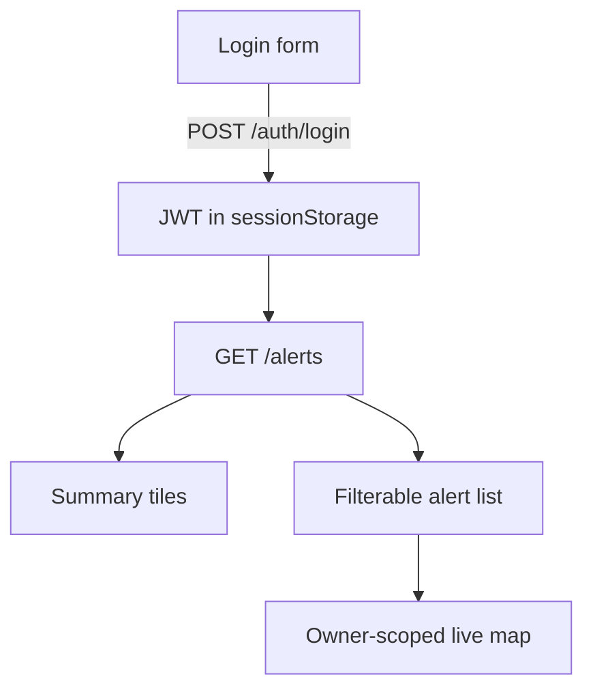

# Web pages

The backend serves public, account, and token-protected HTML surfaces plus static assets. They are rendered from Jinja templates under `templates/web/` and styled by `static/css/`.

## Live alert — `GET /a/{token}`

The compact link delivered to an emergency contact renders an embedded Leaflet map
directly and opens `/a/{token}/live`; it is not a redirect. Its opaque 128-bit token is
looked up by SHA-256 hash and expires after 30 days. See
[short-alert-urls.md](short-alert-urls.md) for the security model and before/after design.

An owner-scoped JWT version at `/alerts/view/{token}` is generated for each dashboard
alert, and the same route remains available for historical contact JWTs. Both pages
receive the persisted route snapshot and move the marker as the app reports positions.
They show accuracy, connection freshness, terminal state, a call action, and a
follow/recenter control. Opening a contact link preserves per-notification `viewed_at`
tracking; opening an owner link does not change contact state. The page is `noindex`,
uses `no-store`, and does not expose the private path as a cross-origin referrer.

## Landing — `GET /`

The public marketing page: hero, download button (`static/downloads/panic-button.apk`), feature cards, and a three-step setup. Server-rendered from `landing.html.j2` with the contact email injected. The head carries the favicon set (see below).

## Alert dashboard — `GET /dashboard`

A client-side page where an account owner reviews their alerts. It logs in with the same app credentials (stores the JWT in `sessionStorage`) and calls `GET /alerts`.

**Summary tiles** — total alerts, alerts in the last 7 days, notifications sent, and the seen rate (viewed ÷ sent).

**Filter bar** — search by contact name, per-channel chips (Email / Telegram / WhatsApp / SMS, toggle to hide a channel), and a seen / not-seen filter. Filters narrow both which alerts show and which notification rows within them.

**Alert cards** — each shows the time (US format) and a relative "Xh ago", a
`sent · seen` badge, the initial coordinates, a **View live map** link, and one row per
notification: a coloured channel tag, the contact name (with a **"removed"** tag if the
contact was later deleted — the name is preserved on the row), and its seen status.

Because `alert_notifications` stores the contact name and survives contact deletion (see [database.md](database.md)), the dashboard keeps showing who an old alert reached even after those contacts are gone — no more empty alerts.

There is a refresh button, and the settings dialog offers theme (auto/light/dark) and an accent-colour picker.

## Favicon

`GET /favicon.ico` serves the multi-size icon; the landing and dashboard heads also link `favicon.png` and `apple-touch-icon.png`. All three are generated from the app's `SOS` launcher icon and live in `static/img/`.

## Static & app mounts

- `/static` — css, js, images, the APK download.
- `/app` — the mobile app's web UI (`app/www`), served with `no-cache` on HTML/JS so an app launch always sees the latest bundle, and long cache on images. `/app/manifest` returns a content hash the app uses to decide when to reload. See [app/architecture.md](../app/architecture.md).

## Password reset page — `GET /auth/password-reset/{token}`

A small self-contained page (form + inline script) that a user reaches from the reset email. It posts the new password as JSON to the same path and shows the result inline; it is `noindex`. The flow is described in [auth.md](auth.md).

## SEO metadata

- **Landing (`/`)** carries a full set of tags built from `API_BASE_URL`: title/description/keywords, a canonical link, `theme-color`, Open Graph and Twitter Card tags, and a `SoftwareApplication` JSON-LD block. It is indexable.
- **Dashboard (`/dashboard`)** carries title/description/Open Graph too, but is marked **`noindex, nofollow`** — it's a private, login-gated tool that shouldn't appear in search.
- **`/robots.txt`** allows the landing and disallows `/app`, `/dashboard`, `/docs`, `/a/`, and `/alerts/view/`, pointing crawlers at **`/sitemap.xml`** (the landing page). Both are generated from `API_BASE_URL`, so a [domain change](domain-change.md) updates them automatically.
