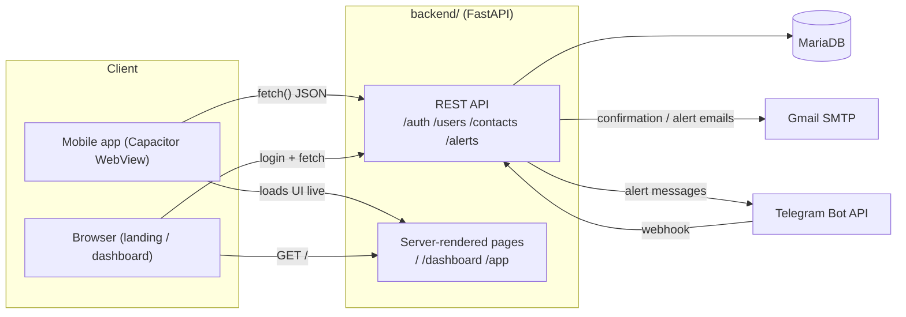

# PanicButton — Documentation

PanicButton is a personal-safety system: a user holds a button in the mobile app, the app captures their GPS location, and the backend notifies their emergency contacts by email and/or Telegram with a link to that location. Registration, contact confirmation, and login all live behind the same API.

This documentation is also available in [Spanish](../es/README.md).

## System overview

## Two halves of one repository

| Directory | What it is | Docs |
|---|---|---|
| [`backend/`](../../backend) | FastAPI + MariaDB API, plus the server-rendered web pages | [`backend/`](backend/) |
| [`app/`](../../app) | Capacitor mobile client (Android/iOS), plain HTML/CSS/JS | [`app/`](app/) |

They're deployed together: the app doesn't bundle its own UI anymore — its WebView loads `backend/`'s `/app` route live, the same way an Electron window points at a URL instead of shipping a local copy of the page. See [`app/architecture.md`](app/architecture.md) for why.

## Backend docs

- [`backend/architecture.md`](backend/architecture.md) — how `main.py` is wired: routers, CORS, the `/docs` toggle, startup
- [`backend/database.md`](backend/database.md) — schema (ER diagram), `Cursor`, connection handling
- [`backend/auth.md`](backend/auth.md) — JWT tokens, password hashing, the `current_user` dependency
- [`backend/api.md`](backend/api.md) — endpoint reference (full examples in [`backend/API.md`](../../backend/API.md))
- [`backend/notifications.md`](backend/notifications.md) — email + Telegram alert delivery
- [`backend/web-pages.md`](backend/web-pages.md) — the landing page, dashboard, and confirmation pages the backend renders itself
- [`backend/operations.md`](backend/operations.md) — environment variables, logging, maintenance scripts, feature flags

## App docs

- [`app/architecture.md`](app/architecture.md) — the build pipeline, and why the app loads its UI from the backend instead of bundling it
- [`app/screens.md`](app/screens.md) — screen-by-screen walkthrough, theming, i18n

## Setup

See the root [`README.md`](../../README.md) for backend setup and [`app/README.md`](../../app/README.md) for the mobile app.
