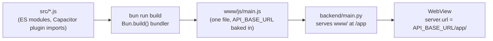
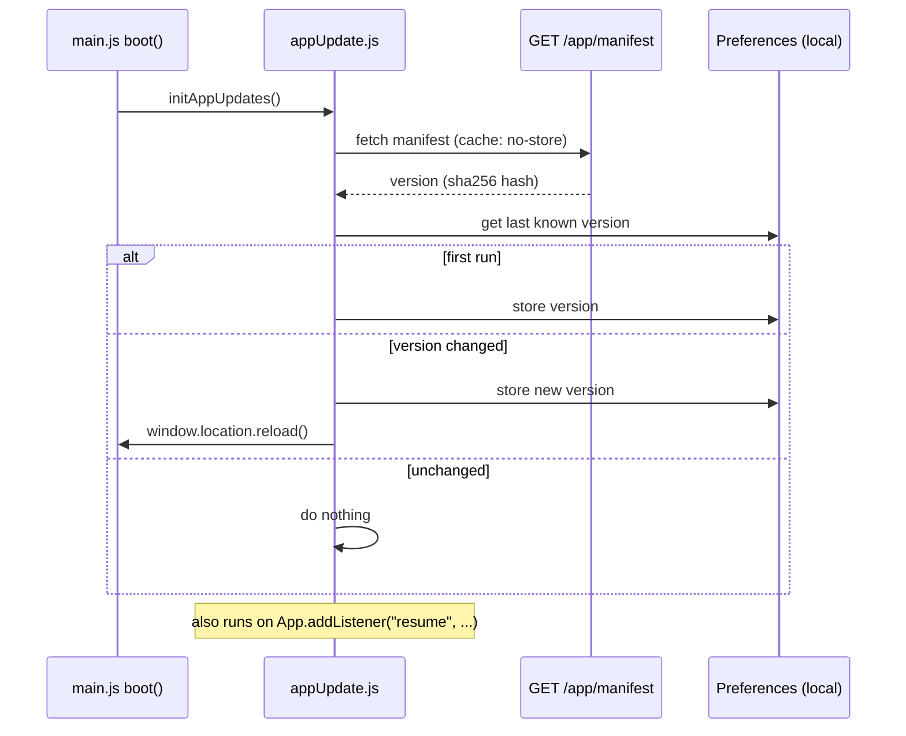

# App architecture

`app/` is a [Capacitor](https://capacitorjs.com/) project (Android + iOS) built with plain HTML/CSS/JavaScript — no frontend framework. Every view (`src/views/*.js`) exports one `render(container, ctx)` function that builds its own markup and wires its own listeners; there's no component system beyond that repeated shape.

**The app doesn't bundle its own UI.** The WebView navigates straight to the backend's own `/app` route and loads it live — the same idea as an Electron window pointed at a URL instead of shipping a local copy of the page. This is the single most important thing to understand about how this app is deployed, so most of this document is about it.

## Build pipeline



`src/*.js` imports Capacitor plugins as bare npm specifiers (`import { Geolocation } from "@capacitor/geolocation"`) — something a WebView can't resolve on its own. `build.js` runs Bun's built-in bundler (`Bun.build()`) to resolve those into one file, `www/js/main.js`, loaded as `<script type="module">`. This is the *only* build step in the project — there's no TypeScript, no syntax transform, every `.js` file is already directly runnable; the bundler's only job is folding `node_modules` imports into something a browser can load.

`import.meta.env.API_BASE_URL` in `src/lib/api.js` isn't a real runtime API — `Bun.build()`'s `define` option textually replaces that exact expression with a string literal at build time, read from `app/.env`. The WebView never sees an environment variable, only the substituted URL, baked in.

Run `bun run build` after any change under `src/` — `www/js/` is committed (not gitignored, so it can be deployed by `git pull` + restarting/leaving the backend running) but it only updates when this command runs.

## Why the app loads its UI from the backend

```js
// capacitor.config.js
server: {
  url: `${apiBaseUrl}/app/`,
  cleartext: true,
  errorPath: "offline.html",
},
```

Every earlier version of this app used Capacitor the conventional way: `webDir: "www"`, `cap sync` copied `www/` into the native project, and an install had the whole UI baked in from the moment it was downloaded — the only way to fix a typo was to ship a new build to every device. Now `capacitor.config.js`'s `server.url` points the WebView straight at `${API_BASE_URL}/app/` instead, in exchange for never needing a new native build just to change a screen's copy or fix a CSS bug.

The one bundled fallback is **`server.errorPath`**: if the WebView can't reach `API_BASE_URL` (no connection, backend down), Capacitor loads the local `www/offline.html` instead of a blank screen. That page is generated by `build.js` with the backend URL baked in, so its **Retry** button navigates straight back to `${API_BASE_URL}/app/`.

`cleartext: true` only matters for local development (`http://10.0.2.2:8000`, a LAN IP, etc.) — a production `API_BASE_URL` is a real `https://` domain and never needs it.

## Staying in sync: the update-check flow

A WebView that's already loaded a page keeps running it — a new backend deploy doesn't reach a phone sitting in the background, the same way pushing to a website doesn't refresh an already-open tab.



`GET /app/manifest` (`backend/modules/app_assets.py`) hashes every file's path + contents under `app/www`, recomputed fresh on every request — no version number to remember to bump, the hash just changes when the files do. The check runs on boot and whenever `@capacitor/app`'s `resume` event fires (foregrounding after being backgrounded) — not on a timer, since both are already moments a hard reload is unsurprising to the user. The reload actually picks up fresh files because `/app`'s static files are served with `Cache-Control: no-cache` (see [`../backend/web-pages.md`](../backend/web-pages.md)) — otherwise the WebView could reload and still get its own stale disk cache back.

## What this update mechanism *doesn't* cover: native code

`GET /app/manifest` only hashes `app/www/` — HTML, CSS, the bundled JS. **It never reaches anything compiled into the native binary.** Concretely, this means the live-reload path does *not* pick up:

- A new or updated Capacitor plugin (native Java/Kotlin or Swift code)
- A new `AndroidManifest.xml` permission or `Info.plist` entry
- Any change under `android/` or `ios/` themselves

Any of those require a fresh `./gradlew assembleRelease` and redistributing the resulting APK (`backend/static/downloads/panic-button.apk`, see [`../backend/web-pages.md`](../backend/web-pages.md)) — a phone that already has the app installed keeps running the native code it shipped with, no matter what `app/www` says, until it installs that new APK.

## Native platforms: manual additions after scaffolding

`bunx cap add android`/`bunx cap add ios` generated `android/`/`ios/`; a few things were added by hand afterward, since Capacitor plugins ship empty native manifests (permissions are declared by the *app*, not the plugin):

- **`AndroidManifest.xml`**: `ACCESS_FINE_LOCATION`/`ACCESS_COARSE_LOCATION` (`@capacitor/geolocation`), `READ_CONTACTS`/`WRITE_CONTACTS` (`@capacitor-community/contacts` requests both under one Android permission alias, though this app never writes to the address book), and `android:usesCleartextTraffic="true"` on `<application>` — needed because `cap sync` doesn't inject that attribute into a manifest that already exists (only into one being scaffolded fresh), and without it a plain-`http://` `server.url` gets silently blocked (no page, no error) on Android 28+.
- **`Info.plist`**: `NSLocationWhenInUseUsageDescription`, `NSContactsUsageDescription` — the iOS equivalent, the human-readable strings shown on first permission request.
- **`colors.xml`**: `colorPrimary`/`colorPrimaryDark`/`colorAccent`, since Capacitor's Android template doesn't generate one — otherwise native chrome (status bar, system dialogs) falls back to Capacitor's stock indigo/pink instead of the brand color.

## `SplashScreen.hide()` is required

```js
// capacitor.config.js
SplashScreen: { launchAutoHide: false, ... }
```

```js
// main.js boot()
await renderCurrentRoute();
await SplashScreen.hide();
```

`launchAutoHide: false` means the native splash overlay stays on screen indefinitely until something explicitly calls `SplashScreen.hide()` — it does not dismiss itself once the WebView's first frame renders. `boot()` calls it as its last step. **If this call is ever removed or an exception in `boot()` happens before it runs, the app gets stuck on the splash screen forever**, indistinguishable at a glance from a network/loading failure — this was an actual bug hit during development.

## Directory layout

```
app/
  build.js                 — Bun.build() script; also generates www/offline.html
  capacitor.config.js      — server.url + errorPath from API_BASE_URL, splash screen config
  src/
    main.js                 — hash router, boot sequence
    lib/
      api.js                 — fetch wrapper for every backend endpoint
      session.js             — auth token persistence (@capacitor/preferences)
      appUpdate.js            — the update-check flow above
      geolocation.js, contactsPicker.js — thin plugin wrappers
      theme.js                — accent color + light/dark, HSL-derived shades
      i18n.js                  — 12-language string dictionary
      share.js                — native share sheet (@capacitor/share) with clipboard fallback
      phone.js, features.js, icons.js, toast.js, sheet.js, dom.js — small shared helpers
    views/
      login.js, register.js, home.js, contacts.js, profile.js, about.js, help.js
  www/                       — build output, see screens.md for what's in it
    index.html, css/styles.css, js/main.js (bundled), assets/
  android/, ios/             — native projects, mostly not hand-edited (see above)
```

See [`screens.md`](screens.md) for what each screen does.
