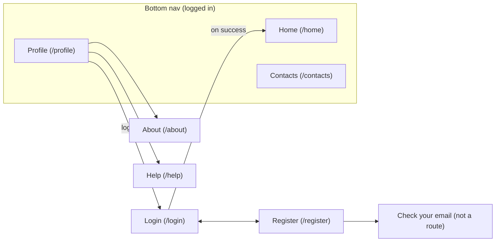

# Screens

Seven screens, one hash router (`src/main.js`), no shared state beyond "who's logged in" (`src/lib/session.js`, cached in memory + `@capacitor/preferences`).

`ROUTES` in `main.js` marks each route `public` (login/register — redirects logged-in users to home) or not (redirects logged-out users to login); `about`/`help` aren't in the bottom nav, only reachable from Profile.

## Login / Register

`login.js`, `register.js` — plain forms, `Api.login`/`Api.register`. Registration doesn't log the user in afterward (the backend blocks login pre-confirmation anyway, see [`../backend/auth.md`](../backend/auth.md)) — it shows a "check your email" screen instead. Both use `phone.js`'s country-code `<select>` + digit-only number input, combined into one E.164-ish string (`combinePhone`) before hitting the API.

## Home — the panic button

`home.js`. A press-and-hold gesture (`HOLD_DURATION_MS = 1400`), tracked with `requestAnimationFrame` filling an SVG ring around the button rather than a plain timer, released early cancels. On hold-complete:

1. `getCurrentCoordinates()` (`lib/geolocation.js`, wraps `@capacitor/geolocation`) — GPS fix, 15s timeout
2. `Api.createAlert({ latitude, longitude })`
3. Success → checkmark + toast; failure → error state + shake animation + toast with the specific error message

A status chip above the button shows how many contacts would actually be notified — those reachable by email (`confirmed`) *or* Telegram (`telegram_linked`), counted client-side from `Api.listContacts()`, matching the backend's own rule for who gets an alert. If that count is a definite zero, the hold is refused with a toast asking the user to add and confirm a contact first, rather than firing into a void. If the count can't be determined (the lookup failed), the alert still goes through — a background check must never block a real emergency.

## Contacts

`contacts.js` — list + add/edit in a bottom sheet (`lib/sheet.js`, a native-feeling modal, not a full navigation). "Add" offers picking from the device's address book (`lib/contactsPicker.js`, native picker UI — the app never gets bulk address-book access) or filling the form manually. Client-side enforces the same `MAX_CONTACTS = 4` the backend enforces (`routers/contacts.py`) purely so the UI can stop offering "add" before the round-trip 400s — the backend is still the actual source of truth. Each row shows two independent channel-status icons (email `confirmed`, Telegram `telegram_linked`) when Telegram is enabled for the deployment (`lib/features.js`); editing a contact can enable/disable its Telegram link inline. A contact that has an email but hasn't confirmed it yet also gets a "resend confirmation email" action in its edit sheet, for when the first email was missed.

## Profile

`profile.js` — edit name/phone/email/password (only changed fields are sent, via a `diffFields`-style comparison). Changing the email or password also asks for the current password, which the backend verifies before applying the change (see [`../backend/auth.md`](../backend/auth.md)); editing only the name or phone doesn't. Below that are three preference controls that all persist via `@capacitor/preferences` and apply immediately without a page reload:

- **Language** — `LANGUAGES` from `lib/i18n.js` (12 languages), `changeLanguage()` re-renders the current screen
- **Theme** — Auto/Light/Dark, `lib/theme.js`
- **Accent color** — six presets plus a native `<input type="color">` for a custom hex; `theme.js` derives the full `--primary-900`…`--primary-300` shade scale from just the hue/saturation via HSL math, with different lightness curves for light vs. dark (so, e.g., `--primary-400` stays readable as text on both a dark background and white)

Logout, and links to About/Help.

## About / Help

`about.js`, `help.js` — static informational screens, both using the shared `.info-screen` layout with a back button to Profile. Help is a fixed list of Q&A-style sections (`account`, `panic`, `contacts`, `channels`, `profile`), all translated strings — no dynamic content.

## Shared building blocks

| Module | Purpose |
|---|---|
| `lib/api.js` | `fetch` wrapper — attaches `Authorization` when `auth: true`, extracts a readable error message from the backend's error shape, throws `ApiError` |
| `lib/dom.js` | `escapeHtml`, `setLoading` (button spinner state), `shake` (form-error animation) |
| `lib/toast.js` | Transient success/error/info notifications |
| `lib/sheet.js` | Bottom-sheet modal used by Contacts' add/edit forms |
| `lib/icons.js` | Inline Material-style SVG icon set |
| `lib/features.js` | Caches `GET /features` for the app's session — see [`../backend/operations.md`](../backend/operations.md) |
