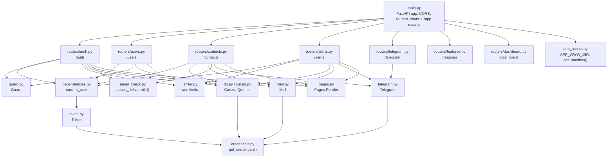
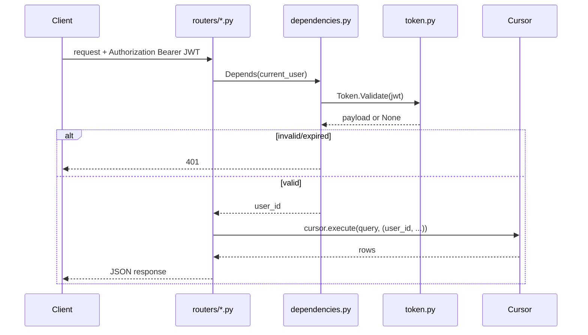

# Backend architecture

`backend/` is a single FastAPI application (`main.py`) split into `modules/` — no service layer, no ORM: routers call `Cursor.execute()` with plain SQL directly. This document covers how `main.py` wires everything together; individual subsystems have their own doc.

## Module map



Every module that needs configuration calls `get_credentials()` (`.env`, see [`operations.md`](operations.md)) itself rather than receiving it injected — there's no dependency-injection framework here, just plain imports.

## Request flow for an authenticated endpoint



## CORS

The mobile app's WebView runs on a fixed Capacitor origin (`capacitor://localhost` on Android, `https://localhost` is also allowed for iOS/dev), not the backend's own origin — so its `fetch()` calls to this API are cross-origin and subject to CORS. `main.py` allows exactly those three fixed origins, not a wildcard, since the app never runs from anywhere else:

```python
app.add_middleware(
    CORSMiddleware,
    allow_origins=["capacitor://localhost", "http://localhost", "https://localhost"],
    allow_methods=["*"],
    allow_headers=["*"],
)
```

## Middleware: rate limiting, request context, security headers

Beyond CORS, `main.py` wires two more middleware layers around every request:

- **Rate limiting** (`slowapi`) caps `POST /auth/register`, `POST /auth/login` and `POST /alerts`; over the limit the request gets a `429` before its handler runs. Login and register are keyed by client address, `POST /alerts` by user id. See [`operations.md`](operations.md).
- **Request context** assigns each request a short id, held in a `ContextVar` so every log line from that request — and the background tasks it spawns — carries it (see [`operations.md`](operations.md)). The same middleware sets `X-Content-Type-Options`, `X-Frame-Options`, `Referrer-Policy` and `Permissions-Policy` on every response, and turns an unhandled exception into a clean `500` rather than leaking a traceback.

## `APP_MODE`: toggling the automatic docs

```python
_docs_enabled: bool = get_credentials()['app_mode'] != "Deploy"

app = FastAPI(
    docs_url=("/docs" if _docs_enabled else None),
    redoc_url=("/redoc" if _docs_enabled else None),
    openapi_url=("/openapi.json" if _docs_enabled else None),
    ...
)
```

`APP_MODE=Deploy` doesn't just hide `/docs`/`/redoc`/`/openapi.json` — passing `None` means FastAPI never registers those routes, so they return a plain `404`. Any other value (including unset, the default) leaves them enabled. Production should set `Deploy` so the API's full surface isn't exposed to anyone who can reach it.

## Startup: verifying the database and registering the Telegram webhook

```python
@asynccontextmanager
async def _lifespan(app: FastAPI):
    cursor.verify()  # fail the boot if the database is unreachable
    if _credentials['telegram']['bot_token']:
        try:
            await Telegram.SetWebhook(f"{_credentials['api_base_url']}/telegram/webhook")
        except Exception as e:
            _logger.error(f"Could not register Telegram webhook: {e}")
    yield
```

The database is checked first: `cursor.verify()` opens a connection eagerly, so a misconfigured or unreachable database fails the boot immediately instead of surfacing on the first request that needs a row.

Registering the webhook is best-effort and non-blocking by contrast: a deployment with no Telegram bot configured still boots normally, just without that feature. This also means `API_BASE_URL` must be a real, publicly reachable `https://` URL for the registration to actually succeed — Telegram can't call back to `127.0.0.1`, so in local development this step logs an error and does nothing further, harmlessly (see [`notifications.md`](notifications.md)).

## `/static` and `/app`: two unrelated static mounts

```python
app.mount("/static", StaticFiles(directory=BACKEND_DIR / "static"), name="static")
...
app.mount("/app", _NoCacheStaticFiles(directory=APP_WWW_DIR, html=True), name="app")
```

- **`/static`** serves `backend/static/` — CSS/JS/images for this backend's *own* server-rendered pages (landing, dashboard, confirmation), plus the release APK download. See [`web-pages.md`](web-pages.md).
- **`/app`** serves `app/www/` — the mobile app's built UI, with a custom caching policy so a version bump reaches an already-open WebView. See [`app/architecture.md`](../app/architecture.md) and [`web-pages.md`](web-pages.md).

These are unrelated: `/static` never needs to signal "the file changed, reload now" the way `/app` does, since a browser tab reloading `/dashboard` naturally re-fetches everything anyway.

## Router registration order

`GET /app/manifest` is registered as an exact route *before* `app.mount("/app", ...)`. Starlette matches routes in registration order, so the exact path wins for that one URL, and everything else under `/app/*` falls through to the mount — `/app/manifest` is never mistaken for "a file named `manifest` inside `app/www`".
