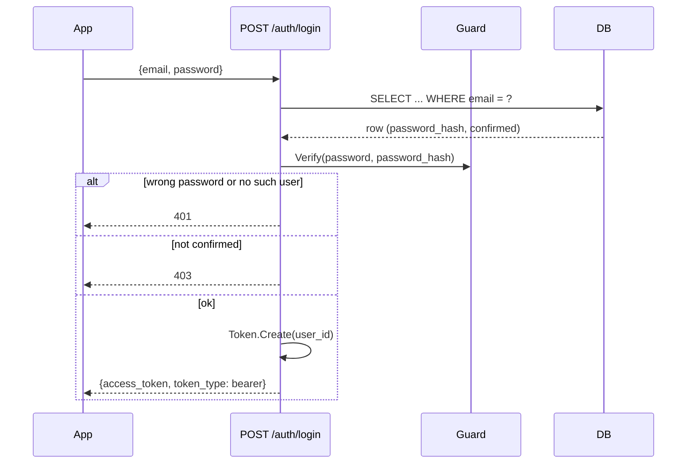

# Authentication

Two independent building blocks: `Guard` (password hashing) and `Token` (JWT). Neither talks to the database — routers combine them with `Cursor` calls.

## Password hashing — `guard.py`

```python
pwd_context = CryptContext(schemes=["bcrypt"], deprecated="auto")

class Guard:
    Hash(password) -> str      # store this, never the plain password
    Verify(password, stored_hash) -> bool
```

`passlib`'s `CryptContext` handles bcrypt's salting; `deprecated="auto"` means if the scheme list ever grows, an old hash still verifies while new ones use the newest scheme — not currently exercised (there's only one scheme), but free to keep.

## JWTs — `token.py`

One secret (`JWT_SECRET_KEY`, see [`operations.md`](operations.md)), one algorithm (`HS256`), four token *purposes* distinguished by a `"type"` claim baked into the payload — so a confirmation link can never be replayed as a login session, even though both are "just a valid JWT":

| Purpose | Created by | Payload | Expires |
|---|---|---|---|
| Login session | `Token.Create` | `sub` (user id) | 30 days |
| Account confirmation | `Token.CreateUserConfirmation` | `user_id`, `type=user_confirmation` | 24h |
| Contact confirmation | `Token.CreateContactConfirmation` | `contact_id`, `type=contact_confirmation` | 7 days |
| Alert-view link | `Token.CreateAlertNotificationView` | `notification_id`, `type=alert_notification_view` | never |

`Token.Validate(token)` just checks the signature/expiry (`jwt.decode`, catching `InvalidTokenError`) and hands back the raw payload or `None`. Each `Validate<Purpose>` wrapper calls that, then additionally checks `payload["type"]` matches before trusting the id inside it — a contact-confirmation token presented where a login token is expected fails the type check, not just "any valid signature is good enough".

The alert-view link deliberately carries no `exp` claim: unlike the confirmation links (meant to be used once, soon), a contact may want to re-open the map days after an alert.

## `current_user`: the auth dependency

```python
def current_user(credentials: HTTPAuthorizationCredentials = Depends(_security)) -> int:
    payload = Token.Validate(credentials.credentials)
    if payload is None:
        raise HTTPException(status_code=401, detail="Invalid or expired token")
    return int(payload["sub"])
```

FastAPI's `HTTPBearer` extracts the `Authorization: Bearer <token>` header; every protected route (`/users/me`, `/contacts`, `/alerts`, ...) declares `user_id: int = Depends(current_user)` and gets an `int` back, or the request never reaches the route body at all.

## Login sequence



The app stores `access_token` via `@capacitor/preferences` (`app/src/lib/session.js`) and sends it as `Authorization: Bearer <token>` on every subsequent authenticated call (`app/src/lib/api.js`).
