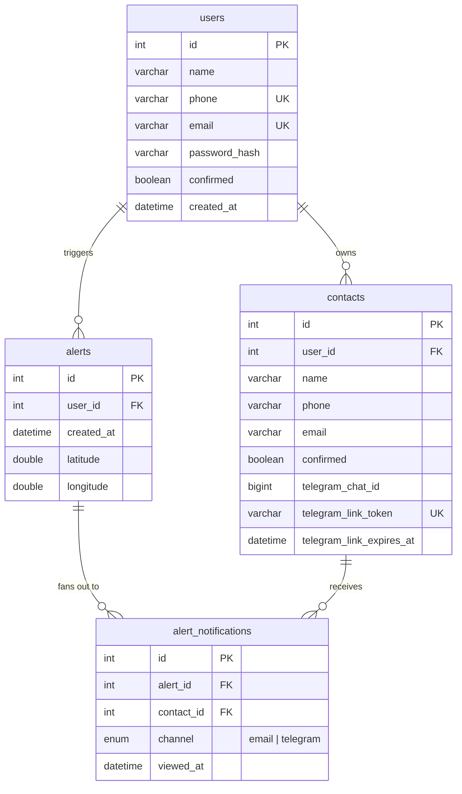

# Database

MariaDB, no ORM, no migration framework. `queries/` (repo root) holds the SQL an administrator runs by hand to provision a database; `modules/cursor.py` holds every query the app runs against it, as plain parameterized SQL strings.

## Schema



(`queries/tables.sql` is the source of truth — this diagram mirrors it.)

- **`users.confirmed`** gates login (`POST /auth/login` returns `403` until it's `true`) — set by clicking the link in the registration email. An account that's never confirmed can't own contacts or alerts, so `scripts/purge_unconfirmed_users.py` can safely delete any that are still unconfirmed 24h after signup (see [`operations.md`](operations.md)).
- **`contacts.confirmed`** and **`contacts.telegram_chat_id`** are two independent notification channels for the same contact — a panic alert reaches them by whichever one (or both) is set. `telegram_link_token`/`telegram_link_expires_at` are single-use, time-boxed state for the linking handshake (see [`notifications.md`](notifications.md)); they're cleared back to `NULL` once linked.
- **`alert_notifications`** is one row per `(alert, contact, channel)` — a contact confirmed on both email and Telegram gets two rows for the same alert. `viewed_at` is set the first time that specific link is opened, which is how the dashboard shows per-contact, per-channel delivery confirmation.

## `Cursor`: one connection per thread

FastAPI runs the `def` routes in a threadpool, so several requests can be in flight at once. Each thread gets its own MariaDB connection and cursor, created on first use and kept for that thread — so `cursor.execute(...)` followed by `cursor.lastrowid` or `cursor.rowcount` always describes the statement *this* thread just ran, never another request's. The connections are held in `threading.local()`; the shared `cursor` object every module imports is just the dispatcher in front of them.

```python
class Cursor:
    def _open(self):
        conn = mariadb.connect(..., client_flag=CLIENT.FOUND_ROWS, autocommit=True)
        return _Connection(conn, conn.cursor(dictionary=True))
```

Two non-default connection flags, both fixing real bugs hit in production:

- **`CLIENT.FOUND_ROWS`** — without it, an `UPDATE` that matches a row but doesn't change its value reports `rowcount = 0`, indistinguishable from "no row matched at all". Every existence/ownership check in this codebase (`if cursor.rowcount == 0: raise 404`) depends on `rowcount` meaning "rows matched", not "rows changed" — a confirmation link clicked twice, or an edit that resubmits the same value, must not 404.
- **`autocommit = True`** — every write already calls `cursor.commit()` explicitly; this is a backstop so a stray write on a path that forgets to (or a plain `SELECT`, which still opens a transaction under MariaDB's default isolation) can't leave a row locked. For the few places that must read and then write atomically, `cursor.transaction()` opens an explicit transaction on the calling thread's connection — used to enforce the emergency-contact cap under a row lock, so two simultaneous adds can't both slip past the limit.

`execute()` retries once on `mariadb.InterfaceError` (the classic "MariaDB server has gone away" from an idle connection getting closed server-side after `wait_timeout`) by reconnecting and re-running the query, so a backend that's been idle overnight recovers on the next request instead of needing a manual restart. A `mariadb.IntegrityError` (a `UNIQUE` constraint violation — duplicate phone/email, etc.) is translated into `DuplicateRecordError`, which routers catch and turn into a `409`. At startup `main.py` opens a connection eagerly (`cursor.verify()`) so a misconfigured or unreachable database fails the boot loudly instead of on the first request.

## `Queries`: every SQL string, in one place

`modules/cursor.py`'s `Queries` class is a namespace of `str` constants — `SELECT_USER_BY_EMAIL`, `INSERT_CONTACT`, `CONFIRM_CONTACT_TELEGRAM`, etc. Routers that need a one-off `UPDATE ... SET <dynamic column list>` (partial updates on `PUT /users/me`, `PUT /contacts/{id}`) build that one query inline instead — everything reused across more than one call site lives here.

## Provisioning a database

```bash
mariadb -u root
```

```sql
-- queries/creation.sql (adjust the placeholders)
CREATE DATABASE <database name> CHARACTER SET utf8mb4 COLLATE utf8mb4_unicode_ci;
CREATE USER '<username>'@'localhost' IDENTIFIED BY '<password>';
GRANT ALL PRIVILEGES ON <database name>.* TO '<username>'@'localhost';
FLUSH PRIVILEGES;
```

Then run `queries/tables.sql` against that database to create all four tables. `queries/insertions.sql` has example `INSERT` statements (one user, two contacts, one alert) for manual testing — there's no seed/fixture script beyond that, a fresh environment starts with an empty database.
