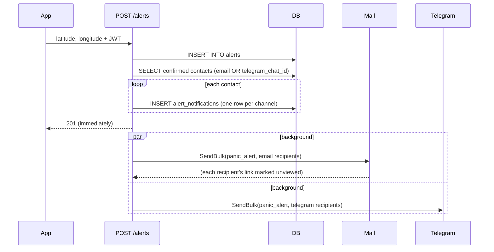
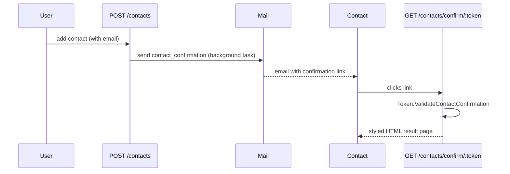
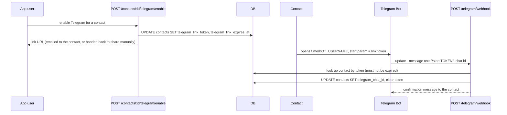

# Notifications: email + Telegram

Two independent, parallel delivery channels for the same events (contact confirmation, panic alerts): `mail.py` (`Mail`) and `telegram.py` (`Telegram`). Neither knows about the other — routers decide who gets notified on which channel(s) and call both.

## `Mail`

SMTP over `aiosmtplib`, Jinja templates under `templates/mail/*.{html,txt}.j2` (both rendered — HTML with a plain-text fallback in the same message). `Mail.Send` opens one connection per email; `Mail.SendBulk` opens a single SMTP connection and reuses it for every recipient, since a panic alert may fan out to several contacts at once.

```python
await Mail.SendBulk(subject, template, [(email, context), ...])
```

A failure for one recipient inside `SendBulk` is logged and collected, not raised immediately — only after the whole batch does it raise `MailNotSentError` listing who failed, so one bad address doesn't stop the rest from being sent.

When `SMTP_ENABLED` is off (see [`operations.md`](operations.md)) both `Send` and `SendBulk` log what they *would* have sent and return without opening a connection — for local development against a real SMTP account without delivering anything.

## `Telegram`

HTTP calls to the Telegram Bot API (`httpx`), templates under `templates/telegram/*.txt.j2` (plain text only — Telegram has no HTML-email equivalent). Same `Send`/`SendBulk` shape as `Mail`, plus `SetWebhook` (called once at startup, see [`architecture.md`](architecture.md)).

## Why `alerts.py` treats a mail failure as non-fatal

```python
async def _notify_by_mail(subject, template, recipients):
    try:
        await Mail.SendBulk(subject, template, recipients)
    except MailNotSentError:
        pass  # already logged inside SendBulk
```

`BackgroundTasks` runs its queued tasks in order and stops at the first exception. `create_alert` queues the email batch and the Telegram batch as two separate background tasks — if the email task's exception were allowed to propagate, the Telegram task queued right after it would never run. During an actual panic alert, a broken mailbox must never be the reason a contact who only has Telegram never hears about it.

## Panic alert fan-out



A contact needs *either* `confirmed = TRUE` (email) or a set `telegram_chat_id` — the two channels are independent, not sequential; someone who never clicked the email confirmation link but did link Telegram still gets notified. Each `(alert, contact, channel)` gets its own `alert_notifications` row and its own no-expiry view-link token (see [`auth.md`](auth.md)), so "did this specific contact, on this specific channel, open the map" is tracked separately — visible on the dashboard.

## Contact confirmation (email)



A contact added *without* an email skips this step entirely — it only becomes eligible for alerts via Telegram instead.

Editing a contact's email address (`PUT /contacts/{id}`) starts this flow over: the contact is marked unconfirmed again and a fresh confirmation email goes to the new address. Correcting a mistyped address therefore re-verifies it, rather than leaving the contact "confirmed" against an address that never actually received anything. `POST /contacts/{id}/confirm/resend` sends the same email again without any edit, for when the first one was lost — it applies only to a contact that has an email and hasn't confirmed yet.

## Verifying an address can receive mail

Before any address is accepted — a new account (`POST /auth/register`), a contact with an email, or an email change on either — its domain is checked for a mail server (an MX or A record). A typo like `gmial.com` or an invented domain is rejected with a `422` at that point, so the system never creates a record whose confirmation email could only ever bounce. This confirms the domain can receive mail, not that the specific mailbox exists; the confirmation link is still what proves the address is real and belongs to the right person. The check can be turned off (`SMTP_VERIFY_DELIVERABILITY`, see [`operations.md`](operations.md)) for offline development.

## Account-change notifications

Changing the account's email or password (see [`auth.md`](auth.md)) emails a security notice — the `security_alert` template — to the address on file *before* the change. If an email address is swapped, the previous owner still hears about it, so an account takeover can't happen silently.

## Telegram linking

Telegram's own deep-link `start` parameter only allows `[A-Za-z0-9_-]`, which a dot-separated JWT can't satisfy — so unlike every other confirmation flow, this one uses an opaque, database-backed token instead of a JWT.



- If the contact already has an email on file, the link is emailed (`telegram_link` template) and the API response omits the URL (`{"telegram_link_url": null}`) — the app doesn't need to show it.
- If not, the API hands the URL straight back so the app can offer it via the OS share sheet.
- The link expires after 24h (`telegram.LINK_EXPIRATION`) and is single-use — a successful link clears `telegram_link_token` back to `NULL`.

### Webhook security

Telegram doesn't sign requests. `POST /telegram/webhook` instead checks the `X-Telegram-Bot-Api-Secret-Token` header against `TELEGRAM_WEBHOOK_SECRET` — a value this deployment invents and registers once via `Telegram.SetWebhook` at startup, not issued by Telegram itself. Any request without a matching header is rejected with `401` before the update is even parsed (skipped only when no secret is configured at all, i.e. local development without a real bot).

Any exception while handling a webhook update is caught and logged, and the endpoint still returns `{"ok": true}` — Telegram retries aggressively on anything but a `2xx` response, and a retry storm over something a retry won't fix is worse than one dropped update.
