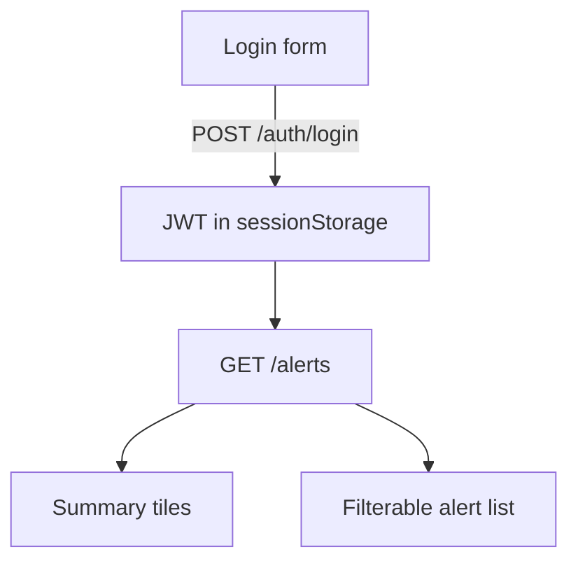

# Web pages

The backend serves three HTML surfaces plus static assets. All are rendered from Jinja templates under `templates/web/` and styled by `static/css/`, and all share a theme system (light/dark + accent colour, stored client-side).

## Landing — `GET /`

The public marketing page: hero, download button (`static/downloads/panic-button.apk`), feature cards, and a three-step setup. Server-rendered from `landing.html.j2` with the contact email injected. The head carries the favicon set (see below).

## Alert dashboard — `GET /dashboard`

A client-side page where an account owner reviews their alerts. It logs in with the same app credentials (stores the JWT in `sessionStorage`) and calls `GET /alerts`.

**Summary tiles** — total alerts, alerts in the last 7 days, notifications sent, and the seen rate (viewed ÷ sent).

**Filter bar** — search by contact name, per-channel chips (Email / Telegram / WhatsApp / SMS, toggle to hide a channel), and a seen / not-seen filter. Filters narrow both which alerts show and which notification rows within them.

**Alert cards** — each shows the time (US format) and a relative "Xh ago", a `sent · seen` badge, the map link, and one row per notification: a coloured channel tag, the contact name (with a **"removed"** tag if the contact was later deleted — the name is preserved on the row), and its seen status.

Because `alert_notifications` stores the contact name and survives contact deletion (see [database.md](database.md)), the dashboard keeps showing who an old alert reached even after those contacts are gone — no more empty alerts.

There is a refresh button, and the settings dialog offers theme (auto/light/dark) and an accent-colour picker.

## Favicon

`GET /favicon.ico` serves the multi-size icon; the landing and dashboard heads also link `favicon.png` and `apple-touch-icon.png`. All three are generated from the app's `SOS` launcher icon and live in `static/img/`.

## Static & app mounts

- `/static` — css, js, images, the APK download.
- `/app` — the mobile app's web UI (`app/www`), served with `no-cache` on HTML/JS so an app launch always sees the latest bundle, and long cache on images. `/app/manifest` returns a content hash the app uses to decide when to reload. See [app/architecture.md](../app/architecture.md).
