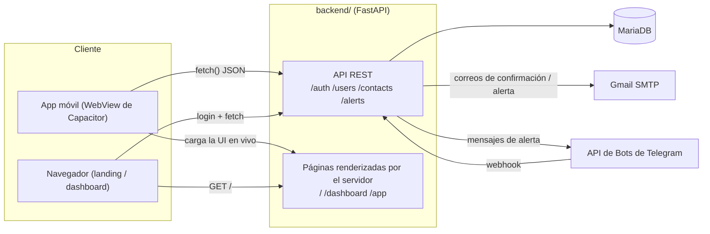

# PanicButton — Documentación

PanicButton es un sistema de seguridad personal: el usuario mantiene presionado un botón en la app móvil, la app captura su ubicación GPS, y el backend notifica a sus contactos de emergencia por correo y/o Telegram con un enlace a esa ubicación. El registro, la confirmación de contactos y el login viven detrás de la misma API.

Esta documentación también está disponible en [inglés](../en/README.md).

## Visión general del sistema

## Dos mitades de un mismo repositorio

| Directorio | Qué es | Docs |
|---|---|---|
| [`backend/`](../../backend) | API en FastAPI + MariaDB, más las páginas web renderizadas por el servidor | [`backend/`](backend/) |
| [`app/`](../../app) | Cliente móvil en Capacitor (Android/iOS), HTML/CSS/JS plano | [`app/`](app/) |

Se despliegan juntos: la app ya no empaqueta su propia UI — su WebView carga la ruta `/app` del `backend/` en vivo, la misma idea que una ventana de Electron apuntando a una URL en vez de empaquetar una copia local de la página. Ver [`app/architecture.md`](app/architecture.md) para el porqué.

## Docs del backend

- [`backend/architecture.md`](backend/architecture.md) — cómo está armado `main.py`: routers, CORS, el interruptor de `/docs`, arranque
- [`backend/database.md`](backend/database.md) — esquema (diagrama ER), `Cursor`, manejo de conexión
- [`backend/auth.md`](backend/auth.md) — tokens JWT, hash de contraseñas, la dependencia `current_user`
- [`backend/api.md`](backend/api.md) — referencia de endpoints (ejemplos completos en [`backend/API.md`](../../backend/API.md))
- [`backend/notifications.md`](backend/notifications.md) — entrega de alertas por correo + Telegram
- [`backend/web-pages.md`](backend/web-pages.md) — la landing page, el dashboard y las páginas de confirmación que el backend renderiza él mismo
- [`backend/operations.md`](backend/operations.md) — variables de entorno, logging, scripts de mantenimiento, feature flags

## Docs de la app

- [`app/architecture.md`](app/architecture.md) — el pipeline de build, y por qué la app carga su UI desde el backend en vez de empaquetarla
- [`app/screens.md`](app/screens.md) — recorrido pantalla por pantalla, theming, i18n

## Instalación

Ver el [`README.md`](../../README.md) de la raíz para la instalación del backend, y [`app/README.md`](../../app/README.md) para la app móvil.
