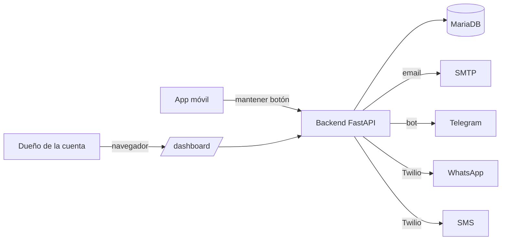

# Panic Button — Documentación

Panic Button es un sistema de seguridad personal: una app móvil con un único botón de "mantener pulsado para alertar" que comparte la ubicación en vivo del usuario con sus contactos de emergencia por **cuatro canales independientes — email, Telegram, WhatsApp y SMS**. Un panel web permite al dueño de la cuenta revisar cada alerta y ver a quién se alcanzó y por qué canal.

El proyecto tiene dos partes desplegables:

- **`backend/`** — un servicio FastAPI (Python) sobre MariaDB. Gestiona cuentas, contactos, alertas, todos los canales de notificación, la landing pública y el panel de alertas.
- **`app/`** — una app Capacitor (Android). Es una app *online*: el contenedor nativo carga su interfaz en vivo desde el mount `/app` del backend, así que la mayoría de los cambios de UI se publican sin recompilar el APK.

## Mapa de la documentación

### Para empezar
- [Instalación y primer arranque](backend/setup.md) — instalar el backend, provisionar la base de datos, llenar el `.env`, ejecutarlo.
- [Configuración de Twilio](backend/twilio.md) — habilitar WhatsApp (sender + plantilla) y SMS.
- [Cambio de dominio](backend/domain-change.md) — todo lo que actualizar cuando cambia la URL pública.

### Referencia del backend
- [Arquitectura](backend/architecture.md) — módulos, flujo de petición, middleware, arranque.
- [Autenticación](backend/auth.md) — hash de contraseñas y los tipos de token JWT.
- [Base de datos](backend/database.md) — esquema, el cursor confinado por hilo, migraciones.
- [Referencia de la API](backend/api.md) — cada ruta.
- [Notificaciones](backend/notifications.md) — los cuatro canales y cómo se eligen.
- [Operaciones](backend/operations.md) — variables de entorno, logging, límites de tasa, salud, mantenimiento.
- [Páginas web](backend/web-pages.md) — landing y panel.

### Referencia de la app
- [Arquitectura](app/architecture.md) — el modelo de app-online y la estructura del proyecto.
- [Pantallas](app/screens.md) — qué hace cada pantalla.

## La foto en cinco minutos

Un contacto es alcanzable por un canal una vez que está **confirmado** para ese canal (enlace de confirmación por email, opt-in de Telegram/WhatsApp, o simplemente activando SMS). Cuando el usuario dispara una alerta, el backend la registra y la reparte, en paralelo, a cada canal confirmado de cada contacto.

## Convenciones

- La documentación es bilingüe: este es el set en español; el espejo en inglés vive en [`docs/en/`](../en/README.md).
- El código y las claves de configuración están en inglés. Los textos de la interfaz se traducen en la app.
- Esta documentación describe el código de la rama `main`.
