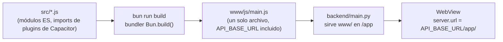
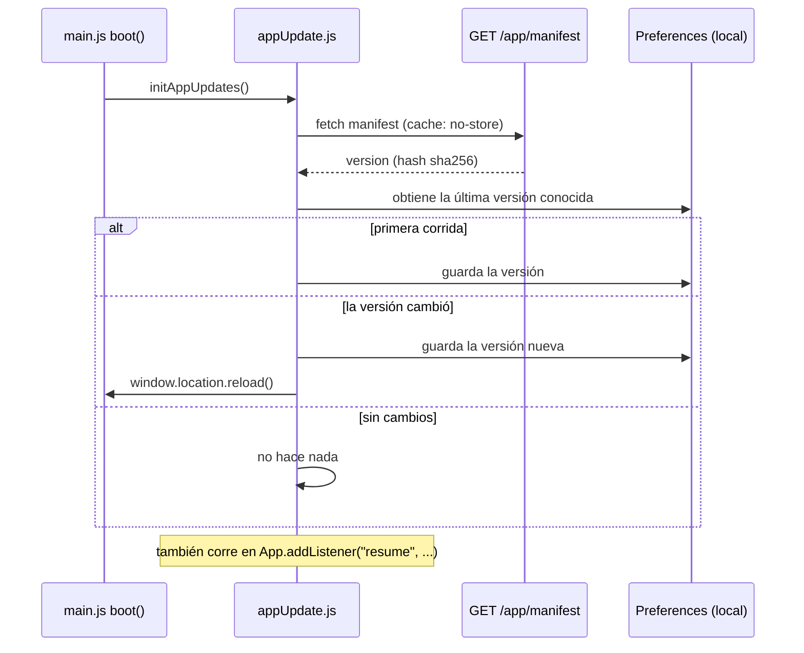

# Arquitectura de la app

`app/` es un proyecto de [Capacitor](https://capacitorjs.com/) (Android + iOS) hecho con HTML/CSS/JavaScript plano — sin framework de frontend. Cada vista (`src/views/*.js`) exporta una función `render(container, ctx)` que construye su propio markup y conecta sus propios listeners; no hay sistema de componentes más allá de esa misma forma repetida.

**La app no empaqueta su propia UI.** El WebView navega directo a la ruta `/app` del backend y la carga en vivo — la misma idea que una ventana de Electron apuntando a una URL en vez de empaquetar una copia local de la página. Esto es lo más importante para entender cómo se despliega esta app, así que la mayor parte de este documento trata sobre eso.

## Pipeline de build



`src/*.js` importa plugins de Capacitor como specifiers de npm (`import { Geolocation } from "@capacitor/geolocation"`) — algo que un WebView no puede resolver por su cuenta. `build.js` corre el bundler integrado de Bun (`Bun.build()`) para resolver esos imports en un solo archivo, `www/js/main.js`, cargado como `<script type="module">`. Este es el *único* paso de build del proyecto — no hay TypeScript, ni transformación de sintaxis, cada archivo `.js` ya es directamente ejecutable; el único trabajo del bundler es plegar los imports de `node_modules` en algo que un navegador pueda cargar.

`import.meta.env.API_BASE_URL` en `src/lib/api.js` no es una API real en tiempo de ejecución — la opción `define` de `Bun.build()` reemplaza textualmente esa expresión exacta por un string literal al momento del build, leído desde `app/.env`. El WebView nunca ve una variable de entorno, solo la URL ya sustituida.

Correr `bun run build` después de cualquier cambio bajo `src/` — `www/js/` está commiteado (no en `.gitignore`, así que se puede desplegar con `git pull` + reiniciar/dejar corriendo el backend) pero solo se actualiza cuando se corre este comando.

## Por qué la app carga su UI desde el backend

```js
// capacitor.config.js
server: {
  url: `${apiBaseUrl}/app/`,
  cleartext: true,
},
```

Toda versión anterior de esta app usaba Capacitor de la forma convencional: `webDir: "www"`, `cap sync` copiaba `www/` al proyecto nativo, y una instalación tenía toda la UI incluida desde el momento de la descarga — la única forma de arreglar un error de tipeo era publicar un build nuevo a cada dispositivo. Ahora, `server.url` de `capacitor.config.js` apunta el WebView directo a `${API_BASE_URL}/app/` en su lugar. El trade-off es explícito: **no hay fallback empaquetado.** Un dispositivo sin red hacia `API_BASE_URL` no tiene nada que cargar, a cambio de nunca necesitar un build nativo nuevo solo para cambiar el texto de una pantalla o arreglar un bug de CSS.

`cleartext: true` solo importa para desarrollo local (`http://10.0.2.2:8000`, una IP de LAN, etc.) — un `API_BASE_URL` de producción es un dominio `https://` real y nunca lo necesita.

## Mantenerse sincronizado: el flujo de chequeo de actualización

Un WebView que ya cargó una página la sigue corriendo — un despliegue nuevo del backend no llega a un teléfono que está en segundo plano, de la misma forma que publicar cambios en un sitio web no refresca una pestaña ya abierta.



`GET /app/manifest` (`backend/modules/app_assets.py`) hashea la ruta + el contenido de cada archivo bajo `app/www`, recalculado en cada petición — sin número de versión que recordar incrementar, el hash simplemente cambia cuando los archivos cambian. El chequeo corre al arrancar y cada vez que se dispara el evento `resume` de `@capacitor/app` (volver a primer plano tras estar en segundo plano) — no con un timer, ya que ambos son momentos donde una recarga forzada no sorprende al usuario. La recarga realmente trae archivos frescos porque los estáticos de `/app` se sirven con `Cache-Control: no-cache` (ver [`../backend/web-pages.md`](../backend/web-pages.md)) — de lo contrario el WebView podría recargar y aun así recibir su propia caché de disco desactualizada.

## Lo que este mecanismo de actualización *no* cubre: código nativo

`GET /app/manifest` solo hashea `app/www/` — HTML, CSS, el JS empaquetado. **Nunca alcanza nada compilado dentro del binario nativo.** En concreto, esto significa que el camino de recarga en vivo *no* recoge:

- Un plugin de Capacitor nuevo o actualizado (código nativo Java/Kotlin o Swift)
- Un permiso nuevo en `AndroidManifest.xml` o una entrada en `Info.plist`
- Cualquier cambio bajo `android/` o `ios/` mismos

Cualquiera de esos requiere un `./gradlew assembleRelease` nuevo y redistribuir el APK resultante (`backend/static/downloads/panic-button.apk`, ver [`../backend/web-pages.md`](../backend/web-pages.md)) — un teléfono que ya tiene la app instalada sigue corriendo el código nativo con el que vino, sin importar lo que diga `app/www`, hasta que instale ese APK nuevo.

## Plataformas nativas: agregados a mano después del scaffolding

`bunx cap add android`/`bunx cap add ios` generaron `android/`/`ios/`; unas cosas se agregaron a mano después, ya que los plugins de Capacitor traen manifests nativos vacíos (los permisos los declara la *app*, no el plugin):

- **`AndroidManifest.xml`**: `ACCESS_FINE_LOCATION`/`ACCESS_COARSE_LOCATION` (`@capacitor/geolocation`), `READ_CONTACTS`/`WRITE_CONTACTS` (`@capacitor-community/contacts` pide ambos bajo un mismo alias de permiso de Android, aunque esta app nunca escribe en la agenda), y `android:usesCleartextTraffic="true"` en `<application>` — necesario porque `cap sync` no inyecta ese atributo en un manifest que ya existe (solo en uno que se está generando desde cero), y sin él un `server.url` en `http://` plano queda bloqueado en silencio (sin página, sin error) en Android 28+.
- **`Info.plist`**: `NSLocationWhenInUseUsageDescription`, `NSContactsUsageDescription` — el equivalente en iOS, los strings legibles que se muestran la primera vez que se pide cada permiso.
- **`colors.xml`**: `colorPrimary`/`colorPrimaryDark`/`colorAccent`, ya que la plantilla de Android de Capacitor no genera uno — de lo contrario el chrome nativo (barra de estado, diálogos del sistema) cae al índigo/rosa por defecto de Capacitor en vez del color de marca.

## `SplashScreen.hide()` es obligatorio

```js
// capacitor.config.js
SplashScreen: { launchAutoHide: false, ... }
```

```js
// main.js boot()
await renderCurrentRoute();
await SplashScreen.hide();
```

`launchAutoHide: false` significa que el overlay nativo del splash se queda en pantalla indefinidamente hasta que algo llame explícitamente a `SplashScreen.hide()` — no se cierra solo cuando el primer frame del WebView está listo. `boot()` lo llama como su último paso. **Si esta llamada alguna vez se elimina, o una excepción en `boot()` ocurre antes de que se ejecute, la app queda atascada en el splash para siempre**, indistinguible a simple vista de una falla de red o de carga — esto fue un bug real encontrado durante el desarrollo.

## Estructura de directorios

```
app/
  build.js                 — script de Bun.build()
  capacitor.config.js      — server.url construido desde API_BASE_URL, config del splash screen
  src/
    main.js                 — router por hash, secuencia de arranque
    lib/
      api.js                 — wrapper de fetch para cada endpoint del backend
      session.js             — persistencia del token de auth (@capacitor/preferences)
      appUpdate.js            — el flujo de chequeo de actualización de arriba
      geolocation.js, contactsPicker.js — wrappers finos de plugins
      theme.js                — color de acento + claro/oscuro, tonos derivados por HSL
      i18n.js                  — diccionario de strings en 12 idiomas
      phone.js, features.js, icons.js, toast.js, sheet.js, dom.js — helpers compartidos pequeños
    views/
      login.js, register.js, home.js, contacts.js, profile.js, about.js, help.js
  www/                       — salida del build, ver screens.md para el contenido
    index.html, css/styles.css, js/main.js (empaquetado), assets/
  android/, ios/             — proyectos nativos, mayormente sin edición manual (ver arriba)
```

Ver [`screens.md`](screens.md) para lo que hace cada pantalla.
