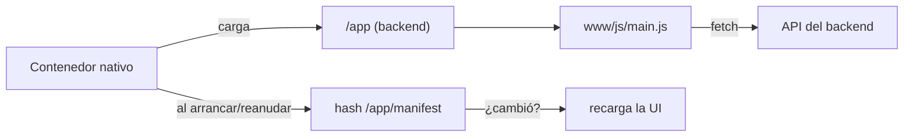

# Arquitectura de la app

La app móvil es una app **Capacitor** (Android) que corre *online*: el contenedor nativo es un envoltorio delgado cuyo WebView carga la UI en vivo desde el mount `/app` del backend. La mayoría de los cambios se publican recompilando el bundle web y redesplegando el backend — sin APK nuevo.

## Estructura

```
app/
├── src/
│   ├── main.js            # entrada: router, montaje de vistas
│   ├── views/             # home, contacts, profile, login, register
│   ├── lib/               # api.js, session.js, features.js, i18n.js, icons.js, …
│   └── ...
├── www/                   # servido por el backend en /app
│   ├── js/main.js         # el bundle compilado (salida de Bun)
│   └── css/styles.css     # servido directo (no se empaqueta)
├── assets/icon.png        # ícono de lanzador fuente (SOS)
├── build.js               # script de build de Bun (también genera www/offline.html)
└── android/, ios/         # contenedores nativos (Capacitor)
```

## El modelo online



- El **JS** se empaqueta desde `src/main.js` a `www/js/main.js` con Bun (`build.js`). `API_BASE_URL` se inyecta al compilar.
- El **CSS** (`www/css/styles.css`) se sirve directo — los cambios solo-CSS no necesitan rebuild.
- Al arrancar/reanudar, el contenedor revisa `/app/manifest` (un hash de contenido) y recarga el WebView cuando cambió, así un bundle redesplegado alcanza a las apps instaladas sin actualización de tienda.

## Respaldo sin conexión (offline)

Como la UI se carga desde el backend, un dispositivo que no puede alcanzar `API_BASE_URL` vería un WebView en blanco. El `server.errorPath` de Capacitor apunta a un `www/offline.html` local (generado por `build.js`, con la URL del backend horneada) que se muestra en su lugar — una pantalla "estás sin conexión" con la marca y un botón **Retry** que vuelve a `${API_BASE_URL}/app/`.

## Compilar

```bash
cd app
bun install
API_BASE_URL='https://tu-dominio' bun run build   # → www/js/main.js
```

Despliega enviando `app/www` con el backend (que sirve `/app`).

## Cuándo *sí* hace falta recompilar el APK

Solo para cambios que el contenedor nativo hornea: plugins/permisos nativos, el ícono de lanzador o el nombre de la app, la config de Capacitor, o la URL de inicio del contenedor. Un cambio puro de UI (vistas, estilos, i18n, toggles de canal) no. Ver [domain-change.md](../backend/domain-change.md) para el caso de dominio.

## Configuración desde el backend

La app pregunta `GET /features` una vez por sesión y se adapta: oculta la UI de un canal (Telegram / WhatsApp / SMS) cuando ese canal no está configurado, y lee `max_contacts` para que su límite de "agregar contacto" coincida con el backend. El token de auth se guarda con `@capacitor/preferences` y se envía como `Authorization: Bearer` en cada llamada.

## Compartir enlaces

Cuando un contacto no tiene email, activar Telegram/WhatsApp devuelve un enlace para compartir. `lib/share.js` abre el **share sheet nativo del sistema** (`@capacitor/share`), comprobando primero `Capacitor.isPluginAvailable("Share")` para que un binario instalado más viejo — que carga este JS nuevo en vivo pero no tiene el plugin nativo — caiga a copiar el enlace al portapapeles.
