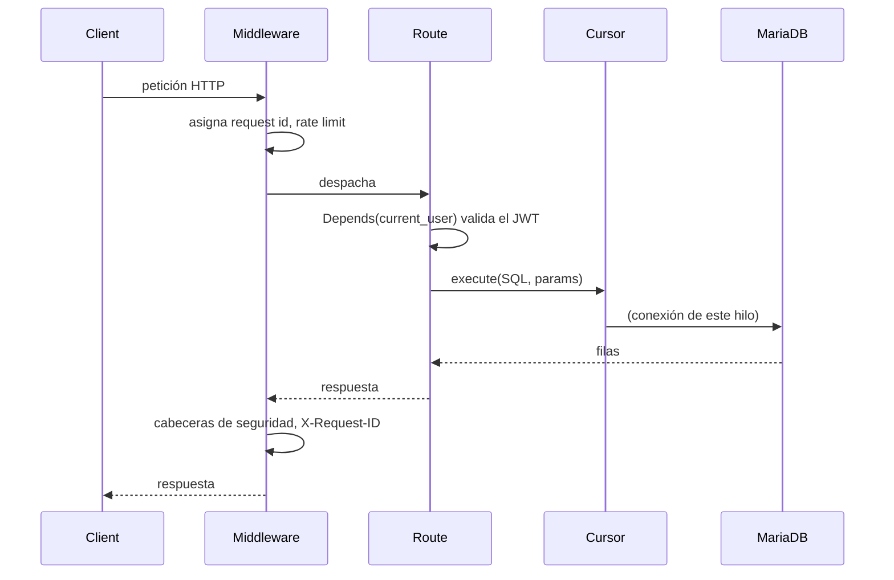

# Arquitectura del backend

Un servicio FastAPI sobre MariaDB, sin ORM. Las rutas son funciones planas; el SQL vive como strings parametrizados en un solo lugar.

## Estructura

```
backend/
├── main.py                 # ensamblado: lifespan, middleware, rutas, mounts estáticos
├── modules/
│   ├── credentials.py      # .env → un dict de config agrupado
│   ├── db.py, cursor.py    # acceso a MariaDB confinado por hilo + todo el SQL (Queries)
│   ├── guard.py, token.py  # hash de contraseñas, JWT
│   ├── dependencies.py     # dependencia de auth current_user
│   ├── types.py            # modelos Pydantic de petición/respuesta
│   ├── limiter.py          # limitador slowapi
│   ├── email_check.py      # chequeo de entregabilidad del dominio del destinatario
│   ├── mail.py             # canal SMTP
│   ├── telegram.py         # canal Telegram + webhook (autorreparable)
│   ├── whatsapp.py         # canal WhatsApp (Twilio) + verificación de firma
│   ├── sms.py              # canal SMS (Twilio)
│   ├── logs.py, pages.py, app_assets.py
│   └── routers/            # auth, users, contacts, alerts, features,
│                           #   telegram, whatsapp, dashboard
├── templates/              # Jinja: mail/, telegram/, whatsapp/, sms/, web/
├── static/                 # css, js, img (favicon), downloads (apk)
└── queries/                # creation.sql, tables.sql, migrations/
```

## Flujo de una petición



FastAPI corre las rutas `def` en un threadpool, así que varias peticiones pueden estar en curso a la vez. Cada hilo obtiene su **propia** conexión a MariaDB (ver [database.md](database.md)), de modo que `execute` / `rowcount` / `lastrowid` siempre describen la sentencia que *esta* petición acaba de correr.

## Middleware

Registrado en `main.py`:

- **SlowAPI** — límites de tasa en `register`, `login`, `alerts` (ver [operations.md](operations.md)).
- **CORS** — permite los orígenes de la app (`capacitor://localhost`, `http://localhost`, `https://localhost`).
- **Contexto de petición** — asigna un request id por petición (heredado por tareas en segundo plano para trazar el reparto de una alerta), captura errores no manejados en un `500` limpio, y pone cabeceras de seguridad (`X-Content-Type-Options`, `X-Frame-Options`, `Referrer-Policy`, `Permissions-Policy`).

## Arranque / apagado (`lifespan`)

1. **Verifica la base de datos** — abre una conexión de inmediato; se niega a arrancar si falla.
2. **Registra el webhook de Telegram** — si hay bot token, `EnsureWebhook` lo pone y verifica vía `getWebhookInfo`, reintentando ante fallos transitorios; el estado se registra. Una tarea **keeper** en segundo plano lo re-chequea y re-registra si deriva. Se cancela limpio al apagar.

## Routers

| Router | Prefijo | Propósito |
|---|---|---|
| `auth` | `/auth` | registro, login, confirmación de cuenta |
| `users` | `/users` | perfil, reautenticación de cambios sensibles |
| `contacts` | `/contacts` | CRUD + activar/desactivar por canal |
| `alerts` | `/alerts` | disparar alerta, listar alertas, enlace de mapa |
| `features` | `/features` | qué canales están configurados + `max_contacts` |
| `telegram` | `/telegram` | webhook de entrada del bot |
| `whatsapp` | `/whatsapp` | webhook de entrada de Twilio (opt-in) |
| `dashboard` | `/dashboard` | el panel web de alertas |

Más rutas de nivel superior en `main.py`: `/` (landing), `/health`, `/favicon.ico`, `/app` (el mount de la UI móvil) y `/static`.

## Canales de notificación

Cuatro canales independientes — `mail.py`, `telegram.py`, `whatsapp.py`, `sms.py` — con la misma forma `Send`/`SendBulk`. Ninguno conoce a los otros; `alerts.py` decide quién es notificado por qué canal(es) y llama a cada uno. Cada canal tiene un interruptor dry-run para correr contra credenciales reales sin enviar. Ver [notifications.md](notifications.md).
