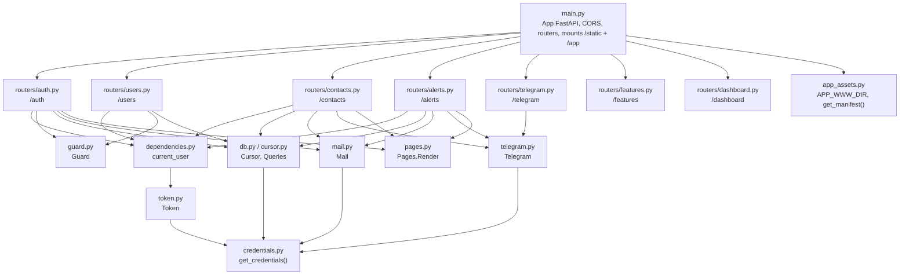
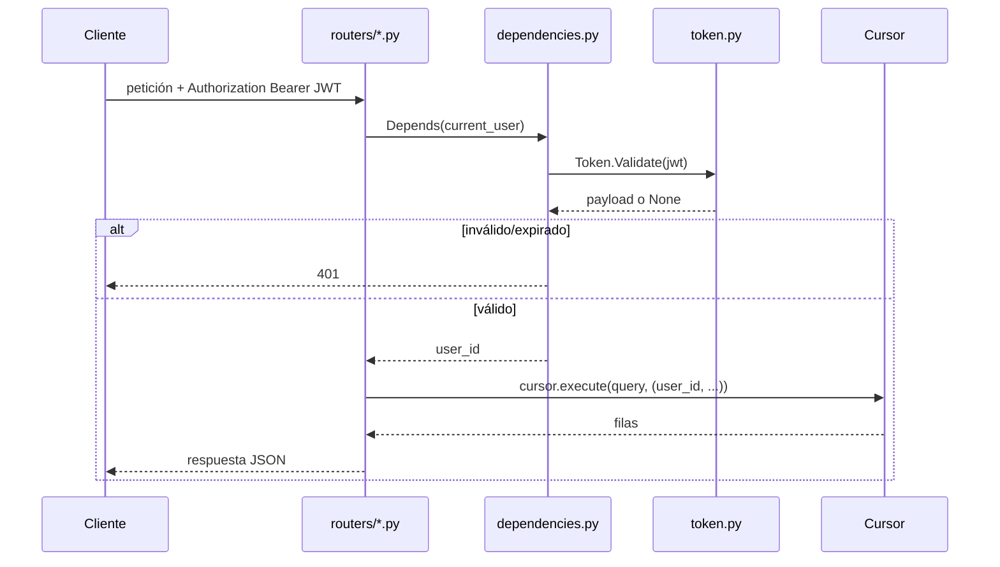

# Arquitectura del backend

`backend/` es una única aplicación FastAPI (`main.py`) dividida en `modules/` — sin capa de servicios, sin ORM: los routers llaman a `Cursor.execute()` directamente con SQL plano. Este documento cubre cómo `main.py` conecta todo; cada subsistema tiene su propio doc.

## Mapa de módulos



Cada módulo que necesita configuración llama a `get_credentials()` (`.env`, ver [`operations.md`](operations.md)) por sí mismo en vez de recibirla inyectada — no hay framework de inyección de dependencias aquí, solo imports directos.

## Flujo de una petición autenticada



## CORS

El WebView de la app móvil corre sobre un origen fijo de Capacitor (`capacitor://localhost` en Android; `https://localhost` también está permitido para iOS/dev), no el propio origen del backend — así que sus llamadas `fetch()` a esta API son cross-origin y quedan sujetas a CORS. `main.py` permite exactamente esos tres orígenes fijos, no un wildcard, ya que la app nunca corre desde ningún otro lugar:

```python
app.add_middleware(
    CORSMiddleware,
    allow_origins=["capacitor://localhost", "http://localhost", "https://localhost"],
    allow_methods=["*"],
    allow_headers=["*"],
)
```

## `APP_MODE`: interruptor de la documentación automática

```python
_docs_enabled: bool = get_credentials()['app_mode'] != "Deploy"

app = FastAPI(
    docs_url=("/docs" if _docs_enabled else None),
    redoc_url=("/redoc" if _docs_enabled else None),
    openapi_url=("/openapi.json" if _docs_enabled else None),
    ...
)
```

`APP_MODE=Deploy` no solo oculta `/docs`/`/redoc`/`/openapi.json` — pasar `None` hace que FastAPI nunca registre esas rutas, así que devuelven un `404` plano. Cualquier otro valor (incluido no definirla, el default) las deja habilitadas. Producción debería usar `Deploy` para que la superficie completa de la API no quede expuesta a cualquiera que pueda alcanzarla.

## Arranque: registrar el webhook de Telegram

```python
@asynccontextmanager
async def _lifespan(app: FastAPI):
    if _credentials['telegram']['bot_token']:
        try:
            await Telegram.SetWebhook(f"{_credentials['api_base_url']}/telegram/webhook")
        except Exception as e:
            _logger.error(f"Could not register Telegram webhook: {e}")
    yield
```

Best-effort y no bloqueante: un despliegue sin bot de Telegram configurado igual arranca con normalidad, solo que sin esa función. Esto también implica que `API_BASE_URL` debe ser una URL `https://` real y públicamente alcanzable para que el registro realmente funcione — Telegram no puede llamar de vuelta a `127.0.0.1`, así que en desarrollo local este paso registra un error en el log y no hace nada más, sin causar problemas (ver [`notifications.md`](notifications.md)).

## `/static` y `/app`: dos mounts estáticos sin relación entre sí

```python
app.mount("/static", StaticFiles(directory=BACKEND_DIR / "static"), name="static")
...
app.mount("/app", _NoCacheStaticFiles(directory=APP_WWW_DIR, html=True), name="app")
```

- **`/static`** sirve `backend/static/` — CSS/JS/imágenes de las páginas propias de este backend (landing, dashboard, confirmación), más la descarga del APK. Ver [`web-pages.md`](web-pages.md).
- **`/app`** sirve `app/www/` — la UI compilada de la app móvil, con una política de cacheo particular para que un cambio de versión llegue a un WebView ya abierto. Ver [`app/architecture.md`](../app/architecture.md) y [`web-pages.md`](web-pages.md).

No están relacionados: `/static` nunca necesita señalar "el archivo cambió, recarga ahora" como sí lo hace `/app`, ya que una pestaña de navegador que recarga `/dashboard` de todas formas vuelve a pedir todo.

## Orden de registro de rutas

`GET /app/manifest` se registra como ruta exacta *antes* de `app.mount("/app", ...)`. Starlette compara las rutas en el orden en que se registraron, así que la ruta exacta gana para esa URL puntual, y todo lo demás bajo `/app/*` cae al mount — `/app/manifest` nunca se confunde con "un archivo llamado `manifest` dentro de `app/www`".
