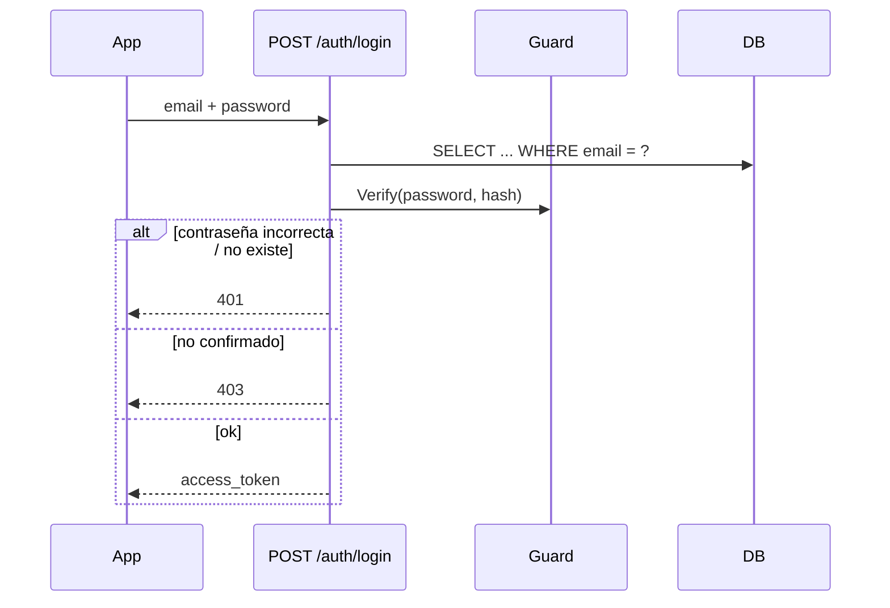

# Autenticación

Dos piezas independientes: `Guard` (hash de contraseñas) y `Token` (JWT). Ninguna toca la base de datos — los routers las combinan con llamadas a `Cursor`.

## Hash de contraseñas — `guard.py`

```python
class Guard:
    Hash(password) -> str      # guardar esto, nunca el texto plano
    Verify(password, stored_hash) -> bool
```

El `CryptContext` de `passlib` con **bcrypt** maneja el salting. `deprecated="auto"` significa que si la lista de esquemas alguna vez crece, los hashes viejos siguen verificando mientras los nuevos usan el esquema más reciente.

## JWT — `token.py`

Un secreto (`JWT_SECRET_KEY`), algoritmo `HS256`, y cuatro *propósitos* de token distinguidos por un claim `type` — así un enlace de confirmación nunca puede reproducirse como una sesión de login, aunque ambos sean "solo un JWT válido":

| Propósito | Creado por | Payload | Expira |
|---|---|---|---|
| Sesión de login | `Token.Create` | `sub` (id de usuario), `type=session` | 30 días |
| Confirmación de cuenta | `Token.CreateUserConfirmation` | `user_id`, `type=user_confirmation` | 24 h |
| Confirmación de contacto | `Token.CreateContactConfirmation` | `contact_id`, `type=contact_confirmation` | 7 días |
| Enlace de vista de alerta | `Token.CreateAlertNotificationView` | `notification_id`, `type=alert_notification_view` | 30 días |

`Token.Validate` solo verifica firma/expiración y devuelve el payload crudo o `None`. Cada wrapper `Validate<Propósito>` además verifica que `payload["type"]` coincida antes de confiar en el id que contiene — "cualquier firma válida" no basta.

El enlace de vista de alerta vive más que los de confirmación (30 días) porque un contacto puede reabrir el mapa bastante después de una alerta, pero igual expira para que un mensaje viejo no revele una ubicación para siempre.

## `current_user`

```python
def current_user(credentials = Depends(_security)) -> int:
    user_id = Token.ValidateSession(credentials.credentials)
    if user_id is None:
        raise HTTPException(401, "Invalid or expired token")
    return user_id
```

El `HTTPBearer` de FastAPI extrae `Authorization: Bearer <token>`; cada ruta protegida declara `user_id: int = Depends(current_user)`. `ValidateSession` exige el claim `type=session`, así que solo un token de login real abre una ruta protegida — cualquier otro JWT válido se rechaza con `401`.

## Login



La app guarda `access_token` (`@capacitor/preferences`) y lo envía como `Authorization: Bearer <token>` en cada llamada autenticada.

## Reautenticación para cambios sensibles

Cambiar el email o la contraseña de la cuenta (`PUT /users/me`) requiere la **contraseña actual** en el cuerpo (`current_password`), aun con un token de sesión válido. Un token de 30 días es cómodo pero de larga vida; volver a pedir la contraseña significa que un token robado por sí solo no basta para apropiarse de la cuenta. El chequeo verifica `current_password` contra el hash almacenado (falta → `400`, incorrecta → `403`); editar solo nombre o teléfono no la pide. Cuando cambia un campo sensible, se envía un aviso de seguridad a la dirección que figuraba **antes** del cambio, para que el dueño legítimo se entere aunque el propio email se haya cambiado (ver [notifications.md](notifications.md)).
