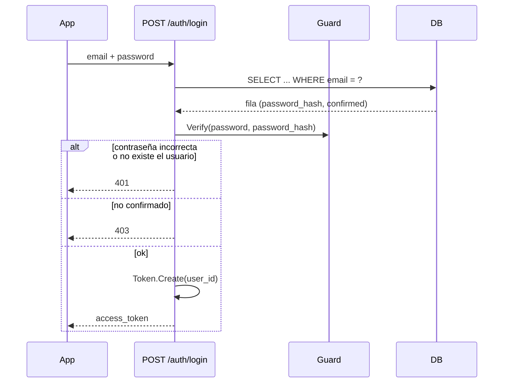

# Autenticación

Dos piezas independientes: `Guard` (hash de contraseñas) y `Token` (JWT). Ninguna de las dos habla con la base de datos — los routers las combinan con llamadas a `Cursor`.

## Hash de contraseñas — `guard.py`

```python
pwd_context = CryptContext(schemes=["bcrypt"], deprecated="auto")

class Guard:
    Hash(password) -> str      # guardar esto, nunca la contraseña en texto plano
    Verify(password, stored_hash) -> bool
```

El `CryptContext` de `passlib` maneja el salting de bcrypt; `deprecated="auto"` significa que si la lista de esquemas alguna vez crece, un hash viejo sigue verificando mientras los nuevos usan el esquema más reciente — no se usa hoy (solo hay un esquema), pero queda disponible sin costo.

## JWT — `token.py`

Un secreto (`JWT_SECRET_KEY`, ver [`operations.md`](operations.md)), un algoritmo (`HS256`), cuatro *propósitos* de token distinguidos por un claim `"type"` incluido en el payload — así un enlace de confirmación nunca puede reproducirse como una sesión de login, aunque ambos sean "solo un JWT válido":

| Propósito | Creado por | Payload | Expira |
|---|---|---|---|
| Sesión de login | `Token.Create` | `sub` (id de usuario), `type=session` | 30 días |
| Confirmación de cuenta | `Token.CreateUserConfirmation` | `user_id`, `type=user_confirmation` | 24h |
| Confirmación de contacto | `Token.CreateContactConfirmation` | `contact_id`, `type=contact_confirmation` | 7 días |
| Enlace de vista de alerta | `Token.CreateAlertNotificationView` | `notification_id`, `type=alert_notification_view` | 30 días |

`Token.Validate(token)` solo verifica firma/expiración (`jwt.decode`, capturando `InvalidTokenError`) y devuelve el payload crudo o `None`. Cada wrapper `Validate<Propósito>` llama a eso, y además verifica que `payload["type"]` coincida antes de confiar en el id que contiene — un token de confirmación de contacto presentado donde se espera un token de login falla por el chequeo de tipo, no basta con "cualquier firma válida". El token de sesión lleva su propio claim `type=session` justamente por esto, de modo que un token de confirmación o de vista de alerta nunca puede hacerse pasar por uno de login.

El enlace de vista de alerta vive más que los enlaces de confirmación (30 días en lugar de horas): un contacto puede querer reabrir el mapa bastante después de una alerta, pero el enlace igualmente expira para que un mensaje antiguo no revele una ubicación indefinidamente.

## `current_user`: la dependencia de autenticación

```python
def current_user(credentials: HTTPAuthorizationCredentials = Depends(_security)) -> int:
    user_id = Token.ValidateSession(credentials.credentials)
    if user_id is None:
        raise HTTPException(status_code=401, detail="Invalid or expired token")
    return user_id
```

`HTTPBearer` de FastAPI extrae el header `Authorization: Bearer <token>`; cada ruta protegida (`/users/me`, `/contacts`, `/alerts`, ...) declara `user_id: int = Depends(current_user)` y recibe un `int`, o la petición nunca llega al cuerpo de la ruta. `ValidateSession` exige el claim `type=session`, así que solo un token de login real abre una ruta protegida — cualquier otro JWT válido se rechaza con un `401`.

## Secuencia de login



La app guarda `access_token` vía `@capacitor/preferences` (`app/src/lib/session.js`) y lo envía como `Authorization: Bearer <token>` en cada llamada autenticada posterior (`app/src/lib/api.js`).

## Reautenticación para cambios sensibles

Cambiar el email o la contraseña de la cuenta en `PUT /users/me` requiere la **contraseña actual** en el cuerpo de la petición (`current_password`), aunque el token de sesión ya sea válido. Un token de 30 días es cómodo pero de larga vida; volver a pedir la contraseña significa que un token robado por sí solo no basta para apropiarse de una cuenta cambiándole el email o la contraseña de acceso. La comprobación verifica `current_password` contra el hash almacenado antes de aplicar el cambio — si falta es un `400`, si es incorrecta un `403`. Editar solo el nombre o el teléfono no la pide. Cuando cualquiera de esos campos sensibles sí cambia, se envía un aviso por correo a la dirección que figuraba *antes* del cambio, de modo que el dueño legítimo se entere aunque el propio email se haya cambiado (ver [`notifications.md`](notifications.md)).
