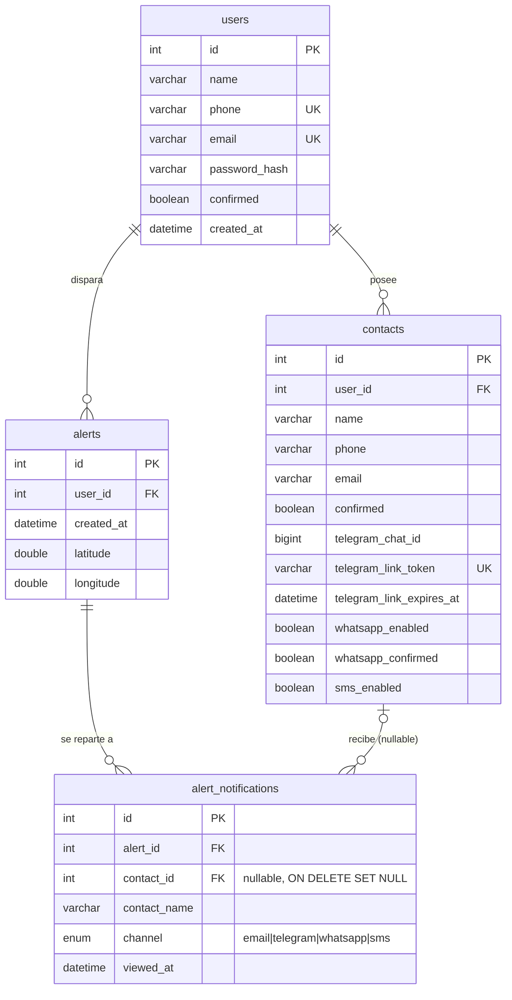

# Base de datos

MariaDB, sin ORM, sin framework de migraciones. `queries/` tiene el SQL que un operador ejecuta a mano; `modules/cursor.py` tiene cada query que la app ejecuta, como strings SQL parametrizados planos.

## Esquema



`queries/tables.sql` es la fuente de verdad para una instalación nueva.

- **`users.confirmed`** condiciona el login (`403` hasta que sea true) — se activa con el enlace del correo de registro. Una cuenta sin confirmar no puede poseer nada, así que `scripts/purge_unconfirmed_users.py` puede borrar las viejas sin riesgo.
- **`contacts`** lleva un conjunto de estado por canal: `confirmed` (email), `telegram_chat_id` (+ token/vencimiento de enlace de un solo uso), `whatsapp_enabled`/`whatsapp_confirmed`, y `sms_enabled`. Un contacto es notificado por un canal solo cuando se cumple la condición de ese canal (ver [notifications.md](notifications.md)).
- **`alert_notifications`** es una fila por `(alerta, contacto, canal)`. Guarda el **`contact_name`** al momento del envío y su FK `contact_id` es **`ON DELETE SET NULL`** — así, borrar un contacto conserva el historial de la alerta (la fila sobrevive con el nombre; solo se limpia el enlace al contacto vivo). `viewed_at` marca la primera vez que se abrió ese enlace de vista específico.

## `Cursor`: una conexión por hilo

FastAPI corre las rutas `def` en un threadpool. Una sola conexión compartida dejaría que las peticiones intercalen `execute` / `rowcount` / `lastrowid` sobre el mismo cursor — una petición leyendo el id de inserción de otra. Cada hilo obtiene su propia conexión y cursor, creados en el primer uso y conservados para ese hilo (vía `threading.local()`); el objeto `cursor` compartido que cada módulo importa es solo el despachador frente a ellos.

```python
conn = mariadb.connect(..., client_flag=CLIENT.FOUND_ROWS, autocommit=True)
```

Dos flags no default, cada uno corrigiendo un bug real:

- **`CLIENT.FOUND_ROWS`** — sin esto, un `UPDATE` que encuentra una fila pero no cambia nada reporta `rowcount = 0`, indistinguible de "ninguna coincidencia". Cada chequeo de existencia/pertenencia depende de que `rowcount` signifique "filas encontradas".
- **`autocommit = True`** — un respaldo para que una escritura suelta (o un simple `SELECT`, que igual abre transacción) no deje una fila bloqueada. Los pocos caminos leer-luego-escribir que deben ser atómicos usan `cursor.transaction()`, una transacción explícita en la conexión del hilo que llama.

`execute()` reintenta una vez ante `mariadb.InterfaceError` (el "server has gone away" tras `wait_timeout`) reconectando — así un backend inactivo se recupera en la siguiente petición en vez de necesitar un reinicio. Un `mariadb.IntegrityError` (violación de UNIQUE) se traduce a `DuplicateRecordError`, que los routers convierten en `409`. Al arrancar, `cursor.verify()` abre una conexión de inmediato para que una base mal configurada falle ruidosamente.

## `Queries`

La clase `Queries` de `modules/cursor.py` es un namespace de constantes `str` — `SELECT_USER_BY_EMAIL`, `INSERT_CONTACT`, `SELECT_CONFIRMED_CONTACTS_BY_USER`, etc. Las rutas que necesitan un `UPDATE … SET <columnas dinámicas>` puntual (actualizaciones parciales en `PUT /users/me`, `PUT /contacts/{id}`) lo arman inline; todo lo reutilizado vive acá.

## Provisionar y migrar

Ver [setup.md](setup.md) para crear una base desde `creation.sql` + `tables.sql`, y [operations.md](operations.md) para aplicar los archivos de `migrations/` a una base existente.
