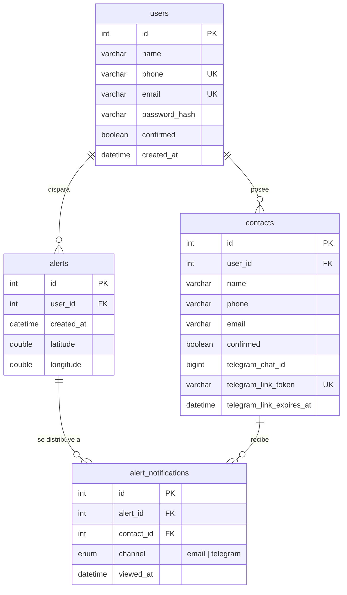

# Base de datos

MariaDB, sin ORM, sin framework de migraciones. `queries/` (raíz del repo) tiene el SQL que un administrador ejecuta a mano para provisionar una base de datos; `modules/cursor.py` tiene cada query que la app ejecuta contra ella, como strings SQL parametrizados planos.

## Esquema



(`queries/tables.sql` es la fuente de verdad — este diagrama lo refleja.)

- **`users.confirmed`** condiciona el login (`POST /auth/login` devuelve `403` hasta que sea `true`) — se activa haciendo clic en el enlace del correo de registro. Una cuenta que nunca se confirma no puede tener contactos ni alertas, así que `scripts/purge_unconfirmed_users.py` puede borrar sin riesgo cualquiera que siga sin confirmar 24h después del registro (ver [`operations.md`](operations.md)).
- **`contacts.confirmed`** y **`contacts.telegram_chat_id`** son dos canales de notificación independientes para el mismo contacto — una alerta de pánico los alcanza por el que esté activo (o ambos). `telegram_link_token`/`telegram_link_expires_at` son estado de un solo uso y con vencimiento para el enlace de vinculación (ver [`notifications.md`](notifications.md)); se limpian de vuelta a `NULL` una vez vinculado.
- **`alert_notifications`** es una fila por `(alerta, contacto, canal)` — un contacto confirmado por email y por Telegram genera dos filas para la misma alerta. `viewed_at` se marca la primera vez que se abre ese enlace específico, que es cómo el dashboard muestra confirmación de entrega por contacto y por canal.

## `Cursor`: una sola conexión, viva durante toda la vida del proceso

```python
class Cursor:
    def __init__(self, username, password, host, port, database):
        self.conn = mariadb.connect(..., client_flag=CLIENT.FOUND_ROWS, autocommit=True)
        self.cursor = self.conn.cursor(dictionary=True)
```

Dos flags de conexión no default, ambos corrigiendo bugs reales encontrados en producción:

- **`CLIENT.FOUND_ROWS`** — sin esto, un `UPDATE` que encuentra una fila pero no cambia su valor reporta `rowcount = 0`, indistinguible de "ninguna fila coincidió". Cada verificación de existencia/pertenencia en este código (`if cursor.rowcount == 0: raise 404`) depende de que `rowcount` signifique "filas encontradas", no "filas modificadas" — un enlace de confirmación clickeado dos veces, o una edición que reenvía el mismo valor, no debe dar 404.
- **`autocommit = True`** — cada escritura ya llama a `cursor.commit()` explícitamente; esto es un respaldo para que una escritura suelta en un camino que se olvida de hacerlo (o un simple `SELECT`, que igual abre una transacción bajo el nivel de aislamiento default de MariaDB) no deje una fila bloqueada indefinidamente en esta única conexión compartida.

`execute()` reintenta una vez ante `mariadb.InterfaceError` (el clásico "MariaDB server has gone away" de una conexión inactiva cerrada del lado del servidor tras `wait_timeout`) reconectando y reejecutando la query — como el proceso mantiene una sola conexión durante toda su vida en vez de usar un pool, esto es lo que evita que un backend inactivo toda la noche necesite un reinicio manual. Un `mariadb.IntegrityError` (violación de una restricción `UNIQUE` — teléfono/email duplicado, etc.) se traduce a `DuplicateRecordError`, que los routers capturan y convierten en un `409`.

## `Queries`: todo el SQL, en un solo lugar

La clase `Queries` de `modules/cursor.py` es un namespace de constantes `str` — `SELECT_USER_BY_EMAIL`, `INSERT_CONTACT`, `CONFIRM_CONTACT_TELEGRAM`, etc. Los routers que necesitan un `UPDATE ... SET <lista dinámica de columnas>` puntual (actualizaciones parciales en `PUT /users/me`, `PUT /contacts/{id}`) arman esa query inline en su lugar — todo lo que se reutiliza en más de un lugar vive acá.

## Provisionar una base de datos

```bash
mariadb -u root
```

```sql
-- queries/creation.sql (ajustar los placeholders)
CREATE DATABASE <nombre de la base de datos> CHARACTER SET utf8mb4 COLLATE utf8mb4_unicode_ci;
CREATE USER '<usuario>'@'localhost' IDENTIFIED BY '<contraseña>';
GRANT ALL PRIVILEGES ON <nombre de la base de datos>.* TO '<usuario>'@'localhost';
FLUSH PRIVILEGES;
```

Luego correr `queries/tables.sql` contra esa base para crear las cuatro tablas. `queries/insertions.sql` tiene ejemplos de `INSERT` (un usuario, dos contactos, una alerta) para pruebas manuales — no hay script de seed/fixtures más allá de eso, un entorno nuevo arranca con la base vacía.
