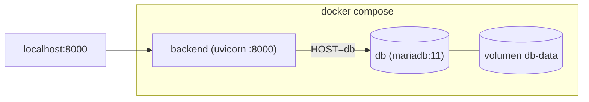

# Ejecutar el backend con Docker

El repositorio incluye un setup de contenedores para el backend:

- **`backend/Dockerfile`** — construye una imagen que corre el backend FastAPI.
- **`backend/docker-compose.yml`** — corre esa imagen junto a un servicio MariaDB como un solo stack.
- **`.dockerignore`** (raíz del repo) — mantiene pequeño el contexto de build.

## Requisitos

- **Docker Desktop** (Windows/macOS) o Docker Engine + el plugin Compose (Linux). Confirma que está corriendo:
  ```bash
  docker --version
  docker compose version
  docker info          # debe alcanzar el daemon
  ```

## Inicio rápido

Desde el directorio `backend/`:

```bash
docker compose up -d --build
```

Esto construye la imagen del backend, arranca MariaDB, espera a que la base esté sana, y luego arranca el backend. Verifícalo:

```bash
curl http://127.0.0.1:8000/health      # {"status":"ok","database":true}
```

- Landing: `http://127.0.0.1:8000/`
- Dashboard: `http://127.0.0.1:8000/dashboard`
- Detener todo: `docker compose down` (agrega `-v` para borrar también el volumen de la base).

## Cómo se construye la imagen

El Dockerfile es **multi-stage** y su **contexto de build es la raíz del repositorio** (no `backend/`), porque el backend sirve la UI compilada de la app móvil desde `../app/www` y esa carpeta debe estar dentro de la imagen.

- **etapa builder** — instala las dependencias de Python con `uv` en `/opt/venv`. Necesita `build-essential` + `libmariadb-dev` porque el conector `mariadb` se compila contra los headers de MariaDB Connector/C.
- **etapa runtime** — imagen slim con solo `libmariadb3`, el virtualenv y la app. Replica la estructura del repo para que las rutas resuelvan:
  - `/srv/backend` — el código del backend (directorio de trabajo)
  - `/srv/app/www` — la UI móvil servida en `/app`
  Corre como usuario no-root, expone `8000`, tiene un HEALTHCHECK a `/health`, y arranca `uvicorn … --proxy-headers`.

Compose fija el contexto por ti:

```yaml
build:
  context: ..
  dockerfile: backend/Dockerfile
```

Para construir la imagen sin Compose, corre desde la **raíz del repo**:

```bash
docker build -f backend/Dockerfile -t panicbutton-backend .
```

## El stack de compose



- Dos contenedores en una red privada; el backend alcanza la base como host **`db`**.
- La base persiste en el volumen **`db-data`** (sobrevive a `down`; se borra con `down -v`).
- En el **primer** arranque de la base, `queries/tables.sql` se carga automáticamente (montado en `/docker-entrypoint-initdb.d/`), así el esquema se crea solo. Si luego cambias `tables.sql`, recrea el volumen (`down -v` y `up`) para que vuelva a correr.

## Configuración

El backend lee `backend/.env` (vía `env_file`) para sus secretos y canales — JWT, SMTP, Telegram, Twilio, `API_BASE_URL`, `APP_MODE` (ver [operations.md](operations.md)). Las **credenciales de la base incluida** se fijan aparte, mediante variables de Compose:

| Variable de Compose | Default | Para |
|---|---|---|
| `DB_USERNAME` | `panic` | usuario de la app en MariaDB (y el `USERNAME` del backend) |
| `DB_PASSWORD` | `panic` | su contraseña |
| `DB_NAME` | `panicbutton` | la base de datos |
| `DB_ROOT_PASSWORD` | `change-me-root` | contraseña root de MariaDB |

Ponlas en `backend/.env` (o en el shell) para sobreescribir los defaults; tanto `db` como `backend` leen los mismos valores, así que no se desincronizan.

> **¿Por qué `DB_USERNAME` y no `USERNAME`?** En Windows el shell ya define `USERNAME` (la cuenta que inició sesión), y la interpolación de Docker Compose prefiere el shell sobre el `.env` — así que `${USERNAME}` crearía el usuario de la base con el nombre de tu cuenta de Windows en vez del que querías. Los nombres dedicados `DB_*` no chocan. (El backend igual lee `USERNAME` *dentro* del contenedor, donde no hay tal choque; Compose lo fija desde `DB_USERNAME`.)

## Usar una base de datos externa

Si ya corres MariaDB en otro lado, omite el servicio `db` y apunta el backend a ella: fija `HOST`, `PORT`, `USERNAME`, `PASSWORD`, `DATABASE` en el `.env`, aplica el esquema/migraciones tú mismo (ver [operations.md](operations.md)), y corre solo el backend:

```bash
docker build -f backend/Dockerfile -t panicbutton-backend .
docker run --rm -p 8000:8000 --env-file backend/.env panicbutton-backend
```

Si esa MariaDB corre en el host de Docker, pon `HOST=host.docker.internal` (no `127.0.0.1`, que dentro del contenedor es el propio contenedor).

## Notas de producción

- Pon `API_BASE_URL` con la URL pública **HTTPS** y `APP_MODE=Deploy` (oculta `/docs`).
- Termina TLS en un proxy inverso frente al contenedor; la imagen ya corre uvicorn con `--proxy-headers`.
- Usa un `DB_PASSWORD` / `DB_ROOT_PASSWORD` reales y un `JWT_SECRET_KEY` fuerte; nunca commitees `.env`.
- Comandos útiles: `docker compose logs -f backend`, `docker compose ps`, `docker compose down`.
