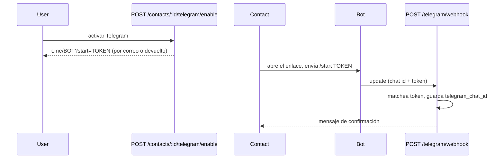

# Notificaciones — cuatro canales

Cuatro canales de entrega independientes para los mismos eventos (confirmación de contacto, alertas de pánico): **email** (`mail.py`), **Telegram** (`telegram.py`), **WhatsApp** (`whatsapp.py`) y **SMS** (`sms.py`). Cada uno tiene la misma forma `Send`/`SendBulk` y un interruptor dry-run; ninguno conoce a los otros. `alerts.py` decide a quién se alcanza por qué canal y llama a cada uno.

## Quién es notificado

`SELECT_CONFIRMED_CONTACTS_BY_USER` devuelve un contacto si **algún** canal está activo, luego `alerts.py` re-chequea cada canal por separado:

| Canal | Se envía cuando | Dirección |
|---|---|---|
| Email | `email` puesto **y** `confirmed = TRUE` | email del contacto |
| Telegram | `telegram_chat_id` puesto | ese chat |
| WhatsApp | `whatsapp_enabled` **y** `whatsapp_confirmed` | teléfono del contacto |
| SMS | `sms_enabled` | teléfono del contacto |

Cada `(alerta, contacto, canal)` obtiene su propia fila `alert_notifications` con el nombre del contacto y un token de vista sin vencimiento, así "¿este contacto, por este canal, abrió el mapa?" se rastrea por canal y se muestra en el panel.

## Reparto (fan-out)

```mermaid
sequenceDiagram
    participant App
    participant Alerts as POST /alerts
    participant DB
    App->>Alerts: latitud, longitud + JWT
    Alerts->>DB: INSERT alerta; SELECT contactos confirmados
    loop cada contacto × canal activo
        Alerts->>DB: INSERT alert_notifications
    end
    Alerts-->>App: 201 con conteos por canal
    par background
        Alerts->>Alerts: lote email
    and
        Alerts->>Alerts: lote Telegram
    and
        Alerts->>Alerts: lote WhatsApp
    and
        Alerts->>Alerts: lote SMS
    end
```

Los cuatro lotes se encolan como tareas en segundo plano separadas y el fallo de cada canal se captura, no se lanza — `BackgroundTasks` se detiene ante la primera excepción, así que un buzón roto nunca debe detener los lotes de Telegram/WhatsApp/SMS encolados después. Durante una alerta real, un canal caído no puede silenciar a los otros.

## Email

SMTP sobre `aiosmtplib`, plantillas Jinja en `templates/mail/*.{html,txt}.j2` (ambas renderizadas). `Send` abre una conexión por correo; `SendBulk` reutiliza una sola para todo el lote. Con `SMTP_ENABLED=false`, ambos registran lo que *enviarían* y retornan sin conectar (dry-run para dev local).

**Chequeo de entregabilidad.** Antes de aceptar cualquier dirección — registro, email de un contacto, cambio de email — se verifica que su dominio tenga servidor de correo (MX/A). Un typo como `gmial.com` se rechaza con `422`, así no se crea un registro cuya confirmación solo podría rebotar. Se alterna con `SMTP_VERIFY_DELIVERABILITY`.

**Confirmación de contacto (email).** Agregar un contacto con email encola un enlace de confirmación; al clicarlo se activa `confirmed`. Editar el email reinicia el flujo (vuelve a no confirmado, enlace nuevo). `POST /contacts/{id}/confirm/resend` reenvía sin editar.

**Aviso de cambio de cuenta.** Cambiar el email o la contraseña de la cuenta envía la plantilla `security_alert` a la dirección que figuraba *antes* del cambio, para que una apropiación no ocurra en silencio.

## Telegram

HTTP a la Bot API (`httpx`), plantillas de texto plano en `templates/telegram/`. El parámetro `start` de los deep-link de Telegram solo permite `[A-Za-z0-9_-]`, así que la vinculación de contacto usa un token opaco respaldado en base de datos en vez de un JWT.



**Seguridad del webhook y autorreparación.** `POST /telegram/webhook` verifica `X-Telegram-Bot-Api-Secret-Token` contra `TELEGRAM_WEBHOOK_SECRET`. La URL del webhook la **registra el backend** al arrancar (`EnsureWebhook`: set + verificar vía `getWebhookInfo`, con reintentos) y una tarea keeper la re-afirma si deriva. Cada golpe y cada motivo de ignorar/fallar se registra, así que un webhook mal registrado es visible en vez de silencioso (ver [operations.md](operations.md)).

## WhatsApp

Twilio Messages API (`httpx`). Como una alerta de pánico es iniciada por el negocio y suele estar fuera de la ventana de 24 h de texto libre de WhatsApp, las alertas se envían por una **plantilla aprobada** cuando `TWILIO_WHATSAPP_TEMPLATE_SID` está puesto (cuerpo de texto libre si no, para sandbox). Configuración completa en [twilio.md](twilio.md).

**Opt-in.** Activar WhatsApp en un contacto pone `whatsapp_enabled` y devuelve un enlace `wa.me`. Cuando el contacto escribe al número, Twilio llama a `POST /whatsapp/webhook` (verificado por firma de Twilio), que lo matchea por teléfono y pone `whatsapp_confirmed`. Ambos flags deben ser true para notificar. A diferencia de Telegram, este webhook se **configura a mano** en Twilio — no se auto-registra.

## SMS

Twilio Messages API, una plantilla corta de texto (`templates/sms/panic_alert.txt.j2`). Sin opt-in, sin plantilla, sin ventana de 24 h — SMS es un toggle por contacto (`sms_enabled`): actívalo y los contactos confirmados reciben un texto en la siguiente alerta. Los detalles (A2P 10DLC, geo-permisos) están en [twilio.md](twilio.md).
