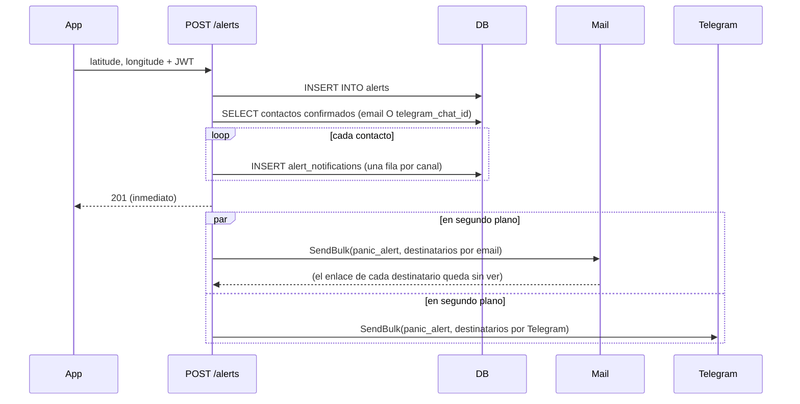
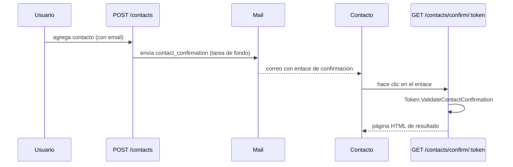
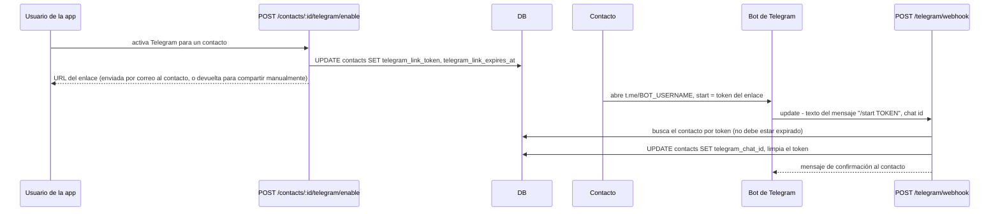

# Notificaciones: correo + Telegram

Dos canales de entrega independientes y paralelos para los mismos eventos (confirmación de contacto, alertas de pánico): `mail.py` (`Mail`) y `telegram.py` (`Telegram`). Ninguno sabe del otro — los routers deciden a quién notificar por cuál(es) canal(es) y llaman a ambos.

## `Mail`

SMTP vía `aiosmtplib`, plantillas Jinja bajo `templates/mail/*.{html,txt}.j2` (se renderizan ambas — HTML con un fallback en texto plano en el mismo mensaje). `Mail.Send` abre una conexión por correo; `Mail.SendBulk` abre una única conexión SMTP y la reutiliza para cada destinatario, ya que una alerta de pánico puede distribuirse a varios contactos a la vez.

```python
await Mail.SendBulk(subject, template, [(email, context), ...])
```

Una falla para un destinatario dentro de `SendBulk` se registra en el log y se acumula, no se lanza de inmediato — solo después de todo el lote lanza `MailNotSentError` listando quién falló, así una dirección mala no detiene el envío al resto.

Cuando `SMTP_ENABLED` está desactivado (ver [`operations.md`](operations.md)), tanto `Send` como `SendBulk` registran lo que *habrían* enviado y retornan sin abrir conexión — para desarrollo local contra una cuenta SMTP real sin entregar nada.

## `Telegram`

Llamadas HTTP a la API de Bots de Telegram (`httpx`), plantillas bajo `templates/telegram/*.txt.j2` (solo texto plano — Telegram no tiene equivalente a un correo HTML). Misma forma `Send`/`SendBulk` que `Mail`, más `SetWebhook` (llamado una vez al arrancar, ver [`architecture.md`](architecture.md)).

## Por qué `alerts.py` trata una falla de correo como no fatal

```python
async def _notify_by_mail(subject, template, recipients):
    try:
        await Mail.SendBulk(subject, template, recipients)
    except MailNotSentError:
        pass  # ya quedó registrado dentro de SendBulk
```

`BackgroundTasks` ejecuta sus tareas encoladas en orden y se detiene ante la primera excepción. `create_alert` encola el lote de correo y el de Telegram como dos tareas de fondo separadas — si se dejara propagar la excepción de la tarea de correo, la tarea de Telegram encolada justo después nunca correría. Durante una alerta de pánico real, un correo roto nunca debe ser la razón por la que un contacto que solo tiene Telegram no se entera.

## Distribución de una alerta de pánico



Un contacto necesita *o bien* `confirmed = TRUE` (email) o un `telegram_chat_id` definido — los dos canales son independientes, no secuenciales; alguien que nunca hizo clic en el correo de confirmación pero sí vinculó Telegram igual es notificado. Cada `(alerta, contacto, canal)` obtiene su propia fila en `alert_notifications` y su propio token de enlace de vista sin expiración (ver [`auth.md`](auth.md)), así que "este contacto específico, en este canal específico, abrió el mapa" se rastrea por separado — visible en el dashboard.

## Confirmación de contacto (correo)



Un contacto agregado *sin* email se salta este paso por completo — solo queda habilitado para alertas vía Telegram.

Editar la dirección de email de un contacto (`PUT /contacts/{id}`) reinicia este flujo: el contacto vuelve a marcarse como no confirmado y sale un nuevo correo de confirmación a la nueva dirección. Corregir una dirección mal escrita, por tanto, la vuelve a verificar, en vez de dejar el contacto "confirmado" contra una dirección que en realidad nunca recibió nada. `POST /contacts/{id}/confirm/resend` envía el mismo correo de nuevo sin ninguna edición, para cuando el primero se perdió — solo aplica a un contacto que tiene email y aún no ha confirmado.

## Verificar que una dirección puede recibir correo

Antes de aceptar cualquier dirección — una cuenta nueva (`POST /auth/register`), un contacto con email, o un cambio de email en cualquiera de los dos — se comprueba que su dominio tenga un servidor de correo (un registro MX o A). Un error de tipeo como `gmial.com` o un dominio inventado se rechaza con un `422` en ese punto, así el sistema nunca crea un registro cuyo correo de confirmación solo podría rebotar. Esto confirma que el dominio puede recibir correo, no que el buzón concreto exista; el enlace de confirmación sigue siendo lo que prueba que la dirección es real y pertenece a la persona correcta. La comprobación puede desactivarse (`SMTP_VERIFY_DELIVERABILITY`, ver [`operations.md`](operations.md)) para desarrollo sin conexión.

## Avisos de cambio de cuenta

Cambiar el email o la contraseña de la cuenta (ver [`auth.md`](auth.md)) envía un aviso de seguridad — la plantilla `security_alert` — a la dirección que figuraba *antes* del cambio. Si se cambia una dirección de email, el dueño anterior igual se entera, así una apropiación de cuenta no puede ocurrir en silencio.

## Vinculación con Telegram

El parámetro `start` de los deep links propios de Telegram solo permite `[A-Za-z0-9_-]`, algo que un JWT (separado por puntos) no puede cumplir — así que, a diferencia de cualquier otro flujo de confirmación, este usa un token opaco respaldado en base de datos en vez de un JWT.



- Si el contacto ya tiene un email registrado, el enlace se envía por correo (plantilla `telegram_link`) y la respuesta de la API omite la URL (`{"telegram_link_url": null}`) — la app no necesita mostrarla.
- Si no, la API devuelve la URL directamente para que la app la ofrezca vía el share sheet del sistema operativo.
- El enlace expira a las 24h (`telegram.LINK_EXPIRATION`) y es de un solo uso — una vinculación exitosa limpia `telegram_link_token` de vuelta a `NULL`.

### Seguridad del webhook

Telegram no firma sus peticiones. `POST /telegram/webhook` en cambio verifica el header `X-Telegram-Bot-Api-Secret-Token` contra `TELEGRAM_WEBHOOK_SECRET` — un valor que este despliegue inventa y registra una sola vez vía `Telegram.SetWebhook` al arrancar, no algo emitido por Telegram. Cualquier petición sin un header coincidente se rechaza con `401` antes incluso de parsear el update (se salta solo cuando no hay ningún secreto configurado, es decir, desarrollo local sin un bot real).

Cualquier excepción al manejar un update del webhook se captura y se registra en el log, y el endpoint igual devuelve `{"ok": true}` — Telegram reintenta agresivamente ante cualquier cosa que no sea una respuesta `2xx`, y una tormenta de reintentos por algo que un reintento no va a arreglar es peor que un update perdido.
