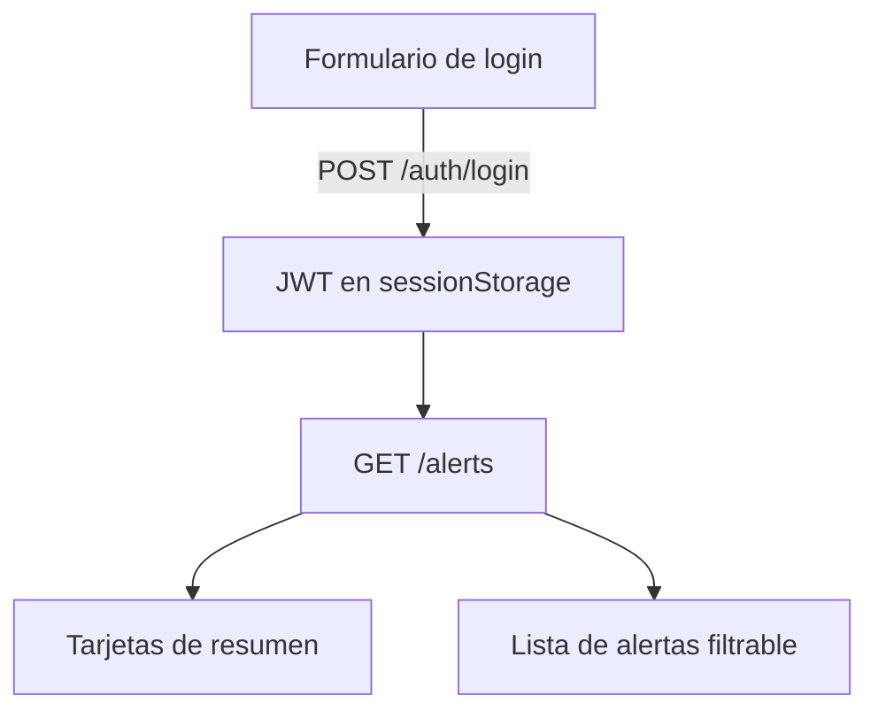

# Páginas web

El backend sirve tres superficies HTML más los estáticos. Todas se renderizan desde plantillas Jinja en `templates/web/` y se estilan con `static/css/`, y todas comparten un sistema de tema (claro/oscuro + color de acento, guardado en el cliente).

## Landing — `GET /`

La página pública de marketing: hero, botón de descarga (`static/downloads/panic-button.apk`), tarjetas de características y un setup de tres pasos. Renderizada en el servidor desde `landing.html.j2` con el correo de contacto inyectado. La cabecera lleva el set de favicon (ver abajo).

## Panel de alertas — `GET /dashboard`

Una página del lado del cliente donde el dueño de la cuenta revisa sus alertas. Inicia sesión con las mismas credenciales de la app (guarda el JWT en `sessionStorage`) y llama a `GET /alerts`.

**Tarjetas de resumen** — total de alertas, alertas en los últimos 7 días, notificaciones enviadas, y la tasa de vistas (vistas ÷ enviadas).

**Barra de filtros** — buscar por nombre de contacto, chips por canal (Email / Telegram / WhatsApp / SMS, se apagan para ocultar un canal), y un filtro visto / no visto. Los filtros acotan tanto qué alertas se muestran como qué filas de notificación dentro de ellas.

**Tarjetas de alerta** — cada una muestra la hora (formato US) y un "hace X" relativo, un badge `enviadas · vistas`, el enlace del mapa, y una fila por notificación: una etiqueta de canal con color, el nombre del contacto (con una etiqueta **"removed"** si el contacto fue borrado luego — el nombre se conserva en la fila), y su estado de visto.

Como `alert_notifications` guarda el nombre del contacto y sobrevive al borrado del contacto (ver [database.md](database.md)), el panel sigue mostrando a quién alcanzó una alerta vieja aun cuando esos contactos ya no existen — se acabaron las alertas vacías.

Hay un botón de refrescar, y el diálogo de ajustes ofrece tema (auto/claro/oscuro) y un selector de color de acento.

## Favicon

`GET /favicon.ico` sirve el ícono multitamaño; las cabeceras de landing y panel también enlazan `favicon.png` y `apple-touch-icon.png`. Los tres se generan desde el ícono `SOS` de la app y viven en `static/img/`.

## Mounts estáticos y de la app

- `/static` — css, js, imágenes, la descarga del APK.
- `/app` — la UI web de la app móvil (`app/www`), servida con `no-cache` en HTML/JS para que un arranque de la app siempre vea el último bundle, y cache largo en imágenes. `/app/manifest` devuelve un hash de contenido que la app usa para decidir cuándo recargar. Ver [app/architecture.md](../app/architecture.md).
