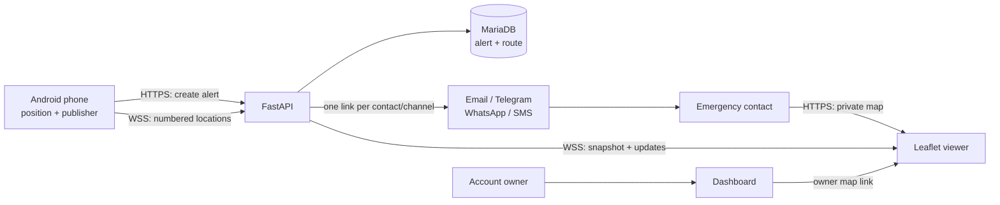
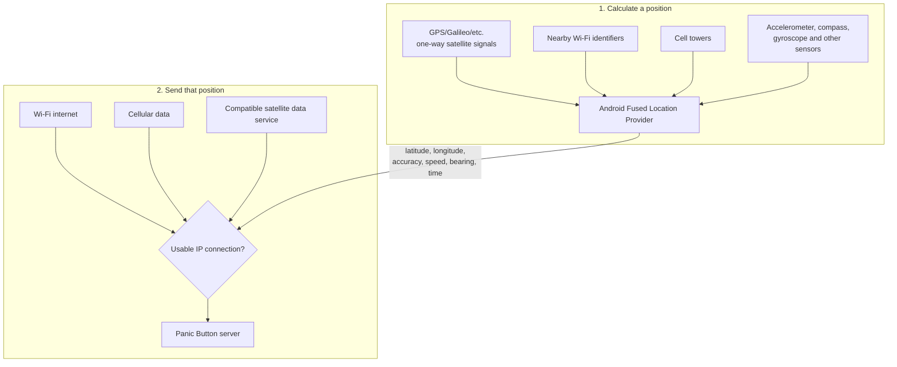
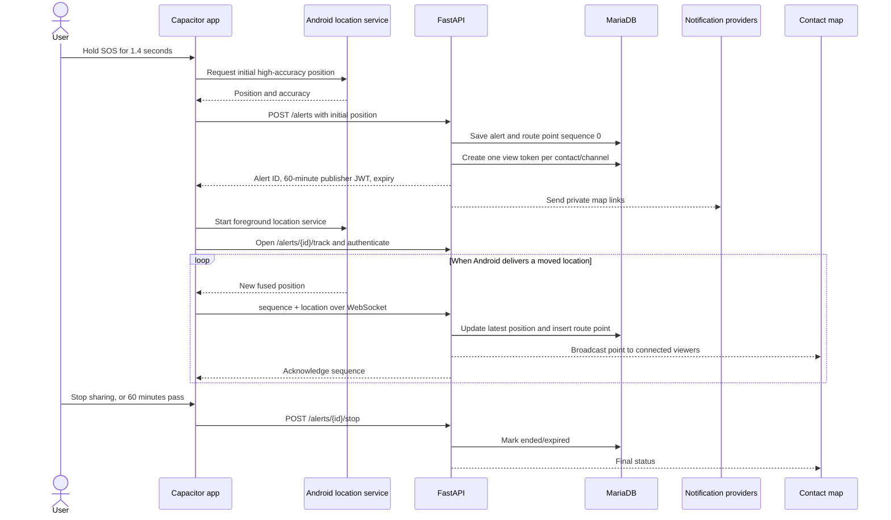
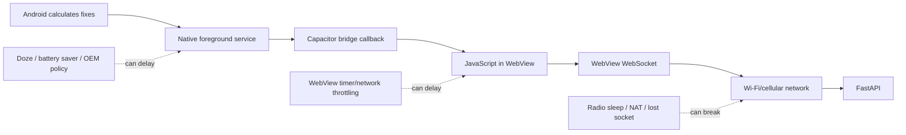
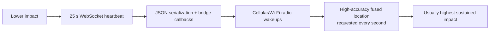
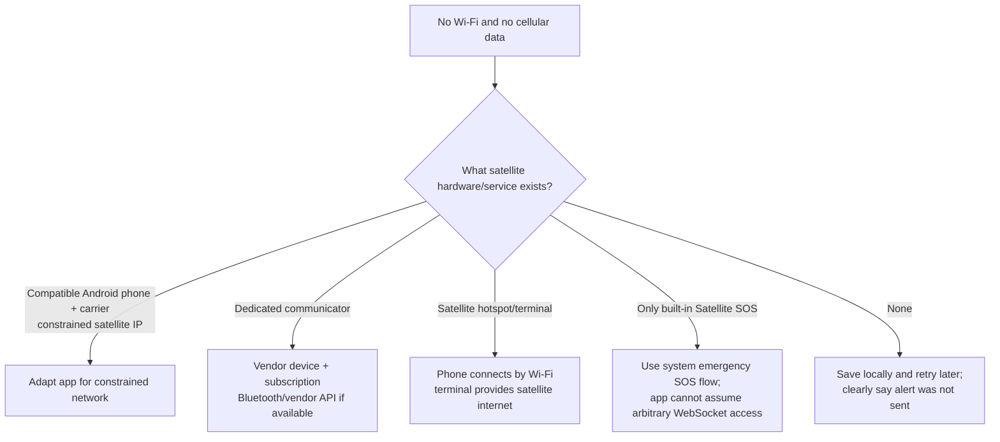

# Panic Button IRT geolocation: complete product and engineering guide

> **Scope and date:** this document describes the implementation present in this
> repository on 2026-09-11. In this project, **IRT geolocation** means live or
> near-real-time geolocation. It is not a guarantee that every point arrives
> immediately.

## 1. What the feature does

When a user holds the SOS button, Panic Button obtains an initial location, creates an
alert, and sends each confirmed contact a private web link. That link opens a Panic
Button page with a Leaflet map; it does not redirect to Google Maps. While the tracking
session remains active, the phone publishes new coordinates and every open map moves
as the server broadcasts them.

The live publishing window is **60 minutes**. The user can stop it earlier. Contact
links remain usable for **30 days**, and the authenticated owner can open an alert from
the dashboard. An ended map shows the saved route and last known point; it does not
continue moving.



## 2. Positioning is different from communication

A phone answering “where am I?” and a phone telling the server “where I am” are two
different operations.



### GNSS/GPS

GPS and other GNSS constellations broadcast timing signals. The phone receives signals
from several satellites and calculates a position. Civil GPS has no direct usage fee;
the receiver is already part of the phone. GPS reception is **not satellite internet**:
the phone normally sends nothing to a GPS satellite.

GNSS works best outdoors with a clear sky. Buildings, roofs, mountains, foliage,
weather conditions, radio interference and the phone's antenna can slow the first fix
or increase uncertainty. A phone can calculate a GNSS position without internet, but
assistance data downloaded through a network usually makes the first fix faster.

### Wi-Fi and cellular positioning

Android can combine Wi-Fi access points, cell towers and sensors with GNSS. Dense Wi-Fi
can produce a useful indoor estimate where satellite signals are weak. Cell-only
location is usually much coarser. These signals help calculate a position, but the
presence of a Wi-Fi access point does not mean the phone has internet access.

The plugin used by this project calls Google's **Fused Location Provider** with
`PRIORITY_HIGH_ACCURACY`. Android may therefore use GPS/GNSS, Wi-Fi, cellular and
sensors together. The server receives the result selected by Android; Panic Button
does not choose an individual satellite or calculate trilateration itself.

### Internet transport

The current app needs usable internet twice:

1. An HTTPS request creates the alert and sends notification jobs to the backend.
2. A secure WebSocket (`wss://`) carries subsequent coordinates.

Wi-Fi and cellular data are equivalent to the application once they provide working
IP connectivity. They differ in coverage, billing, power behavior, latency, captive
portals and how aggressively the network closes idle sockets.

If the phone has a GPS fix but no internet, the current app knows approximately where
it is but **cannot create the alert or notify the backend**. The present implementation
does not keep a durable offline alert outbox.

## 3. Exact alert lifecycle



### Step-by-step behavior

1. The user must have at least one usable confirmed contact channel.
2. Holding the button for 1.4 seconds starts the flow. Releasing early cancels it.
3. `@capacitor/geolocation` obtains the initial high-accuracy point.
4. `POST /alerts` saves the alert and initial point before notification delivery begins.
5. The backend creates a different private view token for each contact and channel.
6. The response returns a publisher JWT scoped to that user and alert. It expires with
   the 60-minute session and cannot be used as a normal account token.
7. The app opens the publisher WebSocket and authenticates in its first message.
8. The native background-geolocation plugin starts an Android location foreground
   service with a persistent notification.
9. Every delivered location gets an increasing sequence number. The server accepts it
   only while the alert is active and only if it is newer than the saved sequence.
10. The server saves the point, broadcasts it to viewers and acknowledges it.
11. The user can tap **Stop sharing**. Otherwise server and app expiry end the session
    after 60 minutes.

The publisher and viewer send a heartbeat every **25 seconds**. Reconnection uses
exponential backoff from approximately one second to a maximum of 30 seconds.

## 4. What is stored

Panic Button stores the route, not only the final coordinate.

| Storage | Contents | Lifetime in current code |
|---|---|---|
| `alerts` | Initial point, latest point, accuracy, speed, bearing, last sequence, status and times | No automatic scheduled deletion |
| `alert_locations` | Every location accepted by the backend, ordered by `(alert_id, sequence)` | No automatic scheduled deletion; removed if its alert is deleted |
| `alert_notifications` | Contact/channel record, link-token hash, token expiry and first-view time | No automatic scheduled deletion |
| Capacitor Preferences on phone | Alert ID, publisher JWT, expiry, sequence, watcher ID and last-update time | Removed when tracking stops/expires; private app storage, not a server backup |

All accepted route points remain in MariaDB. A map snapshot returns only the **latest
500 points**, so a long or fast route can contain older points in the database that are
not rendered after a refresh. Points received live after the snapshot are appended to
the currently open map.

There is no implemented scheduled purge for location history. A retention schedule and
purge job must define and enforce when old alerts and route points are deleted.

### Offline buffering limitation

The JavaScript publisher holds only **one pending point**. A newer position replaces
the previous pending one until the server acknowledges it. This is useful for showing
the latest known place after a short reconnect, but it is not a durable route queue.
If connectivity is absent for ten minutes, the intermediate path can be lost and only
the newest pending point may be sent when the socket returns.

## 5. How the contact and owner maps work

The page loads Leaflet, raster map tiles and a WebSocket snapshot. The snapshot contains
the alert state, latest point and up to 500 recent route points. New points move a
marker, update an accuracy circle and extend the route line.

| Map state | Meaning |
|---|---|
| **Connecting / Reconnecting** | Browser is opening or recovering the viewer socket. |
| **Live** | A valid snapshot or new position was received. |
| **Signal delayed** | The latest saved point is more than 45 seconds old. This can mean phone, GPS, network, WebView or server delay. |
| **Tracking ended** | User stopped sharing. Saved route remains visible while the link is valid. |
| **Tracking expired** | The 60-minute publishing window elapsed. |

The map follows the marker until the viewer drags it. **Follow location** recenters it.
The accuracy circle is an uncertainty radius supplied by Android, not a guarantee that
the user is inside a building, room or exact lane.

### Link access

- A contact link is an opaque 22-character bearer secret. The database stores its
  SHA-256 hash, and the link expires 30 days after notification creation.
- Anyone who receives or is forwarded a still-valid link can view that alert. There is
  no second login challenge for a contact.
- Opening a contact link records `viewed_at` for that specific contact and channel.
- The dashboard generates an owner-scoped, signed 30-day URL after authenticating the
  account owner. Opening it does not mark a contact notification as seen.
- Map publication stops at 60 minutes, while the saved map can remain readable for the
  rest of the view link's lifetime.
- Map links use `Cache-Control: no-store`, `noindex` and do not send the secret path to
  the tile provider as a referrer. HTTPS/WSS is required in production.

## 6. User instructions

### Before an emergency

1. Install the current native Android build; a remotely updated web page cannot add
   missing native Capacitor plugins to an older APK.
2. Sign in and add emergency contacts.
3. Complete email, Telegram or WhatsApp confirmation where required, or enable SMS.
4. Grant precise location permission. Approximate permission produces a much larger
   uncertainty area.
5. Allow notifications on Android 13 and newer so the tracking foreground-service
   notification can be displayed correctly.
6. Keep location services and Wi-Fi or cellular data enabled.
7. For the best screen-off behavior, allow background activity and remove restrictive
   battery optimization for Panic Button in the phone's settings. Menu names vary by
   manufacturer.

### Triggering and following an alert

1. Open Panic Button and hold **SOS** until the ring completes.
2. Wait for the app to report that the alert was sent and location sharing is active.
3. Leave the persistent tracking notification active. Do not force-stop the app.
4. If safe, keep the app open when frequent updates are essential; the present
   JavaScript WebSocket is more reliable in the foreground.
5. Tap **Stop sharing** when the emergency has ended. It also ends automatically after
   60 minutes.
6. A contact taps the received link, watches the live marker, and should call the user
   directly if the map reports a delayed signal.
7. The account owner can sign into `/dashboard`, find the alert and select **View live
   map**.

This product is a contact-notification tool. It is not an emergency dispatch service,
and successful delivery or continuous tracking cannot be guaranteed.

## 7. Why screen-off updates can arrive every 20 minutes

The observed 20-minute rate is possible with the current architecture, but one device
observation does not identify a single cause. The delay can occur at either side of the
native-to-web boundary:



The installed background plugin requests:

- `PRIORITY_HIGH_ACCURACY`;
- a nominal 1-second interval and 1-second maximum wait;
- a minimum displacement of 10 metres from Panic Button's `distanceFilter`;
- a foreground service and visible notification.

Those values are requests, not guarantees. Android can batch, throttle or suppress
updates. If the device is stationary or its calculated movement stays under 10 metres,
few callbacks are expected. With the screen off, Doze, Battery Saver, app standby,
manufacturer-specific process managers and radio sleep can add delays.

More specifically, location production and server publication are separate here. The
native service can still obtain a point while the WebView's JavaScript execution or
network is suspended. The plugin documentation warns that Android may throttle network
requests initiated from the WebView after about five minutes in the background. This
project uses a WebView-owned WebSocket, so `android.useLegacyBridge: true` helps native
callbacks cross the bridge but does not turn that socket into a native background
connection.

If the socket disconnects while JavaScript is paused, its 25-second heartbeat and
reconnect timer may also pause. When Android wakes the process later, the app can send
the newest pending coordinate, creating the appearance of a location every 20 minutes.

### Conditions that should be recorded during a physical investigation

- Device manufacturer/model, Android version and app version.
- Exact permission choice: precise or approximate.
- Notification permission and whether the persistent notification remains visible.
- Battery Saver, Data Saver, adaptive battery and per-app battery mode.
- Whether the app was visible, backgrounded, screen-locked, swiped away or force-stopped.
- Wi-Fi/cellular transitions, signal strength and captive-portal/VPN use.
- Times for Android location callbacks, WebSocket sends, server acknowledgements and DB
  `received_at`. These timestamps identify which stage caused the delay.

## 8. Physical and software limitations

| Situation | Current result or risk | Why |
|---|---|---|
| Indoors, underground or urban canyon | Slow, inaccurate or Wi-Fi/cell-derived point | GNSS needs usable satellite geometry; reflections distort signals. |
| Approximate permission | Large accuracy circle | Android deliberately reduces precision. |
| Location disabled or permission denied | Alert creation fails before contacts are notified | The initial coordinate is required by `POST /alerts`. |
| No internet | Alert cannot reach the backend | There is no offline request queue or device-originated SMS fallback. |
| Screen locked for a long time | Updates may become sparse, such as the observed 20 minutes | WebView/network throttling, Doze, radio sleep or manufacturer policy. |
| App force-stopped | Tracking should be considered stopped | Android suppresses app work; no boot/force-stop recovery service is implemented. |
| Phone reboots | No publishing until the app runs and restores state, if still unexpired | There is no boot receiver that resumes an alert independently. |
| Phone stationary | Few or no new points | The configured displacement filter is 10 metres. |
| Fast travel | Up to roughly one callback per second may be requested | High accuracy and short interval raise battery, radio and DB load. |
| Temporary disconnect | Latest point can recover; intermediate route can disappear | Only one unsent point is retained in memory. |
| Backend restart | Connected sockets drop and reconnect | Positions already committed survive, but the connection registry is in memory. |
| More than one Uvicorn worker | A viewer may miss live broadcasts | Publisher and viewer can land in different processes; no Redis pub/sub exists. |
| More than 500 saved points | Refresh shows the newest 500 only | Snapshot query deliberately caps the trail. |
| Contact forwards the URL | Recipient can view the map | The URL is the bearer credential. |
| Leaflet CDN unavailable | Viewer logic may not load | Leaflet CSS/JS currently comes from `unpkg.com`. |
| OSM tile server unavailable/blocks traffic | Marker layer may work but map background fails | The public tile service is best-effort and has no SLA. |

### Google Play review requirements

Google Play treats device location as personal and sensitive data. During review, present
this consistently as a user-initiated emergency location feature: it starts after the user
holds the SOS button, may continue through a visible location foreground service while the
app is backgrounded or the screen is off, stops when the user selects **Stop sharing** or
after 60 minutes, and stores the reported route in the alert history.

Keep these items aligned with the released Android bundle:

- Main and localized store descriptions identify live emergency location as a core feature.
- Data safety answers declare approximate and precise location collection, its purpose,
  storage, retention/deletion handling and any applicable sharing.
- The foreground-service declaration selects the Location type and explains why an
  interrupted service would leave emergency contacts with stale coordinates.
- Any location or sensitive-permission declaration describes the same single core feature.
- A prominent in-app disclosure appears before the Android runtime permission and explains
  background/screen-off collection, contact access, the 60-minute limit and route storage.
- The public privacy-policy URL is linked from both Play Console and the app.
- The review video demonstrates the disclosure, permission request, SOS activation,
  persistent notification, background or screen-off tracking on another device, and the
  **Stop sharing** action.
- App access instructions provide a review account that can reach SOS and a safe confirmed
  test contact.

The paste-ready fields and review procedure are documented in
[Google Play Console update](../store/information/google-play-console-update.md).

## 9. Phone resource cost: battery, CPU, memory and data

There is no universal CPU percentage, RAM number or battery percentage for this feature.
They vary substantially with chipset, Android version, signal quality, motion, screen,
radio, installed apps and manufacturer firmware. The project has not recorded an
Android power/CPU/memory profile, so exact figures would be invented.

The expected cost ranking is:



| Component | Current setting | Resource effect |
|---|---|---|
| Fused location | High accuracy, nominal 1 s interval | GPS/Wi-Fi/cell/sensors can stay active; main battery cost. Poor sky view can cost more while producing worse fixes. |
| Movement filter | 10 m | Reduces delivered stationary points, bridge work, network messages and DB writes. It does not change the plugin's one-second high-accuracy request. |
| Foreground service | Active for up to 60 min | Improves survival and makes use visible; keeps process importance higher. |
| Capacitor WebView | Remote UI and publisher JavaScript | Adds WebView process RAM; timers and callbacks use CPU briefly. Exact memory must be profiled. |
| WebSocket | Heartbeat every 25 s plus locations | Payloads are small, but keeping/waking a cellular radio can cost more energy than the bytes imply. |
| Map viewer | Leaflet plus raster tiles | Coordinate traffic is small; initial and panned map tiles normally dominate viewer bandwidth. |

### Planning estimates, not measured results

The native request limits location delivery to roughly **3,600 points per hour** at the
one-second interval. The 10-metre filter usually lowers this:

- stationary: potentially very few accepted points;
- walking near 1.4 m/s in a straight line: about one 10-metre change every seven
  seconds, or roughly 500 points/hour before OS filtering;
- driving faster than 10 m/s: potentially close to one point/second.

A location JSON message is generally a few hundred bytes before WebSocket/TLS/network
overhead. A useful planning range is therefore **well below 1 MB to a few MB of sender
traffic per one-hour session**, depending on update count and reconnections. This must
be measured on the production build and network before using it for a data-plan promise.

Each accepted point currently performs one `alerts` update and one `alert_locations`
insert. Allowing approximately **0.2–0.6 KB per database point** after row and index
overhead gives this rough capacity model:

```text
database growth per session
  = accepted points × approximately 0.2–0.6 KB

500 points/hour   -> approximately 0.1–0.3 MB/session
3,600 points/hour -> approximately 0.7–2.1 MB/session
```

These are sizing estimates, not measured InnoDB allocation. Backups, binary logs,
indexes and filesystem allocation add more. The database retains all accepted points
even though a refreshed viewer receives only 500.

### How to obtain honest hardware figures

A release-like build should be profiled on representative low-, middle- and high-end
phones for a full hour in four scenarios: stationary outdoors, walking, driving and
screen-locked. Record battery percentage/energy, process RSS, CPU time, callback count,
network bytes and server acknowledgements. Android Studio's CPU/memory profiler and a
Perfetto system trace can locate CPU and scheduling costs; Android power tools or a
hardware power monitor are needed for defensible battery measurements.

## 10. Operating and provider cost

Live coordinates do **not** create an SMS, WhatsApp, Telegram or email charge for every
point. Those providers receive the map link when the alert is created; coordinates then
travel between the phone, Panic Button server and web viewers.

| Cost area | How it applies |
|---|---|
| GPS/GNSS reception | No direct satellite usage fee. Hardware is included in the phone. |
| User Wi-Fi | Usually no incremental app charge beyond the user's internet plan. |
| User cellular data | Charged under the user's carrier/data plan; coordinate volume is small but coverage is required. |
| Backend | VPS/container CPU and RAM, public WebSocket traffic, MariaDB storage/backups, domain and monitoring. |
| Email | Depends on the configured SMTP provider and monthly quota. |
| Telegram | Ordinary bot traffic is generally free within platform limits; paid broadcast capacity is irrelevant at small emergency-contact volume. |
| Twilio SMS | Charged per message segment, sender and destination/carrier. Long localized messages can become multiple billable segments. |
| Twilio WhatsApp | Twilio currently lists USD 0.005 per inbound/outbound message plus applicable Meta template fees. Region and category change the total. |
| Map tiles | Standard OSM raster tiles have no direct fee, but are donation-funded, best-effort, rate-policy controlled and have no SLA. A production tile provider or self-hosting adds cost. |

A simple monthly model is:

```text
alerts × contacts × paid channels
  + backend/database/backups
  + map tile service
  + monitoring/support
  + satellite service, if added
```

For a small pilot, database and WebSocket processing are modest compared with
notification-provider and operational costs. At scale, concurrency matters: each active
alert has one publisher socket plus every open viewer socket, and every accepted point
causes two DB writes and a broadcast to all viewers.

The standard `tile.openstreetmap.org` service may block heavy or policy-incompatible
traffic without notice. It must not be treated as a free production SLA. Panic Button
already makes the tile URL configurable, so deployments can select a commercial
OSM-derived provider or self-host tiles.

## 11. Satellite transmission when Wi-Fi and cellular are unavailable

### What works today

Nothing in the current Panic Button code sends an alert over satellite. A phone may
still calculate a GNSS location offline, but `POST /alerts` and the WebSocket require an
IP network. The app also cannot fall back to its own Twilio SMS: Twilio SMS is sent by
the backend, so the phone must first reach the backend.

A carrier may sometimes deliver ordinary SMS when mobile data is unavailable. Panic
Button does not currently send device-originated carrier SMS, and modern Android/Play
permissions make automatic SMS a separate product and policy decision.

### Satellite options



#### A. Direct-to-device constrained satellite internet

Newer Android versions can expose a satellite transport as a constrained network on
supported devices, carriers and regions. Android says applications do not use these
networks by default. An app must opt in, accept lower throughput and higher latency,
remove the default “not bandwidth constrained” network requirement when appropriate,
and reduce its data use.

The current Panic Button manifest has no satellite-data opt-in and its continuously
open WebView WebSocket is not designed for a high-latency, intermittent satellite
network. Device/carrier support is not universal and service pricing belongs to the
carrier or satellite partner.

#### B. Built-in Satellite SOS

Features such as Pixel Satellite SOS are controlled system emergency flows, available
only on supported devices and countries. They require a clear view of the sky and may
take minutes. Panic Button cannot assume that this feature gives third-party apps an
arbitrary internet socket or lets them silently transmit a 60-minute trail. It should
offer clear instructions to use the phone's official SOS function when no app transport
exists, without claiming that Panic Button sent the alert.

#### C. Dedicated satellite communicator

A separate communicator can send messages, SOS and tracking over networks such as
Iridium. It normally requires:

- dedicated hardware carried and charged by the user;
- an active monthly/annual satellite subscription;
- a clear enough sky view;
- Bluetooth or a vendor API/partner agreement for app integration;
- a message format small enough for the provider's limits;
- store-and-forward handling because delivery is delayed and intermittent.

Many consumer communicators do not expose general IP connectivity to any arbitrary
mobile application. A user may need to operate the vendor's app, and Panic Button may
not be able to integrate without commercial access.

#### D. Satellite hotspot or terminal

A portable satellite terminal can provide internet to the phone over local Wi-Fi. In
that case Panic Button sees Wi-Fi and may work without code changes, but the terminal
adds purchase/rental cost, subscription/data charges, physical size, charging needs,
sky-view requirements and setup time. Networks can still have latency, outages, fair-use
limits or geographic restrictions that make a permanent WebSocket unreliable.

### Satellite cost categories

Satellite service is paid because **transmission**, unlike GPS reception, consumes
scarce two-way network capacity. Prices vary too much by country, hardware, provider,
message allowance and contract to promise one figure. A planning budget should include:

| Option | Hardware cost | Recurring/usage cost | Integration cost |
|---|---|---|---|
| Compatible direct-to-device phone | Compatible handset, sometimes no extra accessory | Carrier/satellite plan or included promotional service; country dependent | Android constrained-network adaptation and testing |
| Consumer satellite messenger | Usually hundreds of USD for a dedicated device | Subscription plus possible message/tracking overages | Vendor app only, or vendor API/Bluetooth work if offered |
| Satellite hotspot/terminal | Often hundreds to thousands of USD | Monthly plan and possibly metered/prioritized data | Lower app integration, higher operational/setup burden |
| Custom satellite IoT hardware | Module, antenna, certification and enclosure per unit | Per message/byte/device and commercial contract | Highest engineering, firmware, backend and regulatory cost |

Garmin, for example, states that inReach communication, tracking and SOS require a
device with an active satellite subscription. Exact prices are regional and change.
Country regulations can also restrict or require registration for satellite equipment.

### Recommended satellite-safe architecture

A credible emergency fallback should not attempt to stream every point once per second
over satellite. It should:

1. Detect whether the active network is terrestrial, constrained satellite or absent.
2. Create a compact, durable native outbox before reporting “sent.”
3. Prefer normal HTTPS/WSS on Wi-Fi or cellular.
4. On constrained satellite, use a native store-and-forward HTTP request containing
   alert ID, token, coordinate, accuracy, timestamp and sequence.
5. Send sparse updates, for example on meaningful movement or every 1–5 minutes, and
   batch/compress only when the provider permits it.
6. Keep unacknowledged points in encrypted app-private storage and retry with bounded
   backoff.
7. Show the user the truth: **sent**, **queued**, **satellite pending**, or **not sent**.
8. Allow the viewer to distinguish the recorded time from the server receipt time.
9. Retain the 60-minute alert-scoped credential; never give a satellite component the
   account session token.
10. Provide a direct route to the system's official emergency call/SOS function.

For reliable screen-off behavior, the same native publisher/outbox also fixes the
current terrestrial weakness: location collection and network transmission would both
run in an Android native foreground service instead of depending on a WebView socket.

## 12. Server scaling limits

The live viewer registry is in the memory of one FastAPI/Uvicorn process. Production
must currently run **one Uvicorn worker**. With multiple workers, a publisher connected
to worker A cannot broadcast to viewers connected to worker B.

For horizontal scaling:

1. Publish accepted locations through Redis, NATS or another shared broker.
2. Subscribe each worker and broadcast to its local viewers.
3. Use a connection pool and measure MariaDB write capacity.
4. Add a retention/purge job and backup policy.
5. Rate-limit publisher messages and cap per-alert storage deliberately.
6. Monitor socket count, update latency, acknowledgements, reconnects and stale maps.

Because snapshots are persisted, a server restart loses live sockets but not committed
points. Reconnecting viewers recover the last 500 saved points.

## 13. Current implementation checklist

### Implemented

- Initial precise-position alert creation.
- 60-minute alert-scoped publisher JWT.
- Numbered publisher WebSocket messages and acknowledgements.
- MariaDB latest position plus full accepted route.
- Contact and owner viewer WebSockets with persisted snapshots.
- Leaflet map, trail, accuracy circle, follow/recenter and stale state.
- 25-second heartbeats and bounded socket reconnection.
- Android foreground location service and persistent notification.
- Session restoration through Capacitor Preferences.
- Explicit stop and automatic expiry.

### Needed for dependable production tracking

- Native network publisher and durable offline queue.
- Physical-device matrix including long screen-off runs.
- Complete the Google Play declarations, disclosure, review video and app-access steps for
  the released bundle.
- Shared pub/sub before using multiple backend workers.
- Production map-tile service/SLA for meaningful traffic.
- Updated or replaced background-geolocation dependency with explicit Capacitor 8
  support.
- Satellite transport integration only after choosing supported hardware, carrier,
  countries, service contract and delivery semantics.

## 14. Source map

Repository implementation:

- Mobile flow: `app/src/views/home.ts`
- Location/WebSocket publisher: `app/src/lib/liveTracking.ts`
- Initial coordinate lookup: `app/src/lib/geolocation.ts`
- Capacitor configuration: `app/capacitor.config.js`
- Android permissions: `app/android/app/src/main/AndroidManifest.xml`
- Alert API and WebSockets: `backend/modules/routers/alerts.py`
- Viewer connection manager: `backend/modules/realtime.py`
- JWT lifetimes: `backend/modules/token.py`
- Tables: `backend/queries/tables.sql`
- Viewer: `backend/templates/web/live_alert.html.j2` and
  `backend/static/js/live_alert.js`
- Dashboard link: `backend/static/js/dashboard.js`

External references:

- [Android background location limits](https://developer.android.com/about/versions/oreo/background-location-limits)
- [Android foreground services](https://developer.android.com/develop/background-work/services/fgs)
- [Android location foreground-service type](https://developer.android.com/develop/background-work/services/fgs/service-types)
- [Android location and battery behavior](https://developer.android.com/develop/sensors-and-location/location/battery)
- [Android location permissions](https://developer.android.com/develop/sensors-and-location/location/permissions)
- [Android constrained satellite networks](https://developer.android.com/develop/connectivity/satellite/constrained-networks)
- [Civil GPS availability and user fees](https://www.gps.gov/gps)
- [Google Wi-Fi/cell geolocation accuracy background](https://developers.google.com/maps/documentation/geolocation/requests-geolocation)
- [Google Play location permission policy](https://support.google.com/googleplay/android-developer/answer/16558241)
- [Google Play background location guidance](https://support.google.com/googleplay/android-developer/answer/9799150)
- [OpenStreetMap tile usage policy](https://operations.osmfoundation.org/policies/tiles/)
- [Twilio messaging pricing](https://www.twilio.com/en-us/pricing/messaging)
- [Twilio WhatsApp pricing](https://www.twilio.com/en-us/whatsapp/pricing)
- [Telegram Bot FAQ and limits](https://core.telegram.org/bots/faq)
- [Pixel Satellite SOS limits and availability](https://support.google.com/pixelphone/answer/15254448)
- [Garmin inReach subscription requirement](https://support.garmin.com/en-US/?faq=QK8DnECaKb0JVz1ep2zKI6)
- [`@capacitor-community/background-geolocation` documentation](https://github.com/capacitor-community/background-geolocation)
- [Android performance profiling](https://developer.android.com/studio/profile)
